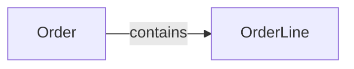
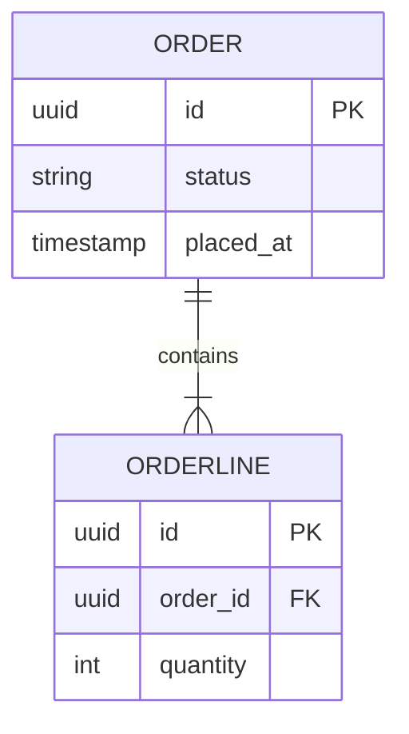
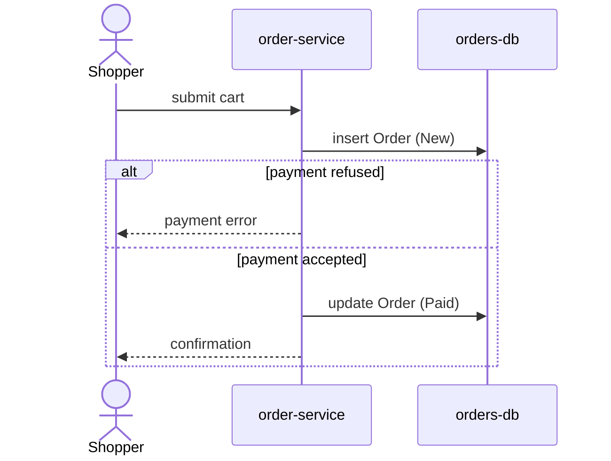
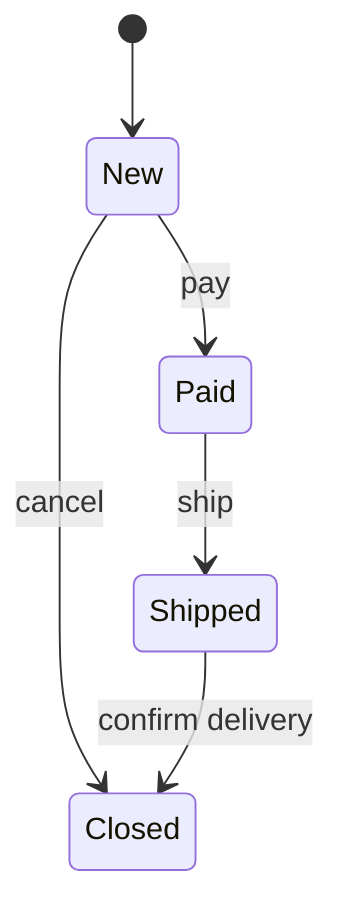

# Data Model: Order checkout (worked example)

**Feature:** 000-order-checkout · **Design:** ./design.md · **Maturity:** Draft · **Created:** 2025-01-01

> Worked example of a filled `data-model.md`. Read it only while filling the template; the domain
> is invented. FR-001, FR-002 and IC-001 stand for requirement and contract IDs of that feature.

## 1. Data Model

### Domain inventory

| Domain | Entities | Stateful | Owner | Source |
|---|---|---|---|---|
| Ordering | Order | yes | order-service | FR-001 |
| Ordering | OrderLine | no | order-service | FR-001 |

### Conceptual domain map

#### ER view: ordering

### Data dictionary

#### Dictionary: Order

| Field | Type | Null | Rule | PII class | Source |
|---|---|---|---|---|---|
| id | uuid | no | generated once | none | code:src/orders/order.ts:12 |
| status | string | no | one of New, Paid, Shipped, Closed | none | FR-001 |
| placed_at | timestamp | no | set at creation | none | proposed |

#### Dictionary: OrderLine

| Field | Type | Null | Rule | PII class | Source |
|---|---|---|---|---|---|
| id | uuid | no | generated once | none | code:src/orders/line.ts:8 |
| order_id | uuid | no | references Order.id | none | FR-001 |
| quantity | int | no | at least 1 | none | FR-002 |

### Database Schemas (ORM / DDL)

| Table | Purpose | Primary Key | Foreign Keys & Relations | Key Indexes | Schema / ORM File |
|---|---|---|---|---|---|
| `orders` | One customer order | `id` | none | `status` | src/orders/order.ts |
| `order_lines` | Items of an order | `id` | `order_id` → `orders(id)` | `order_id` | src/orders/line.ts |

### UX / UI Specifications
- **Design Tokens & Cues:** status badge per state (New, Paid, Shipped, Closed)
- **Component States:** loading, empty cart, populated, payment error

## 2. Sequence / Data Flow

### Interaction: place and pay

A shopper submits a cart; the flow ends with a paid order or a refused payment.

### Swimlane flows

#### Flow: place-order

A shopper submits a cart; the flow ends with a paid order handed to fulfilment.

## 3. Lifecycles

> **Authoritative:** this section governs the states of Order and the moves between them.

#### Lifecycle: Order

**Transitions**

| From | Event | Guard | Actor | Side effect | To | Emitted event | Source |
|---|---|---|---|---|---|---|---|
| New | pay | payment accepted | Shopper | stock reserved | Paid | OrderPaid | FR-001 |
| New | cancel | none | Shopper | none | Closed | OrderClosed | proposed |
| Paid | ship | stock picked | Warehouse | tracking number set | Shipped | OrderShipped | IC-001 |
| Shipped | confirm delivery | carrier scan | System | none | Closed | OrderClosed | UNKNOWN -> Open Point |

**Illegal transitions**

- Closed → any state: a closed order is final.
- Shipped → Paid: payment cannot be undone after dispatch.

**Terminal states:** Closed

#### Lifecycle: OrderLine

N/A: stateless, a line is fixed when the order is placed and follows its Order.

## 4. Cross-entity coupling

N/A: one actor-owned entity changes state; OrderLine has no state to couple.

## 5. Invariants

| Invariant | Holds over | Enforced by | Source |
|---|---|---|---|
| An Order has at least one OrderLine | Order, OrderLine | check at placement | FR-002 |
| A Closed order never changes | Order | code path rejects updates | code:src/orders/order.ts:57 |

## 6. Ownership / CRUD matrix

| Entity | Owner | Create | Read | Update | Delete | Source |
|---|---|---|---|---|---|---|
| Order | order-service | Shopper | Shopper, Warehouse | order-service | none | IC-001 |
| OrderLine | order-service | Shopper | Shopper, Warehouse | none | none | proposed |

## 7. Event catalogue

| Event | Emitted by | Payload | Consumers | Source |
|---|---|---|---|---|
| OrderPaid | order-service | order id, total | warehouse | IC-001 |
| OrderShipped | order-service | order id, tracking number | notifier | proposed |
| OrderClosed | order-service | order id, reason | reporting | proposed |

## 8. Retention, PII and migration

N/A: no personal data is stored in these entities and the tables are new.

## 9. History

None — initial version.
