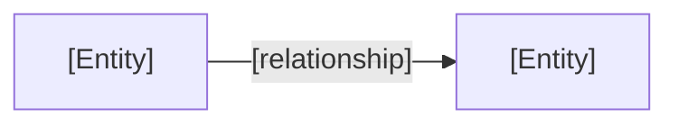
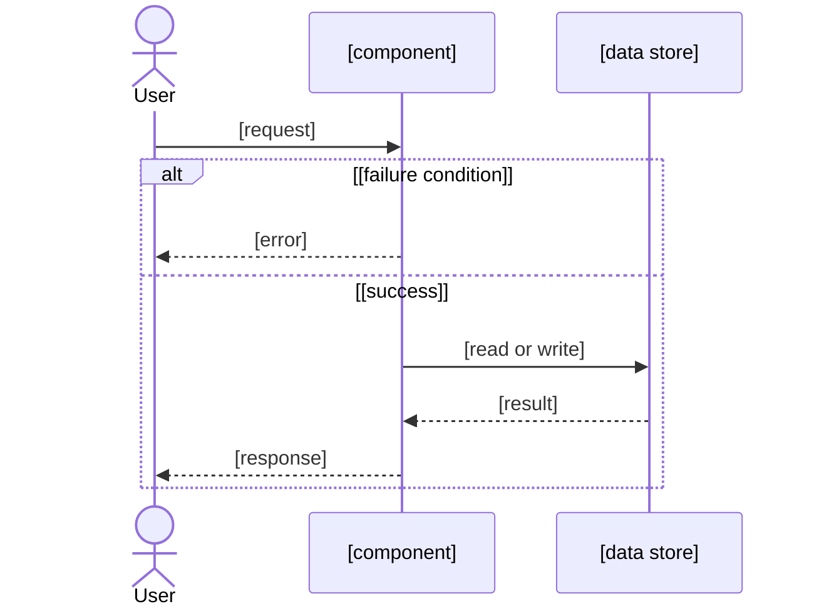
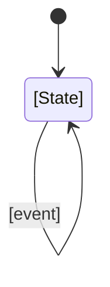

# Data Model: [FEATURE NAME]

**Feature:** [NNN-slug] · **Design:** ./design.md · **Maturity:** Draft · **Created:** [DATE]

> Entity/data model, lifecycles and data-flow diagrams a design decided, split out of design.md's own
> narrative (Data Model and Sequence / Data Flow) and specs.md's interface-contract detail (§1). Reads
> ./design.md; distinct from ./specs.md the way a persisted shape and the flows that move through it
> are distinct from the contracts that expose them.
>
> Structure follows `references/ARTIFACT_FORMAT.md`: the document-level `Maturity` is `Draft`,
> `In review` or `Approved`. The file has nine sections. Only §9 History carries an `ID`-bearing
> index (index-then-detail, item-level `Status` is `Live` or `Superseded → <ref>`); §1 to §8 are
> free-form, because a diagram or a table row is not a normative, citable statement.

<!-- Rules for every section below.
     Source: each row of the §1 dictionary and of every table in §3 to §8 ends with a Source cell
     holding exactly one of: FR-###, IC-###, code:<path>:<line>, proposed, UNKNOWN -> Open Point.
     A `proposed` or `UNKNOWN -> Open Point` row is copied to design.md Open Points for Review.
     Placeholders are bracketed and bare; fill them, never leave a row of placeholders in place.
     A conditional section accepts "N/A: [why]" in place of its content.
     Worked example, read only while filling this file: do-design/references/data_model_example.md -->

## 1. Data Model

<!-- Free-form. Order: domain inventory, domain map, ER views, data dictionary, schemas, UX.
     The domain map carries no attributes, so the shape of the domain is legible before any field
     name. One ER view per bounded subdomain carries that subdomain's attributes, keys and
     cardinalities alone; splitting must not drop an entity, a key or a constraint. -->

### Domain inventory

| Domain | Entities | Stateful | Owner | Source |
|---|---|---|---|---|
| [domain] | [entity, entity] | [yes or no] | [owning component] | [Source] |

### Conceptual domain map

<!-- A flowchart of entities and relationships, no attributes. "N/A: [why]" if nothing persists. -->



#### ER view: [subdomain]

<!-- One heading of this form per bounded subdomain, each an erDiagram. Every entity named here
     needs a dictionary block below and a lifecycle block in §3. -->

```mermaid
erDiagram
    [ENTITY_A] ||--o{ [ENTITY_B] : "[relationship]"
    [ENTITY_A] {
        [type] [field] PK
    }
    [ENTITY_B] {
        [type] [field] FK
    }
```

### Data dictionary

#### Dictionary: [entity]

<!-- One block per ER entity, one row per field. -->

| Field | Type | Null | Rule | PII class | Source |
|---|---|---|---|---|---|
| [field] | [type] | [yes or no] | [constraint or format] | [none, direct, indirect] | [Source] |

### Database Schemas (ORM / DDL)

<!-- The catalog of every table the views above draw, with its keys, indexes and ORM file. -->

| Table | Purpose | Primary Key | Foreign Keys & Relations | Key Indexes | Schema / ORM File |
|---|---|---|---|---|---|
| `[table_name]` | [one-line responsibility] | [key] | [fk → table(key)] | [index] | [path] |

### UX / UI Specifications
- **Design Tokens & Cues:** [tokens, badge variants, typography]
- **Component States:** [loading, empty, populated, error]

## 2. Sequence / Data Flow

<!-- Free-form. `references/DIAGRAM_GUIDE.md` governs lifeline ceilings; there is no message ceiling.
     Declare participants in the order they first act. `->>` is a call, `-->>` a return. Put the
     failure path in an `alt` block. Prefer `rect` over `par` unless steps are truly parallel.
     "N/A: [why]" if the feature has no non-trivial interaction. -->

### Interaction: [name]

[One sentence: what triggers this flow and what it ends with.]



### Swimlane flows

<!-- One "#### Flow: <name>" per end-to-end flow, each embedding its committed render from
     design/c4/flow-<name>.png. The name matches the source file's stem; nothing keeps a manifest.
     No inline text diagram here: Mermaid has no lane primitive. `references/DIAGRAM_GUIDE.md` §6
     governs lanes. "N/A: [why]" when the flow has a single actor. -->

#### Flow: [name]

![End-to-end flow: [name]](design/c4/flow-[name].png)

[One sentence: what triggers this flow and what it ends with.]

## 3. Lifecycles

> **Authoritative:** this section governs [the state, rule or outcome].

<!-- Every entity state lives here and nowhere else. Other sections link to the entity by name and
     restate no state (ARTIFACT_FORMAT.md §11). One block per ER entity.
     Stateful entity: a stateDiagram-v2 of at most 10 states, a Transitions table, Illegal
     transitions and terminal states. Every diagram state (except [*]) appears in the From or To
     column. Above 10 states, split the entity or group states into a composite state.
     Stateless entity: the single line "N/A: stateless, [why]". -->

#### Lifecycle: [entity]



**Transitions**

| From | Event | Guard | Actor | Side effect | To | Emitted event | Source |
|---|---|---|---|---|---|---|---|
| [state] | [event] | [condition] | [who triggers] | [effect] | [state] | [event or none] | [Source] |

**Illegal transitions**

- [From] → [To]: [why it is refused]

**Terminal states:** [state, state]

#### Lifecycle: [entity]

N/A: stateless, [why]

## 4. Cross-entity coupling

<!-- Conditional: two or more actors; otherwise "N/A: [why]". Link to the §2 flow by name; restate
     no picture and no state. -->

| Trigger entity and transition | Effect on entity | Via event | Source |
|---|---|---|---|
| [entity: From → To] | [entity: effect] | [event] | [Source] |

## 5. Invariants

<!-- Mandatory. A statement that must hold at all times, and where it is enforced. -->

| Invariant | Holds over | Enforced by | Source |
|---|---|---|---|
| [statement] | [entities or fields] | [constraint, code path, or check] | [Source] |

## 6. Ownership / CRUD matrix

| Entity | Owner | Create | Read | Update | Delete | Source |
|---|---|---|---|---|---|---|
| [entity] | [component] | [who] | [who] | [who] | [who] | [Source] |

## 7. Event catalogue

<!-- "N/A: [why]" when no event is emitted. -->

| Event | Emitted by | Payload | Consumers | Source |
|---|---|---|---|---|
| [event] | [component] | [fields] | [components] | [Source] |

## 8. Retention, PII and migration

<!-- Conditional: "N/A: [why]" when nothing is retained, personal or migrated. -->

| Entity | Retention | PII class | Migration | Source |
|---|---|---|---|---|
| [entity] | [period or rule] | [none, direct, indirect] | [step or none] | [Source] |

## 9. History

<!-- Superseded data-model entries move here; the index row above stays as a tombstone with
     `Superseded → <ref>`. -->

None — initial version.
