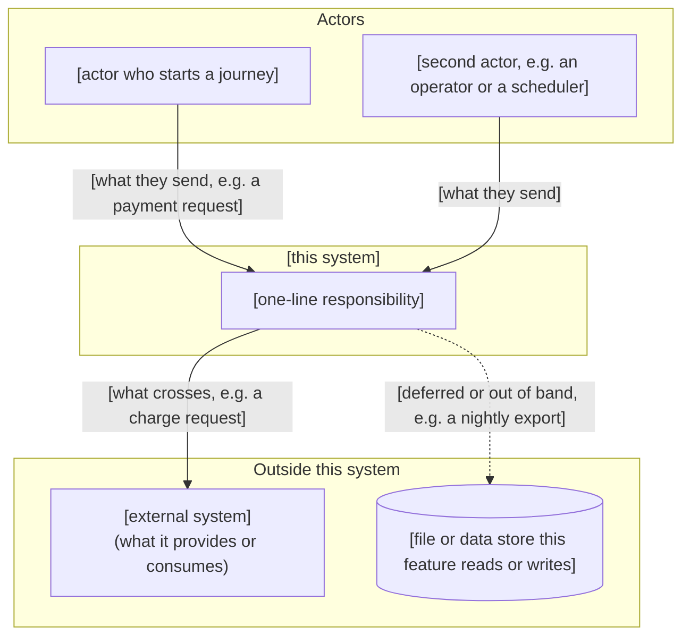
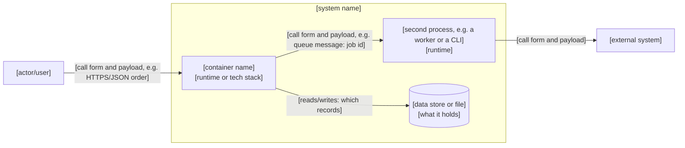
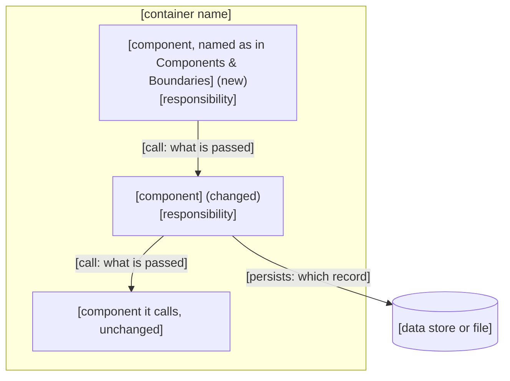
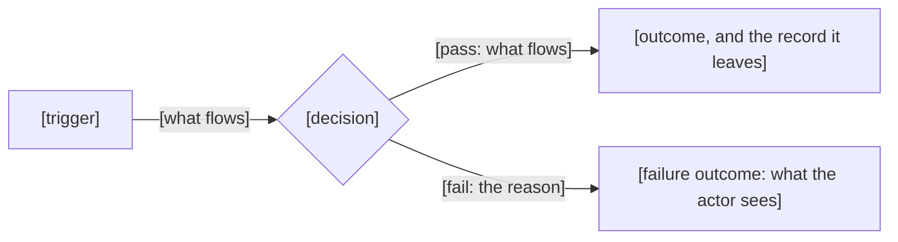
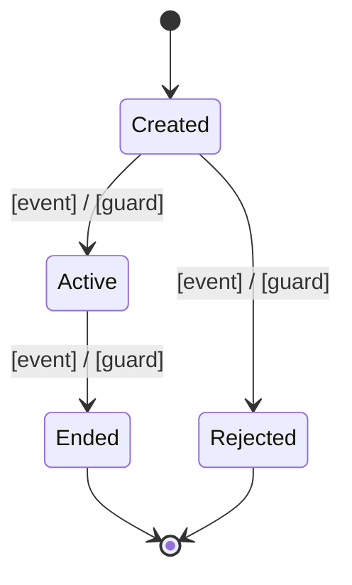

# Design: [FEATURE NAME]

**Feature:** [NNN-slug] · **Requirement:** [REQUIREMENT_PATH] · **Maturity:** Draft · **Created:** [DATE]

> System shape: architecture, journeys and component boundaries. Reads [REQUIREMENT_PATH].
> Distinct from plan.md's HOW-to-implement; this is HOW-it's-shaped.
>
> Journey-first: business and engineering read the front half (Architecture Approach through
> Journeys) on one page, in plain nouns. The component-level sections follow it.
>
> Structure follows `references/ARTIFACT_FORMAT.md`: indexed sections carry a table above full
> `**Detail**`, the document-level `Maturity` is `Draft`, `In review` or `Approved`, the item-level
> `Status` is only `Live` or `Superseded → <ref>`, and superseded prose moves to the History section.

## 1. Architecture Approach

**Decisions and blockers:**

<!-- One row per decision this design makes, placed above the architectural prose. "Decision" names
     what is being settled. "Shape chosen" is the answer this design gives it. "Owner" is the person
     or role accountable for that answer. "Blocks approval?" says whether a reviewer can approve the
     design while this decision stands as written, and names what has to happen first when it cannot.
     A reviewer who reads only this table knows what is being decided, who decided it, and what
     stands between the design and approval. Replace the table with "N/A: [why]" when the feature is
     too small to carry decisions worth tabling. With a decision register, end Shape chosen with its
     DEC-###: see ARTIFACT_FORMAT.md §12. -->

| Decision | Shape chosen | Owner | Blocks approval? |
|---|---|---|---|
| [what is being settled] | [the shape this design gives it] | [person or role accountable] | no |
| [what is being settled] | [the shape this design gives it] | [person or role accountable] | yes: [what must happen first] |

<!-- Acts as the summary. In 2–4 sentences or bullets, in plain nouns with no component IDs or code
     names: who gains what and why, the goal of this phase, and where it plugs into the existing
     system. Leave out implementation detail: that belongs in Components & Boundaries. -->

[Who this is for and why, the goal of this phase, and where it fits in the existing system.]

## 2. System Overview (C4)

<!-- The visual complement to Architecture Approach — lets a reader unfamiliar with this feature see
     the shape before reading prose. C4 is kept as the conceptual zoom model (Context → Container →
     Component) and rendered with Mermaid `flowchart` + `subgraph`. Each level heading is written
     "C4 Level N: ...", so no level label collides with a component ID such as C3.

     Do NOT use the C4Context / C4Container diagram types. They are experimental in Mermaid: no
     direction control, relationship labels collide with arrowheads, and rendering varies across
     viewers. `flowchart` is the most widely supported type and puts labels legibly on the arrow.

     EVERY edge carries a label saying what flows over it (a request, a record, money, a file),
     never a bare arrow.

     `references/DIAGRAM_GUIDE.md` §8 lists what each level has to show. A level that comes out as
     three boxes in a row is a sentence: write the sentence and "N/A: [why]".

     Skip a level with "N/A: [why]". For a trivial single-file change with no new external
     interaction, write "N/A: [why]" for the whole section. -->

<!-- C4 Level 2 below sits inside the generated-block markers `doflow-run render-puml` replaces.
     When this feature authors its C4 in PlantUML under design/c4/, edit container.puml and re-run
     the verb; editing between the markers by hand is a change the next render discards.

     A feature that authors no PlantUML writes the Mermaid here by hand, as it always did. The
     markers are inert in that case — with no design/c4/ directory the verb reports and exits
     before it opens this file — so leave them or delete them, whichever reads better.

     The markers delimit LEVEL 2 ONLY. The projector emits one block per run, from container.puml
     when it exists and context.puml otherwise, so a second marker pair would have nothing to fill.
     Levels 1 and 3 are hand-written at every level of PlantUML adoption. -->

### C4 Level 1: System Context

[Who/what uses this system, and which external systems it talks to. One box per actor or external
system — internal components belong at C4 Level 2 or C4 Level 3, not here.]

### C4 Level 2: Container

[Which deployable services/apps/data stores this feature spans, and how they talk. One box per
independently deployable unit — internals of a single container belong at C4 Level 3.]

<!-- generated from design/c4/container.puml by `doflow-run render-puml` -- do not edit by hand
     source-hash: not-yet-rendered -->

<!-- end generated -->

### C4 Level 3: Component

<!-- Required when this feature touches 3+ components within a single container; otherwise write
     "N/A: covered by Components & Boundaries". On a small change this diagram restates the
     Components & Boundaries table verbatim, and a diagram that adds nothing trains authors to tick boxes. -->

[Internals of the container this feature changes — handlers, services, ports, adapters.]

[One closing sentence: what this feature decides versus where the data or money moves.]

## 3. Concepts

<!-- Write the handful of nouns a reader must hold to follow the Journeys, in plain words: no
     component IDs, no code names. A glossary table only. When the feature has a data-model.md, how
     the nouns relate is drawn once in its §1 Conceptual domain map, and the line below points there.
     When data-model.md is N/A (a UI or model-prompt feature with domain nouns but no stored entity),
     that line says instead, in one or two plain sentences, how the nouns relate. Leave out anything
     a journey does not use. Write "N/A: [why]" for a design with no domain vocabulary worth defining. -->

How these relate: ./data-model.md §1 Conceptual domain map, or, when data-model.md is N/A, [one or
two plain sentences on how the nouns relate].

| Term | Meaning |
|---|---|
| [Concept A] | [one plain sentence] |
| [Concept B] | [one plain sentence] |

## 4. Journeys

<!-- One `### Journey N — <name>` per user or system journey, in the order a reader meets them. Each
     carries one picture (a `flowchart`, or a `sequenceDiagram` with the failure in an `alt` when
     three or more participants act), a `stateDiagram-v2` of the states the actor sees for EVERY
     stateful thing the journey creates (the full entity lifecycle is in ./data-model.md §3), and a
     small rules table. Each decision shows its failure outcome as the actor sees it. Write in plain nouns: no component
     IDs, no code names. Leave out internal calls that no actor sees. Write "N/A: [why]" for the
     whole section when the design has no user or system journey (a pure library or refactor). -->

### Journey 1 — [journey name]

[One sentence: who starts this journey and what it ends with.]

| Rule | Why it holds |
|---|---|
| [a rule this journey enforces] | [the reason, or what breaks without it] |

### Worked example

<!-- Real numbers that make the rules checkable: one case that passes and one that does not, then the
     result. Close with one caveat sentence saying what is not guaranteed. Leave out hypothetical
     values you cannot compute. -->

| Candidate | Eligible? | Why | Result |
|---|---|---|---|
| [case that passes, with a real figure] | yes | [which rule it meets] | [computed outcome] |
| [case that fails, with a real figure] | no | [which rule it breaks] | [computed outcome] |

[Caveat: what is shown but not guaranteed, and where it is re-checked.]

### Eligibility / decision inputs

<!-- A TABLE, never a mindmap: DIAGRAM_GUIDE.md excludes `mindmap`. One row per group of inputs the
     decision reads; say what the first version reads and what comes later. -->

| Input group | What is read | Read in this version? |
|---|---|---|
| [group, e.g. the user] | [the facts checked] | yes |
| [group, e.g. the limits] | [the facts checked] | later: [why] |

## 5. Components & Boundaries

Interface contracts are in `./specs.md` §1; the data model and its flows are in `./data-model.md` §1 and §2.

| ID | Component | Kind | Serves | Status |
|---|---|---|---|---|
| C1 | [component name] | service / script / template / reference | FR-001 | Live |

**Detail**

<!-- A component entry names the component after its ID, then answers the four labels below in
     order. The labels are structural, not emphasis, and none may be dropped or reordered. The
     scaffold reads the `IC-###` ids on the Contracts line: write `IC-a to IC-b` for a run, which counts
     every id between, or a `- IC-###` list item under the line for each contract. -->

- **C1:** [component name]
  - **Responsibility:** [what this component is answerable for, in full].
  - **Owns:** [the state, files or decisions it holds].
  - **Does not own:** [what a reader could expect it to hold but another component does].
  - **Contracts:** [the FR-### and IC-### identifiers it serves].

<!-- A feature with a user interface, a language model, a data pipeline, infrastructure work or a
     public library/CLI surface adds the matching parts of `templates/doflow/discipline-sections.md` (in the
     DoFlow folder this template was copied from) here as `###` subsections. A plain service adds none. -->

## 6. Design Risks & Alternatives Considered

| ID | Risk / Alternative | Disposition | Status |
|---|---|---|---|
| R1 | [risk, or an alternative shape considered] | mitigated / accepted / rejected | Live |

**Detail**

- **R1** → [why this shape was chosen, or why the risk is accepted and what it costs if it lands].

## 7. Open Points for Review

<!-- The questions this design could not answer, ending the design instead of a bare risk list. One
     bold-led question per bullet, followed by the reasoning already known (a figure, a trade-off, the
     option you lean to). Lead each with the question in bold; do not number them with an ID. A
     `proposed` or `UNKNOWN -> Open Point` row of ./data-model.md gets one bullet here that asks its
     question and names the row by section and entity, without restating the row. Write
     "None — no open points." when every question was settled. -->

- **[A question a reviewer must answer?]** [The reasoning already known and the option leaned to.]

## 8. History

<!-- Superseded design decisions move here; the index row above stays as a tombstone with
     `Superseded → <ref>`. -->

None — initial version.
