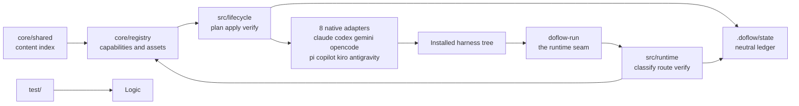
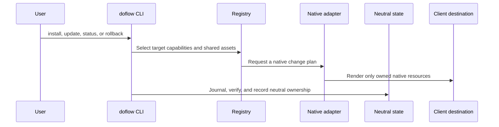
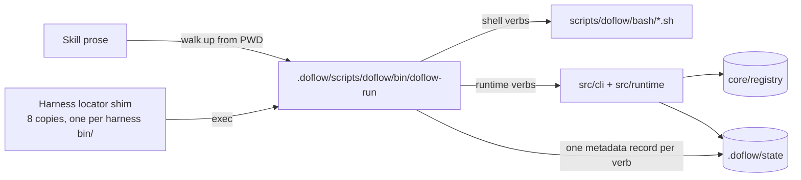
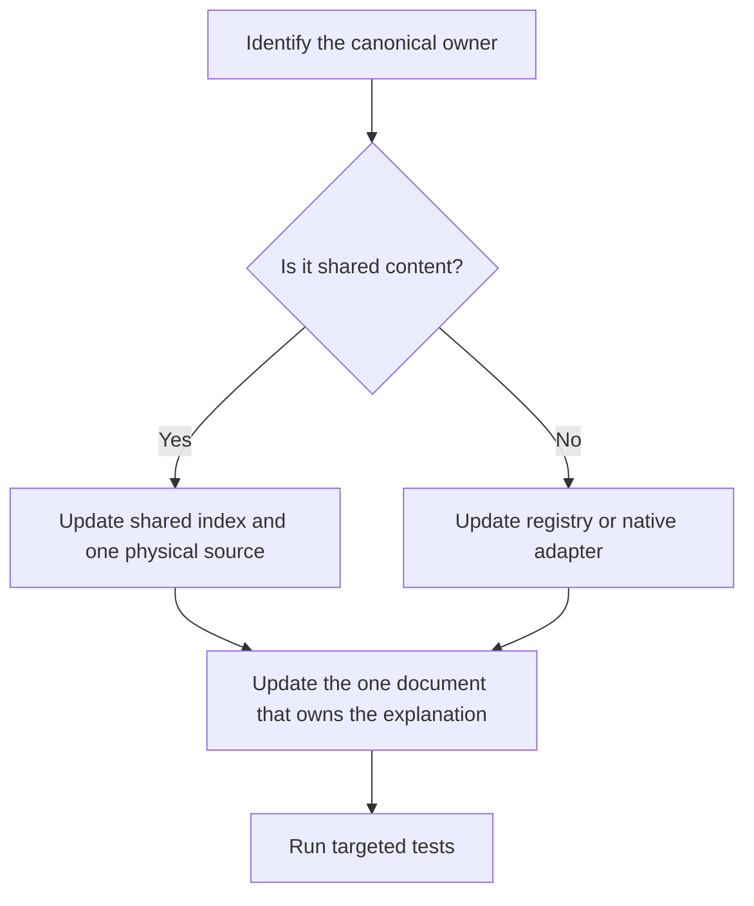

# Architecture

This guide is for contributors changing DoFlow itself. For the user-facing model, see [Home](index.md#the-component-model).

## Design in one picture



The architecture has a deliberately simple boundary: **shared content is described once; the
registry declares what each harness can do, how each shared asset projects onto it, and what the
runtime is allowed to decide; adapters own native paths and formats; lifecycle code owns planning,
ownership, and recovery; and one runtime, reached through one seam, owns everything a skill decides
at use time.** Do not duplicate a skill, rule, or template simply because clients place it in
different directories, and do not add a second implementation of a runtime verb.

At the runtime/registry boundary, `loadRegistry` adapts to tree shape via `registrySourceMode` (IC-001): in a full package or development checkout (`package.json` exists), validation runs in `require` mode where every declared shared asset and native-projection source must exist; from an installed runtime tree (carrying only `bin/`, `src/` and `core/registry/`), validation runs in `skip` mode, verifying source path strings and repository containment without requiring unprojected shared files on disk.

Each target is a native projection, not a copy of another target's settings. Its supported
surfaces, prerequisites, verification steps, and intentional gaps are the contract in the
[multi-harness capability map](capability-map.md). In particular, configuration and hook discovery
can be trust-sensitive, plugin activation belongs to a user or workspace, and unavailable surfaces
are reported rather than imitated.

## Repository map

| Path | Owns |
|---|---|
| `core/shared/` | The single physical source for cross-harness content: guidance, skills, agent specifications, scripts, and templates. Stable IDs and projections, no duplicated bytes |
| `core/registry/` | Two registry families in one directory: installation (harness capabilities, assets, neutral MCP catalog, lifecycle policy) and runtime (capabilities, routes, workflows, verification, readiness templates, external tools) |
| `core/harnesses/` | Native per-harness sources that have no cross-harness equivalent — hooks, settings, and native agent definitions for `claude`, `codex`, `gemini`, and `kiro`, the two hook shims under `antigravity/hooks/`, and the `pi/extensions/doflow-guard.js` extension — plus `core/harnesses/shared/` (the hook bridge, the policies, and `locator/`, the one file projected into all eight). The Antigravity adapter still projects into Gemini-compatible paths (`.agents/`, `~/.gemini/config/`) rather than owning a distinct surface |
| `core/.claude-plugin/` | Claude Code marketplace registry and plugin manifest; `core/` is the plugin root |
| `core/.codex-plugin/` | Codex plugin manifest for plugin-based distribution |
| `core/.plugin/` | GitHub Copilot CLI plugin manifest (skills-only); first in Copilot's documented manifest check order |
| `bin/doflow.js` | The thin CLI entry point (exposed as the `doflow` command) — a forwarder into `src/cli`; it defines no handlers and no parser, so the binary path and the dispatcher seam (`doflow-run`) keep resolving here |
| `src/cli/` | The CLI itself: argument parsing and the installer command→handler table (`index.ts`), one file per installer command under `commands/`, the runtime-verb forwarding switch (`runtime-commands.ts`, whose implementations stay in `src/runtime/`), and the shared command plumbing (`shared.ts`) — including `buildAdapterRegistry()`, which builds the adapter registry the install/update/remove/reconcile apply paths and some runtime verbs use; `registryLifecycleView` in `src/lifecycle/view.ts` keeps a second, literal construction (mirroring it) for the plan views those commands and `status` print. Fully TypeScript; `bin/doflow.js` stays `.js` as the shebang entry and requires `../src/cli/index.ts` explicitly |
| `core/shared/scripts/doflow/bin/doflow-run` | The runtime seam: one dispatcher owning the whole verb namespace |
| `src/adapters/` | Native file formats and verification boundaries, one directory per harness (`claude`, `codex`, `gemini`, `opencode`, `pi`, `copilot`, `kiro`, `antigravity`), each implementing the same six-function contract (`discover, render, plan, apply, remove, verify`) that `src/adapters/index.ts` validates and each also exposing that contract through a uniform `create<Name>Adapter()` factory (`createClaudeAdapter`, `createCodexAdapter`, `createGeminiAdapter`, and so on); `src/adapters/copy-tree.ts` is the shared tree-materializing engine most adapters call into rather than reimplementing file-copy logic; `src/adapters/mcp-entries.ts` holds the MCP entry ownership rules the Claude, Kiro, OpenCode, Copilot and Antigravity adapters share |
| `src/lifecycle/` | Non-mutating plan, ownership checks, apply/remove orchestration, and verification against the neutral state ledger; reads Gemini hook trust through `hookTrustFor`, exported by `src/adapters/gemini/index.ts`, and does not plan Gemini hooks itself; `src/lifecycle/view.ts` parses TOML through `src/helper/toml.ts` (shared with `src/adapters/codex/config.ts`) and also imports every adapter's factory, Codex included, to build its adapter registry |
| `src/runtime/` | Everything a skill asks for at use time: classification, workflow resolution, capability routing, evidence and claims, readiness, verification and command detection, recovery, tracing, scaffold generation, the per-feature decision register and History compaction (`decision-register.ts`, `history-compactor.ts`), and provider health; `src/runtime/cli-result.ts` holds the exit/error-reporting helpers (`finishRuntime`, `usageError`, `captureCaught`) shared by the verb handlers `src/cli/runtime-commands.ts` dispatches to; it requires nothing from `src/runtime/` at load time, and `captureCaught` lazily requires `failure/capture.ts` |
| `src/runtime/config-home.ts` | Resolves the one absolute XDG-or-HOME config home shared by Node and shell readers |
| `src/runtime/settings/files.ts` | Reads and validates project and user settings files |
| `src/runtime/settings/legacy.ts` | Reads legacy settings files into resolver candidates |
| `src/runtime/settings/resolve.ts` | Resolves effective values across registry defaults and settings layers |
| `src/runtime/settings/write.ts` | Safely writes settings layers, replacing symlink targets rather than following them |
| `src/runtime/settings/registry.ts` | Loads and validates the runtime settings registry |
| `src/runtime/settings/shared.ts` | Shared off-word recognition and URL masking for settings adapters |
| `src/runtime/settings/cli.ts` | Implements `doflow config list` and settings output |
| `src/runtime/settings/lexical.ts` | Reads the compatibility lexical setting used by shell copies |
| `src/runtime/settings/project-layers.ts` | Resolves project settings ownership across linked worktrees |
| `src/runtime/settings/refs.ts` | Resolves registry `defaultRef` and `valuesRef` declarations |
| `src/runtime/packages/points.ts` | The contribution point registry (`core/registry/contribution-points.json`) read on its own, so a bad file disables only third-party packages; the map from a point to its validator |
| `src/runtime/packages/manifest.ts` | The `doflow-package.json` checker: closed key set, forbidden fields, id and host-range rules, each contribution through its point's validator; `checkPackage` adds the tree rules and digests. Never writes |
| `src/runtime/packages/digest.ts` | The package tree rules (no symlinks, no path leaving the root, size limits) and the content and capability digests |
| `src/runtime/packages/view.ts` | The package view: the state of every package (`active`, `disabled`, `needs-trust`, `suspended`, `incompatible`), each judged alone, from the bundled package and the global lock. Read-only |
| `src/runtime/packages/contributions.ts` | The one seam a point's owner calls for the entries of `active` packages; a faulty entry is left out, never thrown |
| `src/runtime/packages/store.ts` | Plans, the package store under `~/.doflow/packages/store/` and the apply and remove steps, under the global scope's run lock |
| `src/runtime/packages/grants.ts` | The reader of the person-written `grants.jsonl`; it never writes, renames or deletes that file |
| `src/runtime/packages/state.ts` | `~/.doflow/packages/state.json`: revocations, suspensions, the audit rows and removal tombstones. Narrowing facts only |
| `src/runtime/packages/command.ts` | The `doflow package` verb: points, check, list, show, add, update, enable, disable, trust, exempt, revoke, verify and remove |
| `src/runtime/storage/` | Storage retention: the registry loader and roots (`registry.ts`, `roots.ts`), the one definition of finished work (`work-status.ts`), the bounded pass and its rules (`engine.ts`, `rules.ts`), the silent cleanup moments (`upkeep.ts`) and the `storage` verb (`cli.ts`) |
| `src/state/` | Harness-neutral ledger, recovery records, and legacy-manifest migration |
| `src/registry/` | Loads and validates the installation registry files (`harnesses`, `assets`, `mcp`, `lifecycle`, `contracts`, `external-tools`, `models`) plus the provider descriptors in `capabilities.json` into the in-memory registry object (the other runtime registries are loaded by their own runtime modules) every adapter and lifecycle call consumes — the same data `test/guards/registry.test.ts` checks implementation claims against |
| `src/helper/` | Cross-layer utilities with no harness-, install-, or runtime-specific domain: git commit lookup (`git.ts`), managed-section merging (`marker-merge.ts`), interactive prompts (`prompt.ts`), `settings.json` merging (`settings-merge.ts`, `settings-scope.ts`), generic TOML parsing (`toml.ts`), destructive-command blocklist derivation (`guardrails.ts`), bash-helper resolution (`bash-helper.ts`), declared native path resolution (`harness-paths.ts`), and the single computation of the package root (`repo-root.ts`), which every layer shares and no layer should re-derive from its own depth. Like the rest of `src/`, it is TypeScript run by Node's native type-stripping, with no build step |
| `src/install/` | Installer-domain operations: backup set (`backup-set.ts`), backup, restore, retention and listing (`backup.ts`), scope and target resolution (`context.ts`, `targets.ts`), manifest read/write (`manifest.ts`), external-tool detection and install (`tool-lifecycle.ts`), path resolution (`paths.ts`), and MCP server selection (`mcp.ts`). Fully TypeScript |
| `test/` | Installer, mapping, and runtime behavior tests organized into module directories mirroring `src/` (`adapters/`, `lifecycle/`, `runtime/`, `registry/`, `state/`, `helper/`, `install/`, `e2e/`), plus `hooks/`, `release/`, `settings/`, `bench/` and `fixtures/`, and `test/guards/` for structural invariants about this repo's content |
| `bench/` | Skill-evaluation corpus, TRACKED so the baseline is reproducible from a clean clone; only `bench/runs/` and `bench/reports/` are ignored. Outside the default test command, whose dispatch step makes paid model calls |
| `docs/` | User-facing and contributor documentation site |
| `docs/capability-map.md` | Cross-harness capability contract, evidence, and verification criteria. Its capability matrix and the two coverage matrices (enforcement and context behaviour) are generated by `src/release/docs-blocks.ts`, which also writes the task classes (`how-doflow-work.md`), settings keys (`settings.md`) and command index (`reference.md`) blocks and `docs/llms.txt`; the hook-event matrix is kept by hand (FU-gx7grh) |

## Installation data flow



New behavior should ask the registry and adapter rather than infer a target from a copy path. An
adapter is the only component that knows a client-specific destination or serialization format.

### Installation registries

Every file under `core/registry/` is plain JSON — a convention the
runtime registries below also follow. The installation family declares what each harness can do and
how a shared asset projects onto it:

| File | Declares |
|---|---|
| `core/registry/harnesses.json` | Each target's adapter id, supported scopes, native target files, declared native path facts (`paths`: `{base, segments}` rules resolved through `src/helper/harness-paths.ts`, with adapters owning only justified logic residue), and per-surface capability status with verification evidence. A harness's `capabilities.mcp` may carry `toolName`, a template holding `{server}` and `{tool}` (only `claude` has one: `mcp__{server}__{tool}`); the brief block uses it to show a provider's MCP tool name. Each harness also carries an `agentLimits.readOnly` block (`native` with the `apply` keys the adapter writes into a `read-only` agent file, or `unenforced` with a reason; G63) and an `orchestration.nest` operation, the sixth after spawn, wait, status, cancel and resume, which records whether a subagent can start a subagent (validated in `src/registry/index.ts`) |
| `core/registry/assets.json` | Each shared asset's `source` path and per-harness `projection`/`nativeDir` |
| `core/registry/contracts.json` | Per-harness recognized frontmatter fields and hook events — what `test/guards/fields.test.ts` (G1) checks every asset against |
| `core/registry/lifecycle.json` | Five hook-based lifecycle policies (pre-implementation gate, pre-bash guard, session-context capture, MCP tool guard, stop check), each harness's support status or fallback, and the versioned `coverage` block with evidence-backed enforcement rows |
| `core/registry/mcp.json` | The neutral MCP server catalog every harness's adapter selects from. Each server also carries a required `trigger` (one sentence, 20 to 300 characters: the generic condition under which a stage consults it) and `steps` (the skill files that name it, each `{skill, file}` and optionally `expectedWhen: "research-request"`); adapters ignore both. `src/registry/index.ts` fails the load on a server missing either |

## Lifecycle bridges

Hook enforcement has three separate responsibilities, and the dispatch loop that drives the harness
execution adapter has a fourth:

| Responsibility | Owns | Must not |
|---|---|---|
| Install adapter | Projects, verifies and removes harness files with ledger ownership (`src/adapters/<harness>/` and `core/registry/assets.json`) | Decide a policy outcome |
| Lifecycle bridge | Decodes one native hook input into envelope v1, calls one canonical policy and encodes its decision as the native response (`core/harnesses/shared/hooks/bridge/`, shell front doors, Antigravity runner delegation and Pi extension) | Hold policy rules, replan, spawn an agent or inject context beyond what hooks inject today |
| Harness execution adapter | Launches a harness for a task with a profile; 081 defines and builds it: `src/runtime/worker/` and `doflow-run worker` (discover, probe, describe, select, run, status, cancel, evidence) of a one-shot read-only worker on an 080 claim; 082 amends it three ways: an optional `isolatedEdit` worker capability with an `isolated-edit` eligibility requirement (IC-013), `worker run --edit` for an editing run in a leased attempt worktree (IC-014), and `worker run --child-of` for a granted read-only child run (IC-015) | 077 assigns it no implementation obligation; claim, finish or count budget on an attempt, or read credentials |
| Dispatch and integration loop | Runs a feature's task graph through admission, worker dispatch, verification and integration; 082 defines and builds it: `src/runtime/dispatch/` and `doflow-run dispatch` (start, step, run, submit, spawn, pause, inspect, cancel, takeover, resume) | Write the user's checkout or branches, merge, push, edit `plan.md`, or signal a worker tree except through 081 `cancelRun` |

Policy rules—checks of artifacts, branch, run or readiness state, pattern files and MCP policy—live only in `core/harnesses/shared/hooks/policies/`. A bridge adds no model-visible text of its own except the fixed error reason and the native rendering of a policy's deny reason.

The pre-bash guard policy (`pre-bash-guard.sh`) enforces destructive-command blocking against `blocked-patterns.conf`. The git, rm, and find rules use command-position anchors and prefix/wrapper handling (`_CMDPOS` and `_WRAP`), which covers path-qualified binaries such as `/usr/bin/git reset --hard`, assignments such as `FOO=1 rm -rf /`, and piped commands such as `x | git clean -fd`. The chmod, dd, and curl-to-shell rules keep their previous anchors. SQL text exceptions use a positive allow-list matched against the raw command; a non-match keeps the SQL rule's prior verdict. The accepted text-writing forms are listed in [Enterprise governance](enterprise-governance.md#worker-exemptions-and-guard-scoping).

A worker-only exemption allows a bare reset shape containing `--hard` (with optional `-q` or `--quiet` flags and one revision token) and a single-f `git clean` only when `DOFLOW_SESSION_ROLE` is exactly `worker`, `DOFLOW_WORKTREE` is an absolute path to an existing canonical dispatch worktree (`<project>/.doflow/state/dispatch-worktrees/d-<12 hex>`), and the hook's native cwd (`DF_ENV_CWD`) is equal to or inside that worktree. The hook rejects `GIT_DIR`, `GIT_WORK_TREE`, `GIT_INDEX_FILE`, `GIT_COMMON_DIR`, `GIT_CONFIG_PARAMETERS`, `GIT_CONFIG_COUNT`, and any `GIT_CONFIG_KEY_*` variable. For the exempt shape it runs one `git rev-parse --path-format=absolute --git-dir --show-toplevel` from the cwd under a clean environment; the top level must be the dispatch worktree and the git directory must resolve below `<project>/.git/worktrees/` for that worktree. This rejects a planted `.git` file or a nested repository whose `core.worktree` points at the project. One terminal LF or CRLF is accepted before shape matching. Clean option groups match `(-[dfqxX]+|--force|--quiet)+` with exactly one `f` total; short groups may be split. Other commands keep the ordinary guard verdict.

When an install or update changes shared hook files at a scope, lifecycle planning also refreshes
outdated hook front doors for other installed harnesses at that scope. The companion changes share
the backup, ledger write and rollback with the requested targets; edited companion doors make the
plan unsafe unless forced. Antigravity shims are overwritten without an edited-door check.

## The runtime seam

Installation is one half of the system; the other half is what a skill does once installed. Every
runtime call a skill can make — path resolution, artifact validation, task classification,
capability routing, evidence recording, readiness evaluation, verification, recovery, tracing —
passes through a single dispatcher and nothing else.



Four properties are load-bearing, and each has a guard because each has already been broken once:

**One namespace, one table.** The dispatcher decides whether a verb is served by a shell helper or
by a `src/cli` command, so a verb can move between the two without any caller changing. Skills
never name a helper. `test/guards/runtime-unification.test.ts` checks that every shell verb resolves
to a helper that exists, that every Node verb has a CLI command and every CLI runtime command has a
verb. A verb named on both arms would be served by its shell helper, since the dispatcher tries
the shell arm first; no guard checks for that overlap.

**Skills resolve the dispatcher by walking up, not by a relative path.** A relative path in a shell
command resolves against the working directory — the user's project root — not against the skill's
own directory. A skill therefore walks up from `$PWD` looking for
`.doflow/scripts/doflow/bin/doflow-run`, falls back to the same path under `$HOME/.doflow`, and
exits 2 with a message naming both places searched. `test/guards/skill-seam.test.ts` pins that
resolver to exactly one spelling across the whole skill tree, and
`test/guards/reachability.test.ts` executes each documented snippet with the working directory at a
real project root.

**The locator is a shim, not a second dispatcher.** `core/harnesses/shared/locator/doflow-run` is
projected into each harness's own `bin/` directory by the `locator.doflow` asset. It holds no verb
table — it finds the dispatcher and `exec`s it — so adding a verb never edits eight files. Note the
placement, because it decides what a single-harness install can actually do: `locator.doflow` and
`scripts.doflow`, which carries the dispatcher itself, apply to all eight harnesses, and every
harness projects the dispatcher into the same shared `<scope root>/.doflow/scripts`. A tree that is
missing from every searched path gets the documented exit-2 message naming each one and the
`install -t <harness>` command that provides it, rather than a silent failure.

**Tracing is free because it happens at the seam.** The dispatcher appends one metadata record per
dispatched verb to a date-partitioned append-only run ledger under neutral state (`runs/*.jsonl`),
and hooks and verification append local telemetry (`runs/telemetry/*.jsonl`). No skill has to opt
in, and `test/guards/runtime-unification.test.ts` asserts the records carry metadata only — no
source content, no secrets. When telemetry is turned off (`DOFLOW_TELEMETRY=off`), writers emit
nothing and create no telemetry files.

**Verification observability flow.** During verification execution (`src/runtime/verification/engine.ts` and `src/runtime/verification/contract-runner.ts`), `emitVerifyTelemetry` writes structured metadata lines (`verify.run`, `verify.tier`, `verify.check`) to `.doflow/state/runs/telemetry/YYYY-MM-DD.jsonl`. Verification metrics are tracked in-process via WeakMap on the contract runner instance and flushed to telemetry. V0 (failed-first test ordering and in-flight deduplication over coordination state in `verification-v0`, `.doflow/state/verification/v0`) is on by default; `DOFLOW_VERIFY_V0=off` or a `verify-v0.off` file in the config home turns it off. Offline, `trace spans` and `bench verify-baseline` correlate these telemetry events with run ledger entries and task attempts to project spans and compute baseline statistics without modifying production execution or calling external models.

Offline, `trace spans` projects spans from existing ledger, telemetry, attempt, orchestration, and
worker records without a dedicated span store. Trace segments are scoped to task-attempt slugs rather
than session run keys alone: a worker run joins through its slug's attempt file, token, and task
(falling back to caller run key and time window within that slug), while a dispatch run closes only
its own slug's segment. Orchestration runs close by trace identifier or feature slug, and records
lacking both keep the run-key closing rule. Line placement follows tiered precedence: explicit
identifiers beat time windows (hook lines join by `worker_run` and verification lines by
`dispatch_run`), an ID-less line matching multiple segments joins if it fits exactly one worker or
dispatch run activity window (labelled with `attrs.join: "activity"` as an inferred join), and lines
held by a single segment join by `(run, lineage)` and window. ID-less records inside overlapping
concurrent activity windows cannot be attributed to a single activity and remain explicitly
reported as ambiguous gaps. A hook line records `DOFLOW_SESSION_ROLE` only when it equals `main` or
`worker` exactly (case-sensitive), and records null otherwise. Identity resolution lowercases the
value, maps unset to `main`, and maps unknown values to `worker`. Hook lines also record `worker_run`,
dispatch-sourced verification lines record `dispatch_run`, and worker execution environments receive
`DOFLOW_WORKER_RUN`. Under internal contract IC-012, the worker launch environment may set up to seven named variables (`DOFLOW_RUN_ID`, `DOFLOW_LINEAGE_ID`, `DOFLOW_ATTEMPT`, `DOFLOW_SESSION_ROLE`,
`DOFLOW_WORKTREE`, `DOFLOW_WORKER_RUN`, and `DOFLOW_GUARD_DROP_DATABASES`); the seventh is optional and absent
when no valid database list is set, and any caller-supplied value is removed before launch (not part of the stored identity contract).
One known gap: in the 109 live run the read-only worker wrote no hook lines at all, and the cause has
not been established (tracked as follow-up FU-hehzbq). ID-less windows across concurrent activities
also remain ambiguous.

Behind the seam there is exactly one runtime. `src/runtime/` is canonical; the parallel Python tree
that used to shadow it — a second guidance-projection compiler, a second health auditor, and the
runtime modules behind them — was deleted. The only Python left in `core/` is `do-code-review`'s own
analyzer set, which belongs to a skill rather than to the runtime and is fixtured separately by
`test/code-review-fixtures.sh`.

### Code retrieval boundary

Code retrieval is an additive path in `src/runtime/knowledge/`; the existing guidance search keeps
its BM25 index and output. `doflow retrieve --scope code` admits one bounded project corpus, routes
exact lookups to live lexical search, and defaults conceptual searches to lexical-only. The
opt-in `hybrid` profile adds Semble 0.7.0 only for conceptual queries. Its Python bridge is a
separate subprocess using the public API and a prebuilt project-local index; model files and Python
packages must already exist locally. Provider calls run with offline flags and a disposable bounded
cache/statistics sink. Index build and refresh are explicit commands; a failed mutation reports
incomplete state and a repair instruction rather than rebuilding during search.

Candidates remain untrusted until `code-validation.ts` reads and checks the live source span. The
evidence projection function `projectEvidenceCandidates` (a library function in
`code-validation.ts` with no production caller; only tests call it) projects only locator, provider,
capability, need, source version and live-read content, separately for each contributing provider.
Scores, ranks, untrusted provider snippets and arbitrary metadata do not cross the evidence
boundary. Evidence for a code candidate remains an explicit caller action (`evidence add`); the
candidate response never writes evidence (follow-up FU-rkt8hs tracks wiring the projection). Task-bound retrieval appends
attempts through the existing locked retrieval record service. An empty answer only describes the
attempted scope and cannot establish repository-wide absence.

The full `src/` tree is the source of `runtime.lib` for every harness and for the staged npm
package (`package.json` includes `src/`). Therefore the Python bridge ships through the existing
copy-tree projection and package staging path; it does not need a parallel asset declaration.
`test/lifecycle/hybrid-runtime-assets.test.ts` exercises that projection, and
`test/release/hybrid-package.test.ts` checks the staged file.

Hybrid remains opt-in. Repeated real-provider conformance and all required same-snapshot gates are
promotion requirements; paid outcome and token-cost measurements remain unreached without separate
authorization. Until then lexical-only remains the default and the hybrid MVP is incomplete.

### Runtime registries

The runtime reads its policy from the registry rather than hardcoding it — see [Installation
registries](#installation-registries) for the same plain-JSON convention. Across the runtime/registry boundary, registry loading distinguishes between full checkouts and installed runtimes: `loadRegistry` uses `skip` source mode in an installed runtime (which ships only `bin/`, `src/` and `core/registry/`, without `package.json`), skipping existence checks for shared assets and native-projection sources, while development and installer checkouts run in `require` mode (checked by G48).

| File | Declares |
|---|---|
| `core/registry/workflows.json` | Nine task classes, each an ordered stage list naming skills that already exist (every stage also carries a required `agent`, the archetype that works it, validated in `src/runtime/workflow-engine.ts` and bound to a spec by G63), and a `readinessNote` (only `feature` lists any gates, and five classes, `feature`, `bug`, `refactor`, `dependency-change` and `trivial-edit`, have a readiness template in `readiness-templates.json`), plus the `callers` map giving every shipped skill a role (`stage`, `router`, `standalone`) so the classifier can judge whether a class has a stage for the skill asking, and the `agents.access` map giving every agent spec its `access` (`read-only` or `write`, held to the spec frontmatter by G63), which `review --action start` and `protocol` read for the enforcement rows because an installed runtime carries no `core/shared`. There is no default class: an unrecognized proposal is rejected with the valid set rather than coerced into one. It also carries the `promptNudge` object, the rules and message for the once-per-session `/do` suggestion; only the prompt hook and G25 read it, not the workflow engine or the classifier |
| `core/registry/verification.json` | Nine check tiers and four risk levels; a level selects its required and advisory tiers and sets the recovery-retry bound. Its `reviewDepth` block is the one source of the review depth rule: the risk levels that may take `single` and the light paths (`docs/`, `README.md`, `CHANGELOG.md`); the seat counts are not here but in the review presets of `core/registry/protocols.json` (119), and a leftover `depths` key is refused as unknown. `loadVerificationRegistry` rejects an invalid block, and `review --action start` applies it through `resolveProtocol` |
| `core/registry/readiness-templates.json` | Per-class readiness requirements and the evidence kinds that satisfy each one |
| `core/registry/capabilities.json` | The capabilities an information need can resolve to, and their providers. Every provider declares `sourceMode` (`live` or `index`) and may carry `mcp: {server, tool}`; the router derives its `mcpTool` from it and the brief block names the MCP tool from it |
| `core/registry/routes.json` | Information need → capability, with an ordered fallback when the preferred capability has no healthy provider |
| `core/registry/models.json` | Abstract model roles and their providers (`doflow model-role`), and `dispatchTiers`: the tier names (`tiers`), the `default`, and the tier per agent archetype (`byOwner`, seven archetypes; `delivery-lead` and `reviewer` are `frontier`) that a generated brief states. G29 holds `tiers` to `MODEL_SELECTION.md` `## Capability tiers`, `byOwner` keys to `core/shared/agent-specs/`, and every `byOwner` value to the `## Archetype dispatch tiers` prescription table in `MODEL_SELECTION.md` |
| `core/registry/gates.json` | The roadmap loop's gate policy: per class and gate, whether autopilot may approve (`approve` or `never`), the ordered predicates and the minimum review seats; the protected paths; the loop and merge limits; and the closed `denyReasons` list. Read at develop's committed head by `orchestrate --action decide-gate --policy`, never from a feature branch; a project override can only narrow it. G55 holds its gate ids to `workflows.json` and its reasons to the code |
| `core/registry/protocols.json` | The review and debate protocols (119): the presets (`review-deep`, `review-single`, `debate-2`; `debate-3` is contributed by the bundled first-party package `doflow` in `core/registry/packages/doflow/` (122 IC-015), which `order.debate` still names), each with its kind, seats (agent, lenses, model tier and family), rounds, cross-answer, synthesizer and decider; the lens catalogue; `synthesizerStrength`, the synthesizer lattice; `order`, each kind's presets strictest first, each dominating the next (122 IC-014); `hardRoundCap`; and the locked invariants, each naming what enforces it. `src/runtime/review/protocols.ts` loads and validates it (`loadCoreProtocols` reads the file alone; `loadProtocols` merges the presets of active packages through `contributionsFor` in `src/runtime/packages/contributions.ts` and returns `provenance` and `notices`, an `order` id whose package is not active being skipped and noticed; `validateProtocols`, and `validatePreset` per preset, seat tiers checked against `models.json` `dispatchTiers.tiers`); `src/runtime/review/dominance.ts` holds `dominates`; G66 holds it to itself and to the class seat floors in `gates.json` |
| `core/registry/external-tools.json` | External tools DoFlow can detect, install, and probe rather than reimplement |
| `core/registry/storage.json` | Every store DoFlow writes: its root, location, retention bound, rule kind and writer files, plus the pass budget, throttle and ignore-file text. `src/runtime/storage/` reads it and G26 checks it against the code and `docs/reference.md` |
| `core/registry/settings.json` | Every runtime settings key, its types, defaults, scopes, bindings, legacy files and consumers. `src/runtime/settings/registry.ts` reads it; G44 checks its consumers, reference defaults and documentation |
| `core/registry/advice.json` | Advice kinds, prompts and criteria, loaded by `src/runtime/advice/registry.ts`. It stays outside the general `REGISTRY_FILES` list in `src/registry`: IC-003 makes a load failure turn advice off, whereas the general registry loader would make every install command fail (DEC-025) |

Two contracts follow from these files and should not be re-expressed as flags. Readiness is a
four-state verdict — `READY`, `NEEDS_EVIDENCE`, `NEEDS_USER_DECISION`, `BLOCKED` — with the missing
item named, never a numeric confidence. Verification is risk-scaled: the tiers that run and the
number of recovery attempts allowed are both derived from the risk level, not chosen per invocation.

## The roadmap loop

One verb, `doflow-run roadmap` (feature 108), advances the feature roadmap one step per call. A
session drives it by calling `next` again after each step; nothing resident holds a lock while a model
works. Status is derived from git, not typed: a row is merged when a first-parent two-parent merge of
develop carries a `DoFlow-Row: <id>` trailer (or a seeded `mergeCommit` names such a merge). The
lifecycle status in `src/runtime/lifecycle/status.ts` also reads first-parent merges and their
`DoFlow-Row` trailers, but it accepts the merge subject and branch name as evidence too, while the
roadmap uses the trailer or a seeded `mergeCommit` only.
Gate approvals are data: `core/registry/gates.json` lists, per class and gate, the predicates that
must pass, the protected paths, the loop limits and the closed `denyReasons` list, and
`orchestrate --action decide-gate --policy` evaluates it. The code is six modules under
`src/runtime/roadmap/` (the five in the table plus `seed.ts`, the `roadmap seed` verb), plus the verb's table entry in `src/cli/runtime-commands.ts`. The kill switch is read by `readKillSwitch` in `src/runtime/settings/autopilot.ts`, which the loop and `orchestrate --action decide-gate --policy` share, so the orchestrator never imports the loop; the `roadmap seed` verb reads its own fail-closed `readSeedSwitch` from the same file. The rows-only `check()` defaults make the dependents of an invalid row read `need-unmerged` (intended):

| Module | Does | Must not |
|---|---|---|
| `rows.ts` | Parses the seed (`agent-docs/roadmap/rows.json`), derives status, picks the next row (declared write sets disjoint, work in progress capped), renders `ROADMAP.md` and checks it (`render --check`). Pure apart from the one temp-and-rename write of `ROADMAP.md` | Read a status from the seed (`seed-typed-status`), read git or state |
| `gates.ts` | Loads and narrows the policy (`loadPolicy`) and evaluates the ordered predicates (`evaluate`). Re-exports `validateFindings` from `src/runtime/review/findings.ts`, which owns the review record validator. Pure, byte-stable output for the same inputs | Touch the filesystem or git, accept a project override that widens the policy |
| `facts.ts` | Read-only gathering for status and for each gate: heads, merges and trailers, marker counts, plan parse, capability resolution, verify run records, findings ancestry, the diff against the protected paths. Each fact carries a locator and a sha256 | Write anything, run a git verb outside the read set |
| `merge.ts` | The merge of an approved row by git plumbing (`merge-tree --write-tree`, `commit-tree` with a pinned identity, `merge --ff-only`), the intent record with its crash-resumable phases, the repair of a killed fast-forward, the render trigger and the non-force cleanup, which keeps the worktree and branch unless the branch tip is an ancestor of develop | Force anything (`-D`, `--force`), push, or touch a checkout that is dirty, on another branch or has moved (`develop-dirty`, `develop-wrong-branch`, `develop-moved`) |
| `loop.ts` | The verb: the kill-switch read before every mutating act, lease (taken over through `lease.reclaim`, re-read at each boundary), run record and checkpoints, the audit file, one step per `next` (pick, gate, merge, render, cleanup), the `perform` envelopes a session carries out, the dispatch-outcome mapping, `status` (including run holds and the lease holder), `render`, `audit` | Launch a worker, run a model, or call a binary other than `git` |

Two guards keep the mechanical side mechanical. G53 (`roadmap-git-verbs.test.ts`) reads every git
argument vector in `src/runtime/roadmap/**` and allows only the read verbs, the plumbing merge path and
the tested repair verbs; `push`, `fetch`, `pull`, `tag`, `remote`, `reset`, `stash`, `checkout`,
`switch`, `restore`, `clean`, `rebase`, `-D`, `--force` and `-f` fail it, and so does an argument vector
it cannot read statically. G54 (`roadmap-imports.test.ts`) fails when a roadmap module imports the
worker launcher, the worker supervisor, the dispatch loop or a model client, or spawns anything but
`git`. Workers appear only at the implementation stage, through the existing dispatch loop, and only
inside a `perform` envelope that the session runs with `dispatch --billing-cap free`.

The loop's state is machine-local under `.doflow/state/roadmap/` in the main checkout (`lease.json`,
`lease.reclaim` while a stale lease is taken over, `audit.jsonl`, `runs/`, `intents/`, `done/`,
`tripwire/`), with the verify run record under
`.doflow/state/verification/runs/` and the kill-switch sentinel in the config home; the stores table
in [Reference](reference.md#storage-stores) holds their bounds. The loop is local by construction:
no step pushes, tags, publishes or installs, and the gate policy cannot approve a change to its own
files (`protected.paths` in `gates.json`).

## The lifecycle loop

Four runtime verbs, `followup`, `lifecycle`, `goal` and `failure`, keep what a feature leaves
behind. They are wired the way `decision` is: a flag-table entry and help line in `src/cli/index.ts`,
one `case` in `src/cli/runtime-commands.ts`, an `is_node_verb` entry and usage line in the
dispatcher, a row in [Reference](reference.md), and the literal `doflow-run <verb>` in
`core/shared/skills/do/SKILL.md`. For how it reads to a user, see [How DoFlow
works](how-doflow-work.md#after-the-chain-the-lifecycle-loop).

### Module map

| Path | Owns |
|---|---|
| `src/runtime/mask.ts` | Best-effort masking and failure-message normalisation, in two profiles (line and body). Used by the follow-up service, the report store and the failure writer |
| `src/runtime/review/` | `review/findings.ts`: review record validator, vocabularies, counts and advisories (pure); `review/command.ts`: the `review --action check` and `--action start` verb handler; `review/start.ts`: the `review --action start` precondition (the gate-b verify rule plus a clean tree), `loadProtocolInputs` (the gate policy narrowed by the project override, and the protocols registry) and the call to the resolver; `review/dominance.ts`: `dominates`, the pure strictness comparison of two presets (122 IC-014); `review/resolve-protocol.ts`: `resolveProtocol`, the pure resolver over the risk rule in `reviewDepth`, the run preset, the gate-b seat floor and `core/registry/protocols.json` (seat counts live there), and `protocolLines`, its text form |
| `src/runtime/lifecycle/root.ts` | The project root a store is keyed by: the first entry of `git worktree list` when that entry is a real working tree, else the current worktree's root (`--show-toplevel`), else the working directory |
| `src/runtime/lifecycle/event-store.ts` | Write-once event files under `.doflow/state/lifecycle/events/`, local to the machine: id and `at` stamping, exclusive create, the store lock, the pre-write fold check |
| `src/runtime/lifecycle/store-upkeep.ts` | The one-time copy from `agent-docs/lifecycle/events` and the retention pass, run once per verb before its work |
| `src/runtime/lifecycle/retention.ts` | The retention window and the pure selection of settled units |
| `src/runtime/lifecycle/fold.ts` | The pure fold of events into follow-ups, tracked features, goals and release records, with conflicts. No file or git access |
| `src/runtime/lifecycle/followup.ts`, `goal.ts` | The follow-up and goal services; each returns a result object and never prints |
| `src/runtime/lifecycle/intent-writer.ts` | Creates a new intent for `followup --action promote`, from headings fixed in code |
| `src/runtime/lifecycle/report-store.ts` | The machine-local report body and its masked excerpt |
| `src/runtime/lifecycle/status.ts` | Feature status derived from git and release records, never written |
| `src/runtime/lifecycle/overview.ts`, `release.ts` | `overview`, `init`, `status`; `release` and `merged` |
| `src/runtime/lifecycle/cli.ts` | The `followup`, `lifecycle` and `goal` handlers: flag checks, text output, exit codes |
| `src/runtime/failure/home.ts`, `classifier.ts` | Where the failure home is and whether capture is on; the programming-error classifier |
| `src/runtime/failure/capture.ts`, `store.ts`, `cli.ts` | The Node writer with rotation; the reader, fingerprints and settlements; the `failure` handler |

### The store

One directory, one file per change. Root rules, the write-once guarantee and the fold order are in the
module headers of `root.ts`, `event-store.ts` and `fold.ts`; the event types are:

| Type | `data` fields |
|---|---|
| `followup.added` | `id`, `statement`, `source`; for a report also `excerpt`, `bodyRef`, `bodyBytes` |
| `followup.taken` | `ids`, `feature` |
| `followup.settled` | `id`, `as` (`kept`, `dismissed`, `fix`, `done`), `reason`, `evidence` |
| `followup.promoted` | `ids`, `intent` (root-relative path) |
| `feature.tracked` | `slug` |
| `feature.merged` | `slug`, `reason` |
| `goal.added` | `goal`, `outcome`, `items` |
| `goal.item-added` | `goal`, `item` |
| `goal.checked` | `goal`, `item`, `met`, `evidence` |
| `goal.linked` | `goal`, `slug`, `replace` |
| `goal.done` | `goal`, `reason` |
| `release.recorded` | `tag`, `commit`, `features`, `excluded` |

Every event carries `v`, `id`, `type`, `at`, `by` and `data`. A file whose name is not an event id is
ignored; one that does not parse is skipped and listed as `unreadable`; a transition that is illegal
at its place in the order is not applied and is listed as a conflict. A write is refused with
`store-locked` when the store lock cannot be taken in time. Nothing in the store is ever edited by DoFlow; the files of
settled items are deleted once they pass the retention window (180 days by default, see `core/registry/storage.json`),
and nothing in it is staged or committed. `.doflow/state/.gitignore` keeps the store out of `git add -A`.

### Release detection

A feature's status is derived from the **integration ref**: the first that exists of `develop`,
`origin/develop`, `main`, `origin/main`, `master`, `origin/master` and `origin/HEAD` (DEC-044). The
release preview and the status view take it from one function, `lifecycle_integration_ref` in
`do-git-state.sh`, so a preview before the tag and the overview agree; code that needs the ref calls
that function and never resolves it a second way. When the pinned ref is a local branch behind its
`origin` counterpart the result carries `integrationBehind` and a note, and the status is still
derived from the local ref. A project with no `v*` tag finishes features at merge; with one, a
feature finishes when a release record names it, or when its merge is contained in a tag that has no record.

The Node runtime finds `do-git-state.sh` inside the package, else in the `bash` folder of the scripts
installed beside its runtime (DEC-048), and reports `git-state-helper-missing` when neither exists. The
runtime that is installed carries only `bin/`, `src/` and `core/registry/`, so a path under
`core/shared/` does not exist there. `src/runtime/verification/scope-bound.ts` and
`src/runtime/feature-resolve.ts` resolve their helpers through the same `resolveBashHelper`.

### Failure capture

Capture is a side channel that must not be noticed by the command it observes: it writes no byte to
stdout or stderr, never throws, takes no lock and never changes an exit status. Every writer
appends one JSON line to `events.jsonl` under `${XDG_CONFIG_HOME:-$HOME/.config}/doflow/failures/`,
and is a no-op when no absolute home resolves or the switch is off (the `off` file,
`DOFLOW_FAILURE_CAPTURE` set to `off`, `0`, `false` or `no`, or a `failure.capture` value other than
`on` in `<config home>/settings.json`). Only Node rotates the file.

| Capture point | Records | Is not recorded |
|---|---|---|
| `main()` catch in `src/cli/index.ts`, every usage-error catch site that passes its error to `usageError` (`src/runtime/cli.ts` and several verb modules), and the six exit-1 catch-and-convert sites that call `captureCaught` | An error the classifier calls a programming error: `TypeError`, `RangeError`, `ReferenceError`, an assertion, `MODULE_NOT_FOUND`, a Node system error with a code | A bad flag, a refusal or finding, `EPIPE`, a plain `Error`, a `SyntaxError`, an `AggregateError`, an error class a verb defines and catches |
| `uncaughtExceptionMonitor`, registered in `bin/doflow.js` before the CLI loads | The same classes, as `uncaught:<kind>` | The same exclusions |
| Dispatcher: `helper-missing`, `helpers-not-found`, a symlink loop, a verb status outside 0, 1 and 2 | The reason or `exit-<n>`; no message | 127, 130, 141, 143, status 3 from `task-brief`, `context-pack`, `context-emit` or `context-grant`, caller mistakes (`no-verb`, `unknown-verb`, `node-not-found`, `cli-not-found`, `unlinked-checkout`, `stale-runtime`), a missing `jq` |
| Hook helper `capture-failure.sh`, called by every shared guard policy (`pre-bash-guard`, `mcp-tool-guard`, `pre-implementation-gate`, `session-context`, `stop-check`, `subagent-audit`, `user-prompt-submit`) | A policy whose own install is broken (`contract-missing`, `envelope-missing`, `unsupported:envelope-version`, `dependency-missing:jq`, `patterns-missing`, `policy-file-missing` and similar) | An ordinary deny |
| `stream-hook-runner.js`: `runner-exception`, `runner-event-missing`, `bridge-missing`, `bridge-timeout`, `bridge-answer-invalid`, `fault-profile-unknown`, `bridge-exec-fault:<signal>` | A runner crash; a missing, timed-out or malformed bridge; an unknown fault profile; a bridge killed by a signal other than `SIGINT`, `SIGTERM` or `SIGPIPE` | A missing `bash`, a permission error |

An environment error such as `EACCES` on the project store matches the system-error rule and is
recorded; `/do maintain` settles it as noise. The hook runner carries its own copy of the writer and
of the classifier, because hook files are installed without the runtime library, and a test requires
the two classifiers to agree. A policy calls the helper only inside a subshell with all output discarded, so no option or
variable of the helper reaches the policy; some calls sit in deny branches (`contract-missing`,
`envelope-missing`), the rest where the policy fails open. A bash line is kept at
or under 1000 bytes and a Node line at or under 2048, so concurrent appends do not interleave.
Fingerprints are computed by the reader, never by a writer, and `failure --action settle` is the only
writer of `settlements.jsonl`.

### Harness reach

The runtime reaches every harness at every scope where it gets skills: a standalone install of any
of the eight projects the `scripts.doflow` and `runtime.*` assets to `<scope root>/.doflow`, so the
follow-up, capture and maintain lines run after installing one harness alone. Codex, OpenCode, Pi
and GitHub Copilot CLI also receive the full shared guidance tree at `<scope root>/.doflow/guidance`,
which the pointer in their instructions names; Kiro receives the same full tree there (the
`kiro.guidance-tree` asset), which `doflow retrieve` searches. What each harness loads before the
user types is smaller than that mirror: Kiro steering (`.kiro/steering/`, both scopes), Copilot
instructions (`*.instructions.md` files, each with an `applyTo: '**'` header, in `instructions/`
under `.github/` at project scope and `~/.copilot/` at global scope) and Antigravity rules
(`.agents/rules`, flat, project scope, each file under a `trigger: always_on` front-matter header, without
which Antigravity discards a rules file per the vendor page, unverified against `agy`) hold only the core set, the `@` import walk of
`DOFLOW_CORE.md`; the other files are read from `.doflow/guidance` on demand. The core set is loaded once
per scope: a Copilot or Kiro install at both project and global scope probably loads it twice (untested;
Copilot's documented de-duplication covers identical `copilot-instructions.md` files, not
`*.instructions.md`). A global Antigravity install
projects skills (`~/.gemini/config/skills`), agents, the `doflow-run` locator and the runtime and guidance
trees under `~/.doflow`, but no rules and no instruction pointer: the rules and the `AGENTS.md` section are
project scope only, and `~/.gemini/GEMINI.md` is shared with Gemini CLI. `doflow doctor` prints a
`[Runtime Reach]` section with one line per installed harness and scope: `REACHED`, `NO-REACH` with the install command that fixes it, or `N/A`. At project scope
every ledger from the working directory upward is read, so a nested ledger left by a removed harness
does not hide the install that encloses it. Nothing in the loop
depends on one harness's own commands; a goal is DoFlow's record, whatever a harness's own `goal`
command does.

### Guards this feature touched

- **G4** (`flags.test.ts`): `--stage` and `--statement` are the runtime `followup` verb's own
  arguments, quoted in `WORKFLOW_HANDOFF.md`, so they are on the `NOT_FRAMEWORK_FLAGS` list with that
  reason. A new runtime-verb flag quoted in guidance goes on the same list; do not add it to `FLAGS.md`.
- **G13** (`context-budget.test.ts`): the loaded-context rails of the `feature` and `documentation`
  classes were raised for the lifecycle lines in `do-brainstorm` and the follow-up line in
  `WORKFLOW_HANDOFF.md` (the `documentation` rail only for the second, which `do-test` and
  `do-code-review` load); `TASK_CONTEXT_RAILS` in that file holds the current rails. When a rail fails, measure
  it, record the measured value and the reason beside the rail, and raise it deliberately in its own
  commit; do not trim an unrelated file to fit. The `dependency-change` rail has little headroom.
- **G16** (`module-reachability.test.ts`): every module in `src/runtime/lifecycle/`, `src/runtime/failure/`
  and `mask.ts` must be reached by a static `require()` literal. The failure modules are required
  lazily (in `bin/doflow.js` inside a `try`, in `runtime-commands.ts` inside a function), so the CLI runs
  without them; keep the `require('<literal path>')` form when you add one.
- **G17** (`verb-reachability.test.ts`): each of the four verbs must be invoked in a skill file as
  `doflow-run <verb>`, `"$DOFLOW" <verb>` or `doflow <verb>`, or carry an allowlist entry with a reason; the `do` skill line does it, so no allowlist entry exists. Spell a new verb in a skill
  or the guard fails.

When one of these fails, the stale side is almost always a skill line, a flag list or a rail, not the
guard; fix that side.

## Ownership and projection boundary

Every target has three distinct ownership domains:

| Domain | DoFlow may manage | DoFlow must preserve or leave to the user/workspace |
|---|---|---|
| Repository assets | Managed instruction sections, selected DoFlow assets, and documented hook definitions. | User instructions and assets outside managed boundaries; target-specific configuration may require project trust. |
| Configuration and integrations | Explicitly named DoFlow configuration keys and selected curated MCP registrations, with recorded ownership. | Unknown configuration keys, unrelated MCP servers, credentials, approval/sandbox policy, and ambiguous user modifications. |
| Host-managed capabilities | Discoverable plugin package metadata and documentation of supported workflow entry points. | Plugin marketplace activation, hook review/trust, and scheduled-task creation/management. |

This division prevents a false parity claim: an installed file is not evidence that a host has
activated a plugin, trusted a hook, connected an MCP server, or made an automation available. The
lifecycle verifier must report those prerequisites.

One consequence is worth stating explicitly because the shared runtime tree made it sharper: all eight
harnesses project the same shared `.doflow/scripts` target (and `.doflow/runtime`), so ownership of those trees is shared
rather than per-harness. Removing one harness must reclaim only what no other installed harness
still claims.

## Shared content and client adapters

`core/shared/` is the single physical source for cross-harness content — `core/registry/assets.json`
declares each asset's `source` path and per-harness projection; `core/registry/*.json` overall
declares target capability and ownership inputs, and is not itself a native configuration file.

| Content | Where it lives | Why it is shared |
|---|---|---|
| `DOFLOW_CORE.md`, `PRINCIPLES.md`, `FLAGS.md`, `VERSION`, `rules/`, `references/`, `modes/`, `mcp/` | `core/shared/guidance/` | One `guidance.context-layer` copy-tree asset mirrors this whole tree, byte-for-byte, into `.doflow/guidance/` for every scope, on the harnesses its `appliesTo` names. Three projections carry only the core set (the `@` import walk of `DOFLOW_CORE.md`, computed by `src/adapters/guidance-manifest.ts` and selected with `select: guidance-manifest`): Kiro steering (`.kiro/steering/`, the same asset's Kiro projection, with a second Kiro-only `kiro.guidance-tree` asset mirroring the full tree into `.doflow/guidance/`), the Copilot `instructions.copilot` asset (`*.instructions.md` with an `applyTo: '**'` header) and the Antigravity `rules.antigravity` asset (`flat` layout into project `.agents/rules`, each file under a `trigger: always_on` header from the `antigravity-always-on-rules` transform). `.doflow/guidance/` stays the full mirror for on-demand reads and is never loaded as steering |
| `MCP_INDEX.md` (`.doflow/guidance/` only, no `core/` source) | Written directly by `applyLifecycle` (`src/lifecycle/index.ts`) | The one file in `.doflow/guidance/` that varies per install (the resolved MCP selection) — deliberately outside `guidance.context-layer`'s copy-tree source so its per-install content never conflicts with that asset's byte-for-byte mirror; imported unconditionally from `DOFLOW_CORE.md` |

> **Path anchor (load-bearing).** Every `@import` in `DOFLOW_CORE.md`, and every `doc` value in
> `core/registry/mcp.json`, is relative to the **guidance root** (`.doflow/guidance/`). That is why
> `PRINCIPLES.md`/`FLAGS.md`/`MCP_INDEX.md` sit at the root rather than in a subdirectory: writing
> any of them one level deeper silently reinterprets those relative paths against that subdirectory
> and breaks them without any error. `test/adapters/copy-tree.test.ts` and `test/install/mcp-index.test.ts` resolve
> both sets of paths against the real tree to keep that anchor enforced rather than assumed.
| `skills/`, `agent-specs/`, `scripts/`, `templates/` | `core/shared/{skills,agent-specs,scripts,templates}/` | Task knowledge and reusable assets are client-neutral |
| Native hooks, settings, and native agent definitions per harness | `core/harnesses/{claude,codex,gemini,kiro,antigravity,pi}/` | Copied or reconciled as native configuration only where the harness has such a surface |
| The runtime locator shim | `core/harnesses/shared/locator/` | Byte-identical on every harness; only the native path it is written to differs |
| MCP server catalog | `core/registry/mcp.json` | Single neutral source every harness's adapter selects from |

Each harness's native entry file (`CLAUDE.md`, `AGENTS.md`, `GEMINI.md`, and Copilot's
`copilot-instructions.md`) no longer receives a full copy of the guidance content — its managed
section is a short pointer into `.doflow/guidance/` instead: `@`-import syntax for Claude and
Gemini (both resolve relative/absolute `@file` imports natively), a prose read-instruction for
Codex, OpenCode and Pi (`AGENTS.md` has no native import-expansion mechanism, unlike Claude/Gemini),
and the same prose read-instruction for Copilot and Antigravity at project scope (Copilot CLI reads a
user-level `~/.copilot/copilot-instructions.md`, but DoFlow projects no pointer there; Antigravity's
global instructions file, `~/.gemini/GEMINI.md`, is shared with Gemini CLI and is not written by the
Antigravity adapter). The prose pointer
(`core/shared/guidance/pointers/codex.md`) tells the model to read `DOFLOW_CORE.md` and the files it
imports unless they are already in its instructions, and to read other files under the guidance
directory only when a skill names them. Its guidance path is filled per scope by
`renderGuidancePointer` (`src/adapters/guidance-pointer.ts`): an absolute path under the home
directory at global scope, `.doflow/guidance` at project scope. This replaces the physical
per-harness duplication this section previously described as pending — see `CHANGELOG.md` for when
it landed.

For Codex-specific configuration, keep durable preferences and MCP servers in the applicable
`config.toml` layer, use a single `hooks.json` representation per layer for lifecycle handlers,
and keep custom agents as separate `.codex/agents/*.toml` files. Equivalent native details belong
to their own adapters; see the [capability map](capability-map.md) before claiming parity.

## Neutral state and migration

The lifecycle ledger is independent of a harness directory: project installations use
`<project>/.doflow/state/`; user installations use `~/.doflow/state/`. Lifecycle backups and the
install manifest use sibling paths under `.doflow/` (`backups/` and `.install-manifest.json`). The
same neutral state directory also holds what the runtime writes: per-task evidence and claims, and
the date-partitioned run ledger the dispatcher appends to, with worker ledger lines resolving to the project
store by passing over a `.doflow` inside another `.doflow` (a dispatch worktree's); that nested
worktree `.doflow` used to hide the project store because the launch writes the worker's delivery pack
into its own `.doflow/state/delivery`. **Known limit:** a project located under a `.doflow` folder
resolves its state to the outer store (usually `~/.doflow`). A symlinked checkout may resolve
differently in the shell hook and `ledger.ts` (logical path) than in `doflow-run` (physical path),
so hook and ledger lines can split across two stores. Read-only workers on claim worktrees outside
the project still have no route to the project store (follow-up). Lifecycle commands no longer anchor
metadata to `.claude`; the explicit neutral-state importer remains separate for historical state.
A task's records (evidence, claims, readiness, research requests, outcome, delivery, retrieval plan and the orchestration run) have one root, `taskStateRoot` in `src/runtime/state-root.ts`: a linked, non-sandbox worktree always uses the main checkout's `.doflow/state`, and a sandbox checkout or `-g` keeps its own. Every task id other than its feature's slug is kept under `<store>/<slug>/` whenever a slug resolves (`--slug`, else the checkout's feature), with a read-through to a flat record of the same feature or of none. Every redirected call first runs one locked sweep that moves the records the worktree already holds to the main checkout, and a file present in both with different bytes, or reached through a link, refuses the call with `store-conflict`; the swept stores are the ones `core/registry/storage.json` names with that module as a writer. Source files, and so the freshness hash of a relative evidence locator, stay in the checkout the verb runs in, and `doflow-run paths --json` reports the checkout holding the feature folder as `feature_root`. The machine-wide `slot` queue is the one store outside the project: `slots-user` under `~/.doflow/state/slots`, one file per slot name.
Each backup is a per-file copy of the files a run changes, plus the ownership ledger those files belong to (a rollback restores only the ledger rows of the files it writes back, and keeps every other current row), with a format-2 `.manifest.json` recording which of them existed. `reconcile` takes no backup, although its plan includes the runtime prune (`pruneRetiredRuntimeFiles`): the prune deletes only files the current source no longer ships whose bytes still equal what DoFlow recorded writing there, so nothing a user wrote or changed is lost, and a rollback would have nothing of theirs to bring back. `.doflow/state/` holds `run.lock` while an `install`, `update`, `remove`, `reconcile` or `rollback` runs, so two runs in one scope never read and write the ledger, `doflow.lock` or the install manifest at the same time.

Migration order is deliberate: declare registry ownership, introduce adapters and neutral state,
route the CLI through lifecycle planning, then retire a compatibility path only after idempotency,
conflict, rollback, and recovery tests pass.

## How to make a change



Examples:

- Add or revise a workflow: edit its `core/shared/skills/<name>/SKILL.md`; keep the public description compact in [Reference](reference.md).
- Change a client destination or add a supported asset: edit `core/registry/assets.json`, then cover it in tests.
- Add a harness: declare it in `core/registry/harnesses.json`, `contracts.json`, and `assets.json`; implement `src/adapters/<id>/index.ts`'s six-function contract (`discover, render, plan, apply, remove, verify`); and register the adapter in both `createAdapterRegistry(...)` constructions: `buildAdapterRegistry()` in `src/cli/shared.ts` and `registryLifecycleView` in `src/lifecycle/view.ts`. `test/guards/registry.test.ts` (G5) checks every such call site, and the three registry files and the implementation against each other.
- Change managed instruction behavior: edit the merge/copy implementation in `src/`, then test both fresh install and update paths.
- Add or change a runtime verb: edit the dispatcher's own table alongside the implementation — it is the single place the verb namespace is written down — then run the guards, which cross-check that table against the shell helpers and the CLI commands in both directions.
- Change a skill's flags: land the skill's `argument-hint`, `docs/reference.md`, and `docs/flags.md` in the same commit. Three guards cross-check them, so a partial change turns the suite red.
- Add a stage step that uses an MCP server: the server must already be in `core/registry/mcp.json`; a new server needs no code change.
  1. Word the step in the skill file with the marker ``MCP `<id>` `` (the word `MCP`, then the registry id in backticks) and a trigger naming an artifact and what in it fires the step. The marker belongs only under `core/shared/skills/`; G28 reads this form.
  2. Add `{skill, file}` to that server's `steps` in `mcp.json` (`expectedWhen: "research-request"` for a step that applies only when the stage has a research request). A stage run whose calling skill matches a `steps` entry names the server.
  3. Keep the skill's handoff line carrying ``--mcp-outcome "<server>=<outcome>"``, one per named server. A server named without an outcome prints a warning at handoff and in `doflow doctor`'s `[MCP Consultations]` section; neither blocks.
  4. If the generic `trigger` changed, copy it verbatim into `docs/setup.md`; G28 checks it.
  5. `doflow doctor`'s `[MCP Servers]` section lists the server by the `steps` you added, so it needs no edit.
  6. Run `node --test test/guards/mcp-claims.test.ts test/runtime/mcp-handoff.test.ts test/runtime/doctor-mcp.test.ts`, then `npm test`.
- Add a capability provider:
  1. Add it to its capability's `providers` in `core/registry/capabilities.json` with `id`, `kind`, `binary` where one exists, `costTier`, `sourceMode` (`live` for a provider that reads current files or commands, `index` for one that answers from a built artifact; required, and an `index` provider also needs an entry in `PROVIDER_ARTIFACTS` in `src/runtime/health.ts` or its freshness reads UNKNOWN) and a `checkCommand` (`doflow doctor` runs it as the provider's probe; a provider without one reports unverified, and the brief names only healthy providers).
  2. If it is reached through an MCP tool, add `mcp: {server, tool}`. The router derives `mcpTool` from it and the brief names the tool through the harness's `toolName` template.
  3. A new information need is an intent in `core/registry/routes.json` naming a capability and an ordered `fallback`. The brief block has one row per intent, in file order, and names the provider the router resolves among the healthy ones, so no code changes.
  4. Run `node --test test/guards/brief-tools-registry.test.ts test/guards/provider-source-mode.test.ts test/runtime/brief-tools.test.ts test/runtime/runtime-capability-router.test.ts`, then `npm test`.
- Change user guidance: give it one canonical document—Quickstart, Setup, Guide, Reference, or Overview—rather than copying it across all of them.

### Storage and retention

Every file DoFlow writes belongs to a store declared in `core/registry/storage.json`, and the bound
is declared there; where code keeps its own copy, the store's `source` entry names the file and
pattern, and G26 checks the two agree.

- **Add a writer.** Declare the file in the `writers` of the store it writes, or add a store with its
  root, `match`, `bound` and rule. A new store also needs a step in G26's sandbox scenario that
  produces it. Regenerate the `| Store | Location | Bound |` rows of `docs/reference.md` from
  `formatBound()`, then run `node --test test/guards/storage-declarations.test.ts` and the
  `test/runtime/storage-*.test.js` files.
- **Change a bound.** Edit the store's `bound` in `storage.json`, regenerate the same rows, and run the
  same tests.

## Validation

Run checks appropriate to the change:

```bash
npm test                                   # the whole suite, including test/guards/
node --test test/guards/registry.test.ts   # a single guard while iterating
bash test/doflow-chain-test.sh             # shell suites — not part of npm test
bash test/hooks/test-hooks.sh              # shell suites — not part of npm test
bash test/verify-hooks.sh                  # shell suites — not part of npm test
bash test/code-review-fixtures.sh          # do-code-review's analyzer fixtures, outside npm test
pip install -r requirements.txt            # docs deps, once per environment — see note below
mkdocs build --strict --site-dir /tmp/doflow-docs-site
d="$(mktemp -d)"; TMPDIR="$d" npm test; find "$d" -mindepth 1 -maxdepth 1 -name 'doflow-*'; rm -rf "$d"   # test debris check, outside npm test
node test/explore/ledger-sampler.ts --help   # opt-in sequence sampler, outside npm test
node --test test/explore/ledger-controls.ts  # the sampler's slow controls, outside npm test
```

The debris check prints nothing when the suite left no temporary folder behind. It is not part of
`npm test`, because a test cannot observe the whole run it belongs to.

The sequence sampler (`test/explore/ledger-sampler.ts`) runs two real child processes against the
task-attempt ledger, grants their store, lock and temp-file fs calls one at a time in a seeded
order, and judges each schedule against a hand-written sequential model of claim, finish and
cancel. It exits 0 when every schedule completed and none showed a violation, 1 when one did (with
a replay string for `--replay`), 2 on a usage error and 3 when exploration was incomplete: any
incomplete schedule, a kill switch, an interrupt (SIGINT, SIGTERM or SIGHUP, after which it kills
its actors and prints the partial record), a report it could not write, or a sampling run judged
by an oracle swapped in through `DOFLOW_SAMPLER_ORACLE` (`--replay` always uses the real one). 3 is never a pass, and 0 means "no violation within
these bounds", not a proof of safety or liveness. The gate holds the nine synchronous fs methods
the ledger calls on the store, its lock directory (and any path inside it) and its temp file; any
other `node:fs` or `fs.promises` call that reaches those paths (also through another spelling of
the path, or a descriptor from `open`) makes the schedule incomplete. Outside the model: overlap inside one fs call, network
filesystems, process death, win32, worker threads, child processes, native addons, and a hard
link or symlink to the store under another name. The regressions pinned in
`test/state/ledger-lock-race.test.ts`, which `npm test` runs, came from the sampler (R-claim) and
from review (R-nested and the two-process trace R-two-process); each reproduced the stale-lock
defect FU-8acds5 under its fault assumption (a lock holder paused for longer than the 10 s stale
age, or a forward clock jump of that size) on develop up to `e003dc0d`, also without the gate, by
stopping a real lock holder with SIGSTOP past the stale age (the review record's `realpause.js`
reproduction, kept with the 117 feature records). 117 Phase C fixed the lock (next section); the
regressions are now required, and `test/state/task-state-lock.test.ts` covers the protocol, a process
paused at every step of an acquire or a reclaim, and a lock written by runtimes from before it. Slow
controls run only on demand from `test/explore/ledger-controls.ts`.

### The task-state lock

Every task-state store writes through one per-file lock, the `<file>.lock` directory
(`src/runtime/task-state.ts`). The path and the directory are what runtimes before 117 Phase C used;
what is new is what goes inside it and who may remove it.

- A holder marks the lock with its own `owner-<pid>-<random>` entry and holds it while that entry is
  the only one in it. Release removes the entry, then the directory if it is still the one it held.
- A lock older than 10 s (its directory unchanged that long) is reclaimed in place: the reclaimer
  enters it, checks it is the directory it judged stale, removes the entries it judged by name, and
  holds it once it is alone. No runtime moves a lock directory, and a directory with an entry in it
  cannot be removed, so the directory an entry is in stays at `<file>.lock`.
- A fresh acquire whose `mkdir` of the lock and of its entry are more than 5 s apart cannot tell
  whose directory its entry landed in (an older runtime's lock is an empty directory), so it removes
  the entry and starts over.
- Two processes that enter one lock at the same moment: the entry that sorts first waits, the other
  leaves; one that leaves and finds the lock emptied enters it again, under a fresh entry name and
  only if it is the same directory, rather than leave it empty.
- `updateTaskState` checks the holder's entry is still there after writing its temp file and before
  its rename; when it is not, it removes the temp file and writes nothing (`lock-lost`). The
  task-attempt ledger runs its decision again on the fresh store up to twice, then reports
  `lock-lost` (exit 2, like `store-unreadable`, but the store is intact: run the command again);
  context-pack records it as `delivery.reason: lock-lost`. Callers of `boundedAcquire` still get
  `store-locked` when the lock stays held.
- Recovery: whatever a process left when it died (an empty lock, its entry, entries of an attempt in
  progress, a `reclaim` entry of a pre-release build of this fix) is reclaimed 10 s after the lock
  last changed, as before 117 Phase C. Only a file inside a lock (bound 6) needs removing by hand.
- Runtimes from before 117 Phase C see a directory they did not create: they wait on a fresh one and,
  on a stale one, their `rmdir` fails because it is not empty, so they fail closed (`Could not lock`,
  `store-locked`) instead of taking it. They cannot clear a crashed new holder's lock, and their
  message ("retry shortly") does not say so: any current DoFlow verb on that store reclaims it, or
  remove `<file>.lock` when no DoFlow process runs.

Bounds, not covered (the argument for each step is in the 117 feature records,
`research/phase-c-protocol.md`):

1. A holder whose lock has not changed for 10 s or more (it paused anywhere after making its entry,
   also before it saw itself alone, or the clock stepped forward that far) and which is then
   preempted between that pre-write check and its rename, long enough for a reclaimer to remove its
   entry and read the store: its acknowledged write can replace the reclaimer's (the `LOST_ACK`
   replay in `test/helper/ledger-scenarios.ts`).
2. Any holder that runs past 10 s loses the lock to a reclaimer. A current holder learns it at its
   pre-write check (bound 1 aside); an older runtime's holder, storage pruning's record lock (whose
   by-name `rmdir` then fails and the candidate is recorded as failed while the pass continues), and
   the stores that hold the lock around writes of their own (the decision register, the lifecycle
   event store and its upkeep, research-request runs, state-root moves) do not.
3. Older runtimes and empty locks. Every `rmdir` of an empty `<file>.lock` by name can meet an older
   runtime's lock, which is an empty directory too: two older runtimes breaking one stale lock at the
   same moment can remove each other's lock and, in the first two calls of a current runtime's fresh
   acquire, its lock too, after which it may join an older runtime's empty lock; and a current
   release paused past 10 s after removing its entry can remove an older runtime's new lock if that
   lock appears between the release's identity check of the directory and its `rmdir` (a pause
   between the two `rmdir` calls is caught by that check).
4. On a filesystem without birth times, an inode reused between a reclaimer's judgement and its
   entry, or between a leaving process's look and its re-entry.
5. The clock stepped back during a fresh acquire, or file times coarser than 5 s.
6. Liveness only: a lock left empty (a fresh acquire paused 5 s or more, three processes leaving one
   lock at once, an entry `mkdir` failing with another error) is waited on until it is 10 s old. A
   file inside a lock (no DoFlow runtime makes one, but a file manager may) blocks it until removed by
   hand, as before 117 Phase C; `acquireLock`'s error names it.

Measured on macOS only; Linux and win32 were not run. Locks with their own code are unchanged:
storage pruning's record lock and upkeep's pass lock. The slot queue uses this lock (next section).

### The slot lock

The machine-wide slot queue (`src/runtime/slots.ts`) writes each `~/.doflow/state/slots/<name>.json`
through the task-state lock above: the same `<file>.lock` path, the same protocol, `release.held()`
before every write. Its settings differ (the optional `LockOptions` of `acquireLock`), so that a
slot's lock keeps the rule feature 115 gave it (its C-4: a slow live critical section is not a crash),
amended by the user for FU-31dyvs: a dead owner's lock is no longer used at once but after the quiet
hold below.

- The entry is `owner-<pid>-<start>-<random>`, `<start>` being the hex of the owner's `ps` start time
  (`x` when it could not be read), so the lock can tell who made each entry.
- A reclaim, after its listing re-check, goes ahead only when every entry is reclaimable: one whose
  owner is dead (the pid is gone, a zombie, or now has another start time) at any age (and then held
  only after the quiet hold); one whose
  owner is alive never, however old; one whose liveness is unknown (no start time, `ps` failed,
  win32), an empty lock and a directory with a name this lock does not make once the lock is 10 s
  old, as above. An entry whose owner is dead is never acted on again by that owner, so removing it
  early is safe. A file in the lock (other than an older runtime's `owner.json`) is never removed: it
  keeps the lock locked until removed by hand, and the `Could not lock` error names it.
- A process queued in the lock behind a holder applies the same rule to the other entries at each
  look, so a holder that dies while another process waits behind it is reclaimed without waiting out
  the waiter's budget (and held after the quiet hold).
- A slot change that finds its lock reclaimed before its write or before deleting an emptied slot
  file changes nothing (`lock-lost`) and runs again on the fresh file, up to three runs in all.
  A waiter gives up after 30 s; one that reclaimed a lock just before then can return up to 10 s later
  (the quiet hold runs to its end once started: ending it early would hand a lock that is still in
  an older runtime's way to a successor that does not wait), so the worst case is about 40 s.
- Shared slot state assumes one PID namespace: liveness is `kill(pid, 0)` and `ps` on this machine,
  so runtimes in different PID namespaces sharing one HOME (or `ps` under `hidepid`) can judge a live
  holder dead.

Locks of runtimes from before FU-31dyvs (an `owner.json` file in the lock) are judged by that token
the same way; a live owner's lock is waited on until its release. Those older runtimes ignore entries
and move a lock they judge stale aside by name (its token's owner dead, or no token and the lock older
than 10 s), at whatever moment their move lands. So a current process that reclaims any lock does not
use it at once (the quiet hold): it removes a dead token only if the token and the lock holding its
entry are still the ones it judged, then keeps its entry in the lock, holding nothing, for 10 s,
refreshing the lock's time so that no older runtime judges it stale by age. An older runtime's move
that lands meanwhile takes the lock with that entry, and the current process starts over behind it.
Every reclaim quiets, not only those of a lock an older runtime could have judged: a current process
that dies in its own quiet hold leaves a young lock with a dead entry, and its successor must not
use that lock at once either (review N-1, user ruling). Accepted with the change (user
decision, 117 feature records): when a current holder's lock is 10 s old, older runtimes move it aside
and take it; the current holder then writes nothing (`lock-lost`; its change runs again), each move
leaves a `<file>.lock.stale-*` directory that nothing removes, and older runtimes wait out the 10 s on
a current lock whose owner died. Every reclaim costs the reclaiming process those 10 s; an acquire
that finds the lock free or waits for a live holder's release does not wait.

Bounds, beyond those of the task-state lock:

1. A pid reused within the same second as its first start (`ps` start times have one-second
   resolution) is judged alive: the lock is waited on until that process ends.
2. Mixed installs, accepted by the user with the cost above (review C-3): an older runtime that
   stalls 10 s or more between creating the lock and writing its `owner.json` can write its token
   into a lock a current process reclaimed meanwhile. Both then hold and both write, and the write
   that lands first is lost (each writer's command reports success). Two older runtimes have the same
   hole between themselves; it is gone once every runtime on the machine is current.
3. An older runtime paused 10 s or more between judging a lock stale and moving it can move a lock a
   current process holds by then; that holder writes nothing unless the move lands between its
   pre-write check and its rename (task-state bound 1). Older runtimes have the same window between
   themselves.
   Without any pause: when two older runtimes judged one stale lock, the first moves it, works and
   releases, and a current process then makes a fresh lock (no reclaim, so no quiet hold), the
   second older runtime's move lands on that fresh lock. The current holder writes nothing unless the
   move lands between its pre-write check and its rename. This is the older runtimes' own defect
   (FU-31dyvs C-9) reaching a current lock; nothing in the lock shows it, and it is gone once every
   runtime is current.
4. Between a current reclaim's check of an older runtime's dead token and its `unlink` (one system
   call), an older runtime can move the lock aside and write its own token at the path, which the
   unlink then removes; that runtime's lock then looks empty. A current runtime reclaims it once it
   is 10 s old and holds it after the 10 s quiet hold, so a second writer needs that older holder to
   run for 20 s or more; another older runtime waiting on it judges it by age alone and takes it at
   10 s, so with a second older waiter a 10 s run is enough.
5. A holder whose owner is alive but stopped (SIGSTOP, a debugger) blocks the slot's lock until it
   resumes or ends, as in feature 115; waiters fail after 30 s with `Could not lock`.

The docs build needs `mkdocs`, the Dracula theme and `pymdown-extensions` (the `mermaid` fence in
`mkdocs.yml` is a `pymdownx.superfences` custom fence), which `requirements.txt` pins, which the docs
workflow installs from the same file, and which nothing else in this repository installs. Without that step `mkdocs build` reports command-not-found, which
reads as "this check cannot run here" rather than "the dependency is not installed yet" — so the
install line belongs beside the command, not in a contributor's memory.

Use a temporary client home when validating installation behavior. Do not use a developer's live
configuration as a test fixture.

### The guard suite

`test/guards/*.test.ts` checks structural truths about this repository's own content rather than
runtime behavior, and it is what most changes actually need to keep green. `test/guards/` holds
78 test files (plus `_shared.ts`, a helper rather than a test); this inventory lists
71 entries across 67 test files and carries 69 distinct G-numbers.
Name the file, not the number, when you mean a specific guard: G11 and G13 each label two listed
entries; G18 labels two files, of which `adapter-force.test.ts` is not listed; and G30 labels two
files, `advice.test.ts` and a ratchet test in `module-reachability.test.ts` (the G16 file). The collisions are
historical rather than a convention; G71 is the highest number in use (G67 is row 120 and G68 is row 122), so a new guard takes the next
one above it instead of adding another collision. The list is not the whole directory. The
files absent from it are `verb-reachability.test.ts`, which owns G17 and is why the list runs G16 then
G18; `adopt-path.test.ts`, which owns G19, and `adapter-force.test.ts`, which is the unlisted half
of the G18 pair — between them the reason the list runs G18 then G20; and `boundaries.test.ts`,
`harness-paths.test.ts`, `cli-boundary.test.ts`, `frozen-behaviour.test.ts`,
`provider-source-mode.test.ts`, `context-docs.test.ts`, `context-profile.test.ts` and
`context-silence.test.ts`.

- **G1** (`fields.test.ts`) — every frontmatter key an asset declares is recognized by something.
- **G2** (`paths.test.ts`) — path reachability from `MCP_INDEX.md`-style generalizations.
- **G3** (`consumers.test.ts`) — every guidance-tree `modes/`/`references/` file has at least one
  skill or always-loaded rule that actually reads it (lazy-loading is only safe if something
  loads it — a mode's own "Activation Triggers" prose is not itself a trigger). It also holds every
  `pointers/` file to being named as a source by a registry asset: a pointer's consumer is a registry
  entry rather than a skill, and copy-tree'ing the guidance directory is not reachability — that is
  how an orphaned pointer shipped to five harnesses while naming a directory the install had
  flattened away.
- **G4** (`flags.test.ts`) — `FLAGS.md` entries are wired to a real consumer and vice versa. A flag that is a runtime verb's own argument (such as `--stage` and `--statement` of `followup`) is listed with its reason rather than added to `FLAGS.md`. It also verifies flag ownership against skill frontmatter: the backticked `--flag` tokens on `FLAGS.md`'s shared-flags line equal the flags declared in at least two skills' `argument-hint`, and for every `**--flag ...**` entry, the backticked skill names after "Consumed by" equal exactly the skills whose `argument-hint` declares that flag.
- **G5** (`registry.test.ts`) — checks registry claims against what is actually implemented under
  `src/` and `core/harnesses/`.
- **G6** (`docs.test.ts`) — documented inventories match reality: the skill list in
  `docs/reference.md`, and every skill/agent count quoted in `README.md`.
- **G7** (`package.test.ts`) — no backup, editor or bytecode file sits under the `files` trees that
  ship, `package.json` carries the npm page metadata and public publish access, and `LICENSE`
  matches the declared MIT license.
- **G8** (`reachability.test.ts`) — every shipped script/CLI command/doc-referenced path is
  reachable from something, where a script reached *through a dispatcher verb* counts as reached;
  every flag `docs/reference.md` documents for a skill is declared in that skill's `argument-hint`
  (one direction; `docs/flags.md` is checked both ways by G10); and every
  documented runtime-resolution snippet is actually executed with CWD at a project root.
- **G9** (`dispatch.test.ts`) — a skill that names any `core/shared/agent-specs/` archetype by
  name must reference `references/MODEL_SELECTION.md` for model-tier selection.
- **G10** (`flag-index.test.ts`) — `docs/flags.md` (the flag-first companion to `reference.md`'s
  skill-first table) stays in sync with every skill's `argument-hint`, forward and reverse.
- **G11** (`evals.test.ts`, with `test/bench/bench-runner.test.ts` covering the runner's own
  behavior) — the skill-evaluation corpus under `bench/` is tracked, so a clean clone
  can reproduce the behavioral baseline: the harness, the per-skill case files, the pinned-model
  config and the sanitized baseline are all present, every shipped skill has a case file carrying
  both triggering and behavioral cases, the case files are internally consistent, every case has a
  side (`train` or `heldout`) and every skill a held-out case, every skill has a should-not-trigger
  case graded on by-path runs by `skill_not_routed`, every assertion type is one the runner knows,
  and the config declares a valid token ceiling and a valid noise block. The committed baseline still describes the
  committed corpus: a case missing from the baseline is reported as pending, awaiting a paid
  capture, and does not fail, while a removed, renamed or kind-changed case does, and so does a
  baseline entry recorded twice, and so does a case moved to the other side when its baseline result recorded `split` (the committed baseline
  records a side for every case, so moving a case to the other side fails today);
  `coverage` alone cannot see any of these. It also holds the boundary that keeps the corpus
  cheap: `npm test` scopes discovery to `test/` with a quoted `test/**/*.test.js` glob that Node itself
  expands (Node 24 does not recurse a directory argument), so an unscoped
  `node --test` cannot execute captured artifacts under `bench/runs/`; the harness keeps its own
  `bench` script; and `npm test` never invokes the harness, whose dispatch step makes paid model
  calls. The only bench-specific ignore rules are `bench/runs/` and `bench/reports/`; the perf
  fixtures under `bench/perf/fixtures/` match the generic `.doflow` and `agent-docs/` rules and are
  tracked explicitly. G11b, in the same file, holds skill
  provenance: a run is told to load its skill from the sandbox by path, and a run that cannot prove
  which `SKILL.md` it read is never graded as if it could; a without-skill run withholds the skill
  and is graded `withheld`, `leaked` or `unrecorded` the same way.
- **G11** (`scaffold.test.ts`, same number, different guard) — a `--scaffold` run writes only under
  `agent-docs/doflow/<slug>/scaffold/`, is byte-identical on re-run, emits signatures rather than
  logic, leaves a hand-edited file alone, and reports what it skipped as prominently as what it
  produced.
- **G12** (`runtime-unification.test.ts`) — one runtime: exactly one dispatcher and one locator, no
  verb with two implementations, every shell verb resolving to a helper that exists, every Node verb
  having a CLI command and vice versa, no skill reaching the JS runtime except through the
  dispatcher, and the run ledger carrying metadata only.
- **G13** (`workflows.test.ts`) — every class in `workflows.json` resolves to stages naming skills
  that exist; review has no implementation stage; research requires no implementation readiness.
- **G13** (`context-budget.test.ts`, same number, different guard) — the DoFlow-authored
  always-loaded set stays within its byte ceiling and every import in it resolves; and every task
  class stays within its loaded-context rail (SKILL.md entries plus named references, summed over
  the class's resolved workflow skills — a coarse drift rail, not a byte-exact pin). A rail is raised deliberately, in its own commit, with the measured value beside it. A size view alongside the rails
  reports lines and bytes per always-loaded file and per harness (what each harness's projections
  load before the user types, classified from the registry) as diagnostics, so a change shows what it
  costs each harness; a harness the classification does not recognize fails the guard rather than
  reporting zero. A per-harness assertion computed from the registry holds every harness to the
  core set at least and the core set plus 1,024 B at most (the pointer or the `applyTo` headers), so
  a projection that loads a whole tree, or none of the core set, fails by name.
- **G14** (`agent-specs.test.ts`) — an agent specification references no file outside itself, since
  a dispatched agent has no working directory to resolve one against.
- **G15** (`skill-seam.test.ts`) — one path to the runtime entrypoint, one spelling of the resolver
  across the whole skill tree, and no skill reaching into the config directory for anything but that
  entrypoint.
- **G16** (`module-reachability.test.ts`) — every runtime module (`.js` or `.ts`) under `src/` is reachable from
  something outside `test/`: a static relative `require()` in `bin/`, `src/` or `bench/`, or a path
  named on one of the caller surfaces that invoke a module without requiring it (`package.json`
  scripts, `core/shared/scripts`). It closes for runtime modules the same gap G8 already closes for
  shipped scripts (this is how four now-deleted `src/runtime/` modules accumulated with no requirer
  anywhere before this guard existed) — and excluding `test/` closes the residual case, a module kept
  alive solely by its own test, which is how one dead module survived thirteen months. Its companion
  check, that every relative `require()` literal resolves, deliberately still reads `test/`: it asks
  whether a specifier dangles, which is a different question.
- **G18** (`artifact-conventions.test.ts`) — `references/ARTIFACT_FORMAT.md` declares the artifact
  conventions and the four chain-artifact templates transcribe them, so the two can disagree
  silently; this compares them. Each template must carry a `**Maturity:**` header field and no
  `**Status:**` one, and must restate both closed vocabularies, which stay disjoint. The C4 level
  names must agree between §4's table, §4's prose and `design-template.md` §2, and no level label on
  either side may be shaped like a component ID. The reviewer-facing sections §10 declares must
  appear in the template that owns each, and §10's four component labels must be transcribed into
  `design-template.md` §3 in order. Separately from the templates, the rule names
  `validate-artifacts.sh` implements must match the list §9 documents.
- **G20** (`ownership-identity.test.ts`) — `doflow inventory` treats two recorded resources as
  copies of one logical asset when `(harness, ownershipIdentity)` agrees (IC-004), which makes two
  properties of that identity load-bearing and neither was enforced anywhere: it must carry no
  scope name and no destination path, or a global and a project copy stop joining and are reported
  as two unrelated singletons; and no two resources in one plan may share a pair, or two resources
  collapse into one asset holding two copies at the same scope, a shape the report cannot
  represent. Both are checked twice over. Behaviourally, by planning every harness against
  `mkdtemp` roots — two project roots of different length, then global against project — with
  antigravity's `agents.shared` named as the sentinel, since it is the one asset whose destination
  root genuinely differs by scope. Statically, by parsing every `ownershipIdentity` composition
  site under `src/adapters/` and failing closed on any interpolation not listed with the reason it
  is the same at both scopes. A plan against an empty root only exercises the create path, so the
  scan covers the verify and remove sites the behavioral half never reaches.
- **G21** (`wholesale-assets.test.ts`) — `doflow inventory` reports an unmanaged neighbouring file
  only in a directory the harness loads *wholesale*, and nothing in the registry records load
  semantics, so `WHOLESALE_ASSETS` in `src/runtime/inventory/siblings.ts` is derived by hand. This
  pins it to what adapters actually do, so a harness that gains an apply-to-everything transform
  cannot silently stop being inspected. The derived half runs every entry of `copy-tree.ts`'s
  `TRANSFORMS` table over a probe file and reads the frontmatter it produces — a projection whose
  transform renders an apply-to-everything directive must appear in the constant — and the
  constant may hold no entry that is neither derived this way nor recorded, nor one naming a
  projection that no longer exists. The recorded half exists for Kiro, whose steering directory (the core set) is
  loaded wholesale with no transform to execute; that entry instead pins the two registry facts its
  rationale rests on, and becomes removable if the registry ever declares load semantics per
  projection.
- **G22** (`skill-caps.test.ts`) — every `SKILL.md` stays inside the host's skill limits: listing text
  (`description` plus `when_to_use`) at most 1,536 characters, the file at most 20,000 bytes, with
  `## Boundaries` starting by byte 19,000 (inside the post-compaction window), and each task class's workflow
  skills at most 100,000 bytes together. The listing text summed over every skill also stays within
  8,000 characters, the figure Codex applies when the model's context window is unknown.
- **G23** (`hidden-unicode.test.ts`) — shipped prose and code are read by models and by reviewers, and
  a code point that renders as nothing (tag characters, zero-width characters, bidirectional
  controls, invisible operators, variation selectors, soft hyphens, filler characters — in all, any code
  point with the Unicode property Default_Ignorable_Code_Point) can carry instructions or reorder text
  no reviewer sees. U+FE0E and U+FE0F after a pictograph or a keycap base choose an emoji's
  presentation and are allowed, as is a zero-width joiner between two pictographs; a variation selector
  anywhere else, and a leading byte order mark, are findings. Every file
  under `core/`, `src/`, `bin/` and `docs/`, and `README.md`, must hold none and must decode as strict
  UTF-8, so an undecodable file cannot slip past unscanned. `test/` and `bench/` are not scanned:
  `test/` holds deliberate bidirectional fixtures. A second test in the same file covers every
  tracked file, `test/` included: a text file (any extension outside a short binary list) that holds
  a raw NUL byte is a finding, because grep and diff then treat it as binary and hide its contents.
- **G24** (`instruction-lint.test.ts`) — the guidance, skills and agent specs the harnesses load tell a
  model to read files and run `doflow-run` verbs, and nothing else checked those instructions against
  the tree. Every `doflow-run <verb>` they name must be a verb the dispatcher serves, every backticked
  path they cite must resolve to a file or directory that ships (G8 does the same for `docs/` and
  `README.md`), and no two contradictory defaults may both be present. A path or verb intentionally
  absent from the tree is declared in `instruction-lint.json`; an entry that suppresses nothing, or a
  malformed policy file, fails the lint, so the policy cannot rot into a blanket suppression.
  Policy pairs in `instruction-lint.json` guard against contradictory guidance: `default-vs-disjoint-parallelism`
  (parallel work, including "parallel-first" wording, must be conditional on disjoint write sets),
  `imposed-layout-vs-project-conventions`, `confidence-bands-vs-no-confidence`,
  `ask-only-vs-always-ask`, `continue-vs-wait-at-plan`, and `incremental-vs-no-commit` (with near-miss controls for
  "do not commit secrets" and confirmation wording). The policy file's `harnessOnlyNames` list adds a
  harness-only tool-name check: a tool or token only one harness provides (`TodoWrite`,
  `AskUserQuestion`, `ToolSearch`, `<env>`, all Claude Code's) may appear in the shipped guidance,
  skills, agent specs and templates only in a paragraph that also names that harness, so text every
  harness loads does not name a tool the others lack.
- **G25** (`prompt-nudge-registry.test.ts`) — the standalone-prompt nudge reads its rules from the
  `promptNudge` key of `core/registry/workflows.json` with `jq` and has no built-in defaults, so a
  missing or mistyped field would make the decision fail silently. The guard checks that object's
  shape and ranges, that its message names `/do` and no other skill, stays within 300 characters and
  names no model or provider, that `pathPattern` compiles in `jq`, and that the decision program
  (`prompt-nudge.jq`) runs against the shipped rules on a probe payload. The workflow engine does not
  read this key, so no runtime code validates it; the hook tests
  (`test/hooks/prompt-nudge*.test.js`) also run the shipped rules.
- **G26** (`storage-declarations.test.ts`) — every store DoFlow writes is declared with its retention
  in `core/registry/storage.json`. The registry's shape loads; every static write call under `src/`,
  `bin/`, `core/shared/scripts/` and `core/harnesses/` is scanned and must sit in a declared writer
  file (an undeclared file is reported once per call), and every declared writer still writes; a sandbox scenario of real verbs, hooks and install steps maps each new path
  to a declaration and fails on a store no step produced; every `existing` store's bound is still in
  its source; the store table in `docs/reference.md` equals the registry; and `src/runtime/storage/`
  makes no network or child-process call.
- **G27** (`test-tempdirs.test.ts`) — tests create temporary folders only through
  `test/helper/tmp.ts`, so every folder is removed when its test or file ends. Each other call is
  named by file and line, and an `EXEMPT` entry needs a reason and fails once it no longer matches.

- **G28** (`mcp-claims.test.ts`) — shipped text, the MCP registry and the code agree on which MCP
  servers exist and where they are used. Declared names are the `mcp.json` ids plus every
  provider's `mcp.server`. Over the skills, agent specs and guidance (not `FLAGS.md`), ``MCP `<id>` ``,
  `mcp__<id>__` and `MCP_<Name>.md` must name a declared server or doc, and the ``MCP `<id>` `` marker
  appears only under `core/shared/skills/`; a sentence naming an `optional` server with "always",
  "no flag" or "unconditionally" fails; a sentence holding `ToolSearch(` must say "Claude Code". Each
  marker in a skill file needs a matching `steps` entry in `mcp.json`, and each `steps` entry's file
  must exist and hold its server's marker. `mcp-consultations.ts`, `mcp-reach.ts`, `brief-tools.ts`
  and `do-task-brief.sh` contain no `mcp.json` id as a literal, and the first three require none of
  `http`, `https`, `net` or `dns`. `docs/setup.md` holds each stepped server's `trigger` verbatim. The
  checks are one function over injected files, and fixture tests run it over bad trees.
- **G29** (`brief-tools-registry.test.ts`) — the tier, tools and report-format block of a generated
  brief follows the registries. `src/runtime/brief-tools.ts` and `do-task-brief.sh` contain no
  capability id, provider id or binary, route intent, `mcp.json` id or provider `mcp.server` as a
  literal. The block rendered over the shipped registries has one row per route intent and names
  only providers `capabilities.json` declares, and over a fixture registry with one more intent and
  provider it includes them with no code change. `dispatchTiers.tiers` equals the backticked tier
  names under `## Capability tiers` in `MODEL_SELECTION.md`, `default` and every `byOwner` value are
  in `tiers`, `byOwner` keys equal the `name` of each `core/shared/agent-specs/` archetype, and
  every `byOwner` value equals the archetype's row in the `## Archetype dispatch tiers` prescription
  table in `MODEL_SELECTION.md`, so an off-policy tier edit to `models.json` is caught. Every
  harness `capabilities.mcp.toolName` holds `{server}` and `{tool}` and no other braces.
- **G30** (`advice.test.ts`) — hook, dependency, import and provider-route boundaries for advisory
  model calls: hooks cannot invoke advice, the project adds no package dependencies, within
  `src/runtime/advice/` only `client` and provider modules may require `http`/`https`, only
  `endpoint-guard` may require `dns`, and no module may require `net` or `child_process` (the
  repo-wide network check is G45.3), and providers cannot use model-pull,
  push, create, copy or delete routes or start Ollama.
- **G31** (`advice.test.ts`) — advice cases cover every registered advice kind, and the `tier`
  criteria keys/order and their `Work` text stay synchronized with `models.json` and
  `MODEL_SELECTION.md` respectively, as DEC-033 requires.
- **G32** (`runtime-tree.test.ts`) — the two facts the lifecycle's runtime prune rests on: each of
  `runtime.cli`, `runtime.lib` and `runtime.registry` projects one source directory to one
  `.doflow/runtime/...` tree for every harness, with no layout or transform, and no other asset
  writes into those trees; and every path under a shared `.doflow/` tree that a projected file
  names (harness hooks, shared scripts, skills, agent specs) exists in source — spelled
  `.doflow/<tree>/...` or, for the runtime trees, through `$CONFIG_DIR/runtime/...`,
  `${DOFLOW_CONFIG_DIR:-$HOME/.doflow}/runtime/...` or a `../runtime/...` hop — so a prune can never
  delete a file a not-yet-updated harness calls by path. A reference already broken when the guard
  landed is listed in `KNOWN_STALE` with its reason and fails once it resolves.
- **G33** (`baseline-contracts.test.ts`) — the eighteen baseline and measurement contract checks of
  P0 (074, IC-030): the pinned snapshot commit exists in git history (G33.1); the manifest matches
  `git ls-tree` at that commit (G33.2); dev tasks satisfy IC-013 validation against blobs at the commit
  and match `snapshot.taskFiles.dev.sha256` (G33.3); holdout ids never appear in dev tasks and every
  applicable class has dev and holdout coverage (G33.4); seal canaries appear in no other tracked file
  (G33.5); thresholds carry valid status and `approvedOn` with the verbatim roadmap sentence (G33.6);
  `thresholds.json` was committed before any holdout results (G33.7); holdout results files expose no
  task queries or qrels (G33.8); dev baseline matches snapshot/tasks digests with all configurations
  and classes covered (G33.9); perf budget rows have ≥30 runs, formulaic ceilings within intent budgets,
  and full hook surface coverage (G33.10); `performance-budget.test.js` references `budgets.json` without
  hardcoded millisecond ceiling literals (G33.11); inventory rows and Facts carry required fields,
  valid dates, and sources (G33.12); tool alternatives obey the 20,000-star boundary with only Serena
  excluded (G33.13); ADR section 8 proposals require user approval (G33.14); all eight harnesses declare
  valid orchestration operations (G33.15); operating-mode and candidate-evidence documents follow contract
  headings, states, and examples with score rejection (G33.16); retrieval README includes the three gate
  sentences verbatim (G33.17); and every deliverable defines refresh metadata and avoids transient
  feature-doc paths (G33.18).
- **G36** (`lifecycle-bridges.test.ts`) — coverage rows satisfy IC-022 fields, evidence, lifecycle and
  inventory joins, digest, generated matrix, and shell-write exclusions (G36.1–G36.7).
- **G37** (`lifecycle-bridges.test.ts`) — wired events have parity fixtures and matching template
  sources; shipped hook files equal the reachable closure plus declared documentation; every
  shipped file belongs to a registry asset; Kiro Stop claims retain their evidence; and deny and error fixtures pin valid visible-byte ceilings and Pi result sizes (G37.1–G37.5).

- **G34** (`lifecycle-bridges.test.ts`) — bridge files contain no policy rules, agent spawns, context
  injection, bash-to-Node calls or Pi input mutation (G34.1); the lifecycle architecture names the
  install adapter, lifecycle bridge and 081-owned harness execution adapter with their boundaries
  (G34.2).
- **G35** (`lifecycle-bridges.test.ts`) — the envelope encoder matches every fixture expectation
  and missing, v1 and unsupported version classes follow the v1-only contract (G35.1–G35.2); canonical policies preserve their
  0fcd973 output without the decision fd and begin records with provisional allow (G35.3); exit-2
  faults block with a fixed reason (G35.4), every policy deny has a record (G35.5), and migration
  guidance anchors Pi on `tool_call` and envelope version 1 (G35.6).
- **G38** (`context-authority.test.ts`) - hook paths run no retrieval, model or index work, and no
  full test run; the compiled emission table equals its rules; context output goes only through the
  emission adapter; the retired `last-compact-summary.md` name is confined to the summary-store
  adopter; check policies read no emission state; and bash and TypeScript identity agree
  (G38.1 to G38.6).
- **G39** (`coverage-semantics.test.ts`) - end-of-turn events agree with stop rows, fixtures, the
  inventory and external provenance; every behaviour and harness pair is stated once, with real tests
  or a limitation, and identity is enforced only with live provenance; and the rendered behaviour
  block equals its renderer (G39.1 to G39.3).
- **G40** (`operating-modes-locators.test.ts`) - the `implemented` claims in
  `docs/specs/operating-modes.md` point at code that exists: every `implemented` row of the Task
  states and User controls tables carries a `path#symbol` locator, and every such locator names an
  existing file that declares the symbol as a function, `const`/`let`/`var`, class, `export { }` name
  or `module.exports` key (G40.1); the Manual / assisted cells of Pause, Cancel, Resume and Inspect
  are `implemented` (G40.2); and no locator is a bare `path:line`, which goes stale on the next edit
  (G40.3).
- **G41** (`worker-descriptors.test.ts`) - every harness in `core/registry/harnesses.json` carries a
  `worker` block and the registry validator reports no worker error (G41.1); every `supported`
  worker entry has evidence naming an existing repository path or an `https://` URL (G41.2);
  every declared `structuredOutput.parser` is a key of `PARSERS` in `src/runtime/worker/parsers.ts`
  (G41.3); and every `supported` worker entry other than `cli`, `profile`, `modelChecks` cites a recorded
  evidence file under `core/worker-evidence/<harness>/` establishing it (G41.4). A `cli-check` record needs
  non-empty `checks` and `run: null`; each check must equal its `checks.json` entry (id, argv, expect,
  establishes), and a capability counts only when a check with result `pass`, exit 0 and matched lines
  establishes it, whatever the record's own `establishes` says. A `live-run` record counts only when its
  run report is `success` and its result was offered.
- **G42** (`dispatch-loop.test.ts`) - `core/registry/storage.json` declares the `dispatch`,
  `dispatch-envelopes` and `dispatch-worktrees` stores (G42.1); every harness declares
  `isolatedEdit`, the registry validator reports no `isolatedEdit` error, and the edit baseline is the
  read-only baseline with `read-only` replaced by `isolated-edit` (G42.2); the Autonomous cells of
  Pause, Inspect, Cancel, Take over and Resume in `docs/specs/operating-modes.md` are `implemented`
  with a `src/runtime/dispatch/controls.ts#` locator, while Take over's Manual / assisted cell and
  both Redirect cells stay `target` (G42.3); `trace_run` records `run`, `lineage` and `attempt` only
  from values that pass a pattern test, otherwise `null`, and the run ledger declares the three as
  tokens (G42.4); no dispatch module calls `process.kill` or `.kill(`, only `verify-run.ts`
  references `escalate`, and IC-032's lease rule calls `verify-run.ts`'s exported `endVerification`
  (G42.5); and no dispatch module holds the literals `'push'`, `'fetch'`,
  `'config'`, `'--no-verify'`, `'checkout'` or `'merge'` (G42.6).
- **G43** (`hybrid-retrieval.test.ts`) — the separate `hybrid-c-v1` protocol preserves A/B
  history; its six aggregate slots are reserved before holdout decryption and released only on a
  failed pre-evaluation check; the Semble 0.7.0 bridge uses bounded public dense search, preserves
  provider order, denies network and confines writes, and never rebuilds during query; and the
  promotion gate cannot pass with missing thresholds or unreached paid T-005/T-006 (G43.1–G43.3).
  Package and runtime-projection conformance are exercised separately by the focused release and
  lifecycle tests.
- **G44** (`settings.test.ts`) — settings registry consumers and references resolve, the `Settings keys` table
  matches defaults, scopes and environment names, config-home and lexical copies stay within their
  checked rules, and the settings files remain declared storage stores (086 IC-014/015). The later-key
  registration contract is exercised by `test/settings/register-key.test.ts` (IC-016).
- **G45** (`telemetry-contract.test.ts`) — `core/registry/telemetry.json` is well
  formed and its keys per kind equal the keys the `TelemetryWriter`, the bridge and observer `printf`
  formats and the fixture lines carry, with `harness`, `status` and `risk` equal to their owning
  registries (G45.1); no `node` process starts on a shell hook path except the two pinned Antigravity
  doors' hand-off to `stream-hook-runner.js`, and the node files there are the pinned three (G45.2); no network module or `fetch` under `src/runtime` outside the pinned advice
  client and export sender, a static source check and not a sandbox (G45.3); no skill, guidance or
  agent spec names `trace spans`, `trace export`, `trace analyze` or `verify-baseline` (G45.4); the
  package has no dependency map of any of the four kinds (`dependencies`, `optionalDependencies`,
  `peerDependencies`, `bundleDependencies`/`bundledDependencies`), no `files` entry that npm resolves
  to `console/` (checked after normalising slashes, `..` and case), and
  G30.2 is still enforced (G45.5); every telemetry store is a declared `runs/` subdirectory the ledger
  readers skip (G45.6); and the export block maps only closed descriptors and the analysis block is
  well formed (G45.7). The writer and contract are specified in `docs/specs/telemetry-contract.md`.
- **G46** (`guidance-truth.test.ts`) — prose claims that restate runtime gate behavior, install layout or
  packaged file sets must agree with the scripts and registries that own those facts. The numbered `# Denies` cases in the header of `core/harnesses/shared/hooks/policies/pre-implementation-gate.sh` must be as many as the deny-code families the script emits, and the backticked deny codes in the implement-gate bullet in `core/shared/guidance/references/DOFLOW_CHAIN.md` must equal the codes the script emits (G46.1); a "hard gate" or "hard hook" scope claim anywhere in guidance, skills, or agent specs
  must cite `DOFLOW_CHAIN.md` in its own sentence or an adjacent one (G46.2); the Layout table's
  `shared/hooks/policies/` row must list the shared policy scripts emitting literal deny decisions (G46.3);
  the `templates/doflow/` row must match all ten templates declared in `templates.doflow` (G46.4); the
  `guidance/references/` row must match all ten reference files in `guidance.context-layer` (G46.5); and the
  install-root note must match the resolver search order in `core/shared/skills/do/SKILL.md` (G46.6).
- **G47** (`guidance-consistency.test.ts`) — guidance statements must maintain consistent wording and grounded
  enforcement claims across all shared documentation in `core/shared/guidance/`. Threshold expressions across
  the corpus (`>N`, `N+`, `more than N`, `past N`, `over N`, `at least N` for files, steps, tasks, directories)
  must normalize to a single consistent minimum per unit (such as `>3 files` and `>3 steps/tasks`) (G47.1); and
  uppercase enforcement words (`BLOCK`, `BLOCKS`, `BLOCKED`, `ENFORCED`) must not appear without a matching
  backticked `*.sh` name on the same line that exists in `core/harnesses/shared/hooks/policies/`; any script
  there counts, and the check does not read what the script enforces (G47.2).
- **G48** (`registry-sources.test.ts`) - registry source mode: the source tree requires every declared source and asset to exist (`require` mode), while a runtime-shaped tree (holding only `bin/`, `src/` and `core/registry/`) loads in `skip` mode without checking shared assets or native-projection sources, and fails in `require` mode.
- **G49** (`docs-site.test.ts`) - the published docs site stays true to the code: every `mkdocs.yml` nav page exists and is listed in `docs/llms.txt`, and every `llms.txt` link is a nav page; every Node range statement in `docs/quickstart.md` and `docs/setup.md` equals the range `package.json` declares in `engines.node`; no page claims a Node 18, 20 or 22 floor except in a sentence (or table cell) that itself says the floor was raised; and whenever a page holds a `mermaid` fence, `mkdocs.yml` (YAML comments ignored) declares the mermaid custom fence and an `extra_javascript` script pins the mermaid library (`mermaid@<version>/dist/mermaid`) with a `sha384` integrity hash. Each check has a negative control that re-seeds the fault in a copy under `tempDir`.
- **G50** (`bare-imports.test.ts`) — every code module under `src/` and `bin/` (`.ts`, `.js`, `.mjs`, `.cjs`, ignoring `.d.ts` and files outside those directories) must use `node:` builtins or relative specifiers (`./` or `../`): bare package imports without `node:` prefixes, bare Node builtins (such as `'fs'`), and non-literal or dynamic `require()` calls are forbidden so unvendored dependencies and dynamic lookups cannot slip into shipped code. Specifiers are scanned across all five forms: `require()`, `require.resolve()`, `import()`, `from ...`, and bare `import`. Each check has a negative control: fixture-map tests assert that bare packages, bare Node builtins, dynamic `require()` arguments, and all five specifier forms are reported while safe specifiers are permitted, and a filesystem walk over directories copied into `tempDir` identifies a seeded fault by file and line without modifying tracked sources.
- **G51** (`release-workflow.test.ts`) — the committed release workflow (`.github/workflows/release.yml`) satisfies the IC-004 workflow rules and IC-005 job graph. Each check has a negative control: string mutations re-seed faults on workflow copies (leaving the committed file untouched) to verify that violations of rules R1 (empty top-level permissions), R3 (`id-token: write` restricted to `publish`), R5 (40-hex SHA pinning for external actions), R6 (`preflight` having no dependencies), R7 (`publish-release` dependency on `promote`), and R9 (`publish` publishing to `${channel}-candidate`) are detected and reported by their respective rules.
- **G52** (`verification-levels.test.ts`) — verification levels are data over tiers: L0 tiers exist and lead every risk level's `requiredTiers`; each risk level is in exactly one of L1..L3; L3 includes HIGH and CRITICAL; `policy.v0.levels` is a subset of {L1, L2}. Each check has a negative control.
- **G53** (`roadmap-git-verbs.test.ts`) — every git argument vector in `src/runtime/roadmap/**` is on the allow-list: the read verbs, `merge-tree --write-tree`, `commit-tree`, `merge --ff-only`, `worktree add -b`, `worktree remove` without force, `branch -d`, and the repair-only `read-tree`, three-argument `update-ref`, `checkout-index -a` and `update-index -q --refresh`. `push`, `fetch`, `pull`, `tag`, `remote`, `reset`, `stash`, `checkout`, `switch`, `restore`, `clean`, `rebase`, `-D`, `--force` and `-f` fail it, as does an argument vector that cannot be read statically (computed or spread arguments). Controls: scratch sources with `push`, `branch -D`, `worktree remove --force` and a computed argv turn it red; config reads pass and config writes fail; it passes on an empty tree and reports module count 0.
- **G54** (`roadmap-imports.test.ts`) — no module under `src/runtime/roadmap/**` imports `worker/launch`, `worker/supervisor`, `dispatch/loop`, `model-router` or a model client, and none spawns a binary other than `git`, in any invocation form, static or dynamic. Person-only clause (feature 113): `src/runtime/roadmap/seed.ts` is required only by `src/cli/runtime-commands.ts`, `core/registry/gates.json` names no `seed` predicate, and, over the comment-stripped whole files of every `src/**` module except `seed.ts` and `runtime-commands.ts`, the guard is red on an array literal (single or multi-line) holding `'seed'` beside `'roadmap'`, `--action` or `--draft` (with or without `=value`), on a `skill: 'seed'` field, on a literal `'seed'` argument of `envelopeFor(...)`, and, under `src/runtime/roadmap/**`, on a binding whose value is exactly `'seed'`; over `core/shared/**` and `core/registry/**` it is red on `seed --action apply|amend`. Controls: a scratch `require('../worker/launch.ts')`, a scratch `spawn('node')` and a scratch `require('./seed.ts')` in `loop.ts` each turn it red; controls mutate the real `loop.ts` text in memory (single-line, multi-line, `=` and constant forms), a scratch `rows.ts` copy and a scratch SKILL.md; the unmodified tree stays green (`loop.ts` `Unreadable(['seed'], ...)` and the `rehearse.ts` stage list); the import and spawn check passes on an empty tree and reports module count 0.
- **G55** (`gate-vocabulary.test.ts`) — the gate ids in `core/registry/gates.json` equal those of `core/registry/workflows.json` per class; every reason code emitted by `src/runtime/roadmap/**` and by the decide-gate path in `workflow-orchestrator.ts` is in `denyReasons` (a `:<x>` suffix is a parameter, not a new reason; row outcomes that are not denies are named in the guard); every `denyReasons` entry appears in a test expectation, with an `ALLOWED_GAPS` list that is empty today and may only shrink. The scan reads reason sites only, never every string. Controls: a scratch emitter of a made-up reason, a row outcome moved into `denyReasons`, differing gate ids and an unmentioned listed reason each turn it red.
- **G56** (`decider-channels.test.ts`) — the decision register's channel-to-decider map and the lifecycle event store's map are equal, including `resolution` (`agent`) and `policy` (`autopilot`); the `decision`, `followup`, `lifecycle` and `goal` CLIs refuse `--channel policy` with `channel-reserved` (exit 2) before any write, and a decision batch cannot smuggle the reserved channel past whitespace.
- **G57** (`roadmap-render-check.test.ts`) — `roadmap --action render --check` reports each integrity finding on a fixture: `render-drift`, `duplicate-merge`, `trailer-unknown-row`, `commit-claimed-twice`, `trailered-and-seeded`, `pointer-not-merge`, `needs-unresolved`, `duplicate-id`, `slug-id-mismatch` and `seed-typed-status`, plus the store rules `class-unknown` (an unregistered class), `needs-cycle` (reported once, `rowIds` in path order) and `seed-unknown-key` (an extra row key) on their own fixtures, with a clean acyclic fixture passing; a clean fixture passes with no findings, and a held seed row keeps the rendered bytes. A doc clause matches each `SEED_RULES` code as a backticked whole token in `docs/reference.md`; every emitted `rule:` literal in `seed.ts` and `rows.ts` must be a `SEED_RULES` code or a 108 check code, and every `SEED_RULES` code must be emitted. Controls: a check without the `commit-claimed-twice` rule turns it red; a reference copy without `` `seed-invalid` `` (with `` `seed-invalid-json` `` still present), an unlisted emitted rule and a listed but unemitted code each turn the doc and emission clauses red.
- **G58** (`worker-billing.test.ts`) — every worker block in `core/registry/harnesses.json` declares `billing`, and `validateWorker` accepts exactly `free`, `metered` and `unknown` and rejects a missing, `null`, object or other value. Every shipped descriptor must read `unknown` today, so recording a harness as `free` is a deliberate change to this guard.
- **G59** (`review-findings-contract.test.ts`) — `core/shared/skills/do-code-review/SKILL.md` names the `review/findings.json` schema 1 output contract (path, schema, `reviewedHead`, seats, converged dispositions, `converged.md` staying prose). `validateFindings` lives in `src/runtime/review/findings.ts` and is re-exported by `gates.ts`; the shipped fixture `test/fixtures/roadmap/findings/schema-1.json` passes it. The SKILL text must also name `rounds`, every optional convergence field and vocabulary value, the round cap 3, and `review --action check`, as read from `src/runtime/review/findings.ts`; `test/fixtures/roadmap/findings/schema-1-convergence.json` carries every optional field, passes validation and has non-zero counts. Controls: a scratch SKILL copy without the contract, without `verification`, or a `user-accepted` entry without its decision turns it red.
- **G60** (`eval-noise.test.ts`) — every tracked `bench-decision` JSON under `bench/` or `test/` (top level or nested in a report) passes `validateDecision` and recomputes from its recorded inputs, cases, noise, thresholds and seed through `bench/noise.ts`; model mismatch and unusable-artifact preconditions follow those inputs, and source `none` requires null noise and `no-noise-band` in every scope. Every tracked `bench-noise` JSON node passes `validateNoiseArtifact`, which recomputes its scope statistics and verdict from its cases and thresholds. No other tracked JSON under `bench/` or `test/` carries `gain-above-noise` or `merge-candidate`; the README vocabulary table equals the `bench/noise.ts` vocabulary exports, including `EXCLUSION_MARKS`, in order; and no other tracked bench JS file holds an array literal of two or more words of one vocabulary. G60 carries its own comment masker. It scans `test/` as well as `bench/` so committed test fixtures containing forged or stale decision records receive the same consistency check. Controls: a gain inside the band stored as `gain-above-noise`, tampered `ci95`, `n` or gain, forged preconditions and noise stats, a stray verdict value in another JSON, README value/order faults, and a scratch bench JS vocabulary list turn it red; a decision nested in a report is validated, not flagged.
- **G61** (`docs-generated.test.ts`) — the generated docs stay true to their sources: every
  `BEGIN GENERATED` span and `docs/llms.txt` equal what `src/release/docs-blocks.ts` renders from the
  registries, the two help texts and the nav (a); the markers on every docs page are registered to that
  page, paired and not nested (b); every
  `docs/**/*.md` is a nav page or a `not_in_nav` redirect stub of the fixed shape (c); every
  `doflow <verb>` and `doflow-run <verb>` a nav page names in a code span or code fence is a verb in
  that command's help (d); `mkdocs.yml` keeps its `validation` block in block style with the four keys
  at `warn` (e); each action in `docs.yml` is at or above its floor (checkout v7, setup-python v7,
  configure-pages v6, upload-pages-artifact v5, deploy-pages v5) and not below the same action in
  another workflow (f); `docs/llms.txt` stays within 4,096 bytes (g).
  Each clause re-seeds its fault in a copy. Run `node src/release/docs-blocks.ts --write` after a
  registry, help or nav change, then review the diff.
- **G62** (`review-depth-source.test.ts`) — the review depth rule has one source, the `reviewDepth` block of
  `core/registry/verification.json`, and the seat counts have one source, the review presets of
  `core/registry/protocols.json` (the block holds no `depths` and no `seats` key anywhere, and every
  review preset's seat count is its own `seats` length): `core/shared/skills/do-code-review/SKILL.md` names
  `review --action start`, proceeds past it only on exit 0 with `ok:true`, and keeps `risk` only when
  `riskSource` is `record`; and no file under `core/shared/` states a single-depth rule, meaning the
  word `single`, or `one seat` / `one reviewer`, within 80 characters of a risk level name (whole
  word) or of a `reviewDepth.lightPaths` entry. There is no exclusion for `a single`. Controls: the
  detector flags `single seat when LOW`, `A single seat is enough when risk is LOW.`,
  `Use one seat when LOW.` and `single reviewer for edits to docs/ only`, and passes plain prose.
- **G63** (`agent-roster.test.ts`) — the agent specs under `core/shared/agent-specs/` are the one roster,
  and everything that names or depends on it is derived from that directory, never from a list in the
  guard: every workflow stage carries an `agent` that is a spec and every spec is bound by some stage; each
  harness declares `agentLimits.readOnly` (an `unenforced` limit needs a reason), and
  `agents.shared.appliesTo` equals the harnesses whose `agents` capability is `supported`; the Codex TOMLs
  are one per spec, with `sandbox_mode = "read-only"` exactly for a `read-only` spec; each rendered
  projection (through the shipped copy-tree transforms) carries the harness's `apply` keys for a
  `read-only` spec and none for a `write` one; and the four name lists (Kiro's role list, `DOFLOW_CHAIN.md`,
  `docs/setup.md`, the `docs/reference.md` agent table with its mode against `access`) equal the spec set;
  `workflows.json` `agents.access` names exactly the specs, each with its spec's `access` (the runtime reads
  it there: an installed runtime ships `core/registry`, not `core/shared`).
  Each clause re-seeds its fault on a scratch copy of only the files it reads.
- **G64** (`agent-budget.test.ts`) — the roster is a standing context cost, so it is capped: at most 7
  specs, each `description` at most 160 characters, all together at most 1,000, and every spec declares
  `access` as `read-only` or `write`. A spec is standalone: none names a DoFlow verb, state path or record
  (`doflow-run`, `.doflow/`, `task-attempt`, `readiness`, `orchestrate`, `findings.json`) outside the one
  hook line that lets a stage brief override the spec. Controls: an eighth spec, a 161-character
  description, a 1,001-character sum and a planted `doflow-run` are red. Raising a cap is a deliberate
  edit to the guard.
- **G65** (`adopted-stores.test.ts`) — the stores a linked worktree's records are adopted from
  (`core/registry/storage.json` stores with `root: project-state` that name `src/runtime/state-root.ts`
  in `writers`, read through `adoptedStores`) are the stores that source files address through
  `taskRecord`, `taskStoreDir`, `recordIn` or `resolveTaskScope`. Each helper call is tied to its own
  argument: `taskRecord` and `taskStoreDir` by a string-literal `store: '<path>'` property, `recordIn` by
  a `base:` that is a literal `'.doflow', 'state', '<path>'` path or built from `runStoreDir` or
  `RUN_STORE_REL` (the orchestration run store), followed through a same-file variable or `this.<field>`
  assignment when `base` is a name; `resolveTaskScope` takes no store argument, so a file that calls it addresses the `'.doflow', 'state', '<path>'` stores it names (it builds the record path itself). A call whose store cannot be
  resolved (a variable `store:`, no `store:`, an unresolvable `base:`) is reported with its file and
  line, not skipped. Comments and `src/runtime/task-scope.ts` itself are not read. Every addressed store must
  be adopted (else a worktree's records of it are never swept into the main checkout), and every adopted
  store must be addressed by at least one call (else the declaration is stale). Controls on synthetic
  registries and sources: a consistent pair reports nothing; a helper user of an undeclared store and an
  adopted store with no user are each named; a store named only in a comment, in the helper module or
  beside no helper call is not a user; an unrelated `store:` literal outside a helper call, or nested in
  its arguments, is not attributed to it; a helper call with a variable or missing store is reported;
  `workflow-orchestrator.ts` is an orchestration user through `runStoreDir()` even when
  `research-request.ts` no longer names that store; and against the shipped sources, removing the adopter from
  `task-evidence` or adding it to `task-attempts` turns it red.
- **G66** (`protocols.test.ts`) — `core/registry/protocols.json` is consistent with itself and with the
  class seat floors: preset ids are unique in the raw file text (parsed JSON hides a duplicate key), every
  seat lens is in the lens catalogue, `review-deep` is the strictest review preset in `order.review` with at
  least as many seats as every class's `gate-b.minSeats` in `gates.json` (so no other review preset is needed
  to meet a floor), no preset's `rounds.default` exceeds `hardRoundCap`, every invariant carries a non-empty
  `enforcedBy`, every review-preset seat names an agent whose spec in `core/shared/agent-specs/` declares
  `access: read-only` (a debate seat may be a write-access agent), each adjacent pair of `order.review` and
  `order.debate` satisfies `dominates` (`src/runtime/review/dominance.ts`, 122 IC-014: the stricter preset covers
  every seat of the next by an injective matching on lenses, family and the `models.json` `dispatchTiers.tiers`
  tier, with rounds, cross-answer, the `synthesizerStrength` lattice and decider at least as strict), and the
  shipped file passes `validateProtocols` with no error. Controls on cloned registries: a review seat on a
  write-access or missing agent, a one-seat `review-deep`, an unknown lens, rounds above the cap, an invariant
  without `enforcedBy`, a non-strictest first review preset, an adjacent order pair that does not dominate (a
  narrowed seat, a swapped debate order, an inverted synthesizer lattice) and a duplicate preset id in the raw
  text are each named, and the shipped
  registry reports nothing. Preset and lens ids leave protocols.json only by derivation (C-9): `review.preset`,
  `debate.preset` and `review.extraLenses` in `settings.json` point at their `src/runtime/settings/refs.ts` refs
  (`review.preset` ranks by `orderRef`, never a literal `order`), no settings literal or `telemetry.json`
  vocabulary lists a preset id, and the shipped settings registry loads with those refs resolved; a planted
  literal order, literal preset list or telemetry copy is each named.
- **G67** (`primary-workers.test.ts`) — primary harness, worker catalogue, model bindings and probe consistency (feature 120): every harness id in `core/registry/harnesses.json` passes `workerIdFault` and exactly one `isQualifiedId` definition exists (RK4); the closed list of `workerGate` call sites (`src/runtime/dispatch/command.ts`, `src/runtime/dispatch/loop.ts`, `src/runtime/worker/command.ts`, `src/runtime/worker/readiness.ts`) is respected; `active.ts`, `models.ts` and `context/primary.ts` import no `advice/` module; every `model-id` and `worker-models` key in `core/registry/settings.json` defaults to `null`; and `primaryProbe.model` is `payload` exactly where `envelope.jq` emits `identity.model`, with jq and TS model grammars agreeing on every fixture (RK7). Controls verify that an unauthorized `workerGate` call site, an `advice/` import, a non-null model default, and a mismatched `primaryProbe` turn the guard red.
- **G68** (`packages.test.ts`) — the package extension model's registry facts hold (122 IC-002, IC-005, IC-015):
  `core/registry/contribution-points.json` passes `validatePoints` with no error; each `bundled[]` entry's
  directory hashes (IC-005 content digest) to its `contentDigest` and its manifest carries the bundled id, the
  `package.json` version and the exact range `=<version>` (the runtime trusts a bundled package and never
  re-hashes it, so this is where an edit to the first-party package becomes a visible registry change; the
  release `version` script keeps the three in step, PN-8); `forbiddenFields` equals the list `docs/reference.md`
  prints under "Package manifest: forbidden fields"; and each bundled package passes the full package-mode check
  (`checkPackage`: read-only review seats, local seat ids, comparability, tree rules), which the runtime does not
  run. Controls: one changed byte in a bundled preset, a stale manifest version, a differing or missing documented
  list, and a first-party preset naming an unknown seat agent are each named.
- **G69** (`test-isolation.test.ts`) — every test executes hermetically within its repository and scratch directories: no test file navigates or reads above the repo root (`REPO_ROOT/..`, `../do-flow`, or sibling checkouts), preventing test dependencies on sibling checkouts that do not exist in clean CI environments or isolated release rehearsals (FU-rvzby1). Controls verify that out-of-repo and sibling paths are flagged while safe in-repo references pass.
- **G70** (`rule-lint.test.ts`) — duplicate rule lint across the guidance tree (Feature 107-C, IC-004): scans all `.md` files under `core/shared/guidance/rules/` for substantive rule statements (>50 characters), asserting that no two rule files define the same rule statement verbatim, and no skill file under `core/shared/skills/` duplicates a core rule statement verbatim unless explicitly citing the rule by name (e.g. `RULE_01`, `RULE_02`, etc.). Controls verify that seeded duplicate statements across rules and un-cited duplicates in skills turn the guard red.
- **G71** (`guidance-rules-registry.test.ts`) — guidance rules registry schema, completeness, and safety invariants (Feature 102, IC-001, IC-002): validates `core/registry/rules.json` against the IC-001 schema, asserts that all 26+ canonical guidance statements across `core/shared/guidance/rules/` and `PRINCIPLES.md` are indexed with zero missing statements, verifies that all mandatory safety rules carry `neverAblate: true` and `ablationCandidate: false`, and strictly enforces the mutual-exclusion invariant forbidding any rule from carrying both `neverAblate: true` and `ablationCandidate: true`. Negative controls verify that planted schema errors, missing statements, and safety violations turn the guard red.

A finding from any of these is almost always "a doc/registry/skill went stale relative to
another," not a runtime bug — fix the stale side, don't weaken the guard.

### Boundary ratchets

Two unlisted guard files pin structural boundaries. `test/guards/boundaries.test.ts` holds G-B1,
the dependency direction rule: no file under `core/` requires from `src/`, `bin/` or `test/`, so
the content stays usable without the tool that installs it. It also holds G-B2, the inventory
ratchets: `core/registry/` holds exactly 20 JSON files and `src/adapters/` exactly 8 harness
directories. A ratchet does not forbid a change; it makes the change edit the guard in the same
commit, so each structural shift is a reviewed decision. `test/guards/cli-boundary.test.ts` keeps
`bin/doflow.js` a thin forwarder with no command handler and no argument parser, and requires the
`COMMANDS` table in `src/cli/index.ts` and the files in `src/cli/commands/` to name exactly the
nine installer commands.

### Upstream format-drift watcher

The registries cite vendor pages as evidence for capability facts, and those pages change on
their own schedule. `scripts/check-format-drift.js` (`npm run drift`) derives the watch list from
the registries, fingerprints each cited page, and compares the fingerprints with
`scripts/drift/baseline.json`; it exits 0 clean, 1 when a page drifted, 3 when a previously
fingerprinted page is unreachable, and 2 on a usage or configuration error.
`.github/workflows/drift.yml` runs it every Monday (and on manual `workflow_dispatch`); on drift it
opens a tracking issue, or comments on the open one, and fails that run. It is not a pull-request
gate. After a change is confirmed intentional, `npm run drift -- --update` refreshes the baseline.

Only a page's main content is fingerprinted, so site-wide chrome (navigation, sidebars, footers)
cannot drift a page. The extractor takes the first complete `<main>`, else `<article>`, else the
element with `role="main"`, else the whole page; each report row records the rule it used
(`extractor`) and the one the baseline was written with (`baselineExtractor`). It is tag-aware, not
an HTML parser: it counts same-name tags, reads only the first element of each kind, and an
unterminated or empty block falls through to the next rule, so a `>` inside an attribute value or
an unclosed element inside the block can mis-slice it. `--update` also writes the normalized text of
each page beside the hash, one file per URL at `scripts/drift/snapshots/<sha1(url)>.txt`, cut on a
line boundary to 16 KiB; a DRIFTED row then carries a unified diff against it (`diff` in `--json`,
indented under the row in the human report). The hash covers the full text, so a change past the
cap drifts with an empty diff. The baseline keeps its `urls` map of hash strings and adds
`extractors` (version 2); a version 1 baseline is still read, and its entries are compared on the
whole page, as they were hashed, until `--update` migrates them.
A page that is only a client-side redirect ("Redirecting to: ...") reports `STUB` and exits 1, because
it carries none of the claims it is cited for: point its registry evidence URL at the redirect target.
A URL that is unreachable during `--update` keeps its previous fingerprint, extractor and snapshot.

## Contributor guardrails

- Preserve user content outside DoFlow-managed instruction markers.
- Treat mappings as an explicit compatibility contract; unsupported client features should be intentionally skipped, not silently copied.
- Keep `core/` client-neutral whenever possible.
- Keep one implementation per runtime verb, and reach it only through the seam.
- Keep documentation layered: orientation in the README, procedures in Setup and Guide, lookup facts in Reference, concepts in Overview.
- Update tests whenever a mapping, copy strategy, installer lifecycle behavior, or runtime verb changes.
