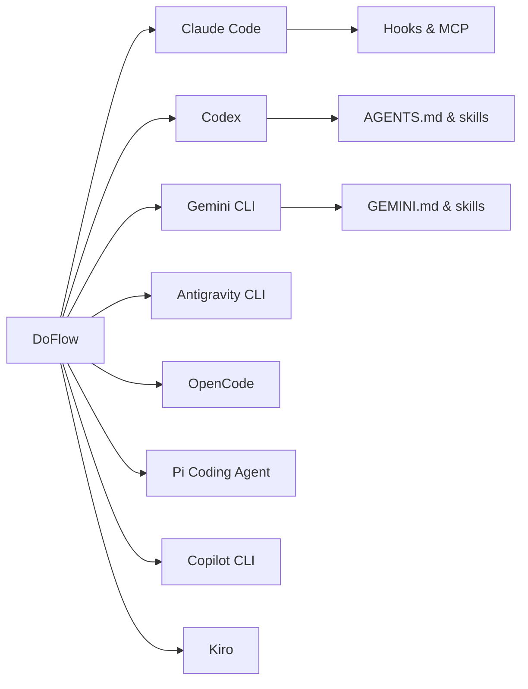
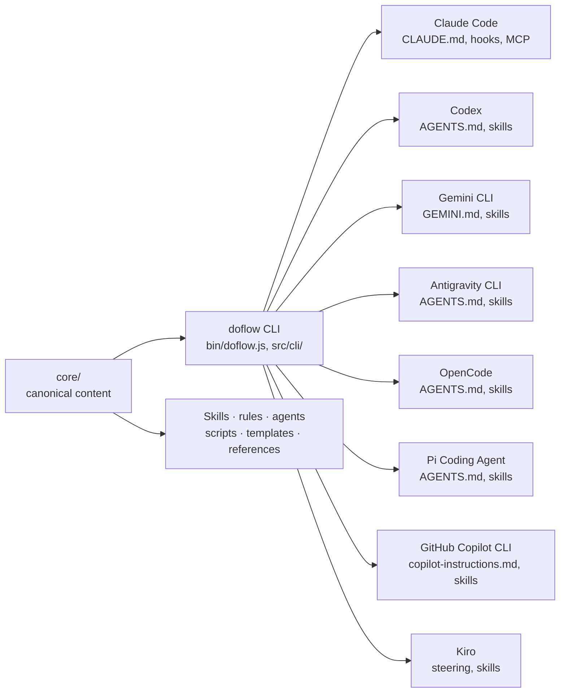
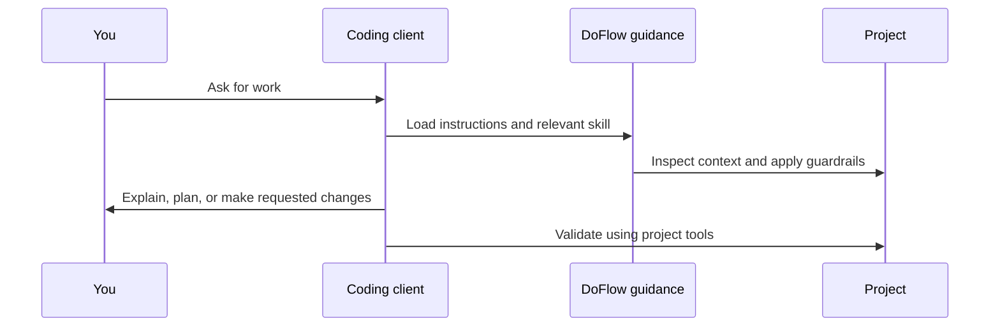
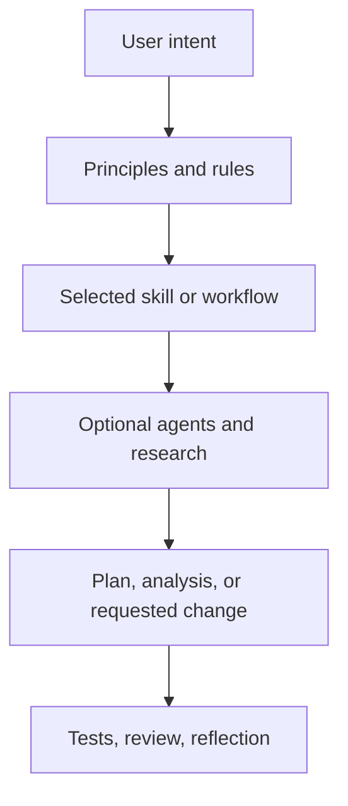
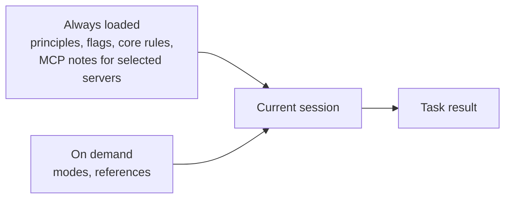

# DoFlow

DoFlow gives AI coding tools a shared engineering operating model: reusable workflows, specialist
guidance, and guardrails that stay close to the repository.

## What you get

| Capability | Purpose |
|---|---|
| Skills | Structured workflows for planning, implementation, testing, review, and research |
| Agents | Five specialist archetypes: spec analysis, system architecture, implementation, quality, and research |
| Rules | Consistent safety, workflow, quality, and question-handling expectations |
| Hooks | Session context capture and command safety controls on the harnesses that support them |

## The component model

The `core/` directory owns reusable content. `bin/` and `src/` decide where that content belongs for each supported client. This separation makes it possible to change a skill or rule once and distribute it consistently.

## What happens in a session

The client decides how to execute work. DoFlow supplies shared guidance, task workflows, and—where the client supports them—hooks and MCP registrations.

## Workflow layers

The layers have different jobs:

| Layer | Role |
|---|---|
| Principles and rules | Set non-negotiable collaboration, safety, workflow, and quality expectations |
| Skills | Define focused repeatable workflows |
| Agents | Provide a named expert lens when a workflow benefits from one |
| Scripts and hooks | Automate guardrails in environments that support them |
| Templates and references | Keep repeated deliverables consistent without putting everything in the active prompt |

## Memory without prompt bloat

DoFlow separates always-needed instructions from material that is only useful for a specific kind of work.

This keeps the default context small while retaining a discoverable home for deeper guidance. The installed instruction file points to optional resources instead of copying them into every session.

## Documentation map

| Page | Use it for |
|---|---|
| [Quickstart](quickstart.md) | First installation and first workflow |
| [Setup](setup.md) | CLI, installation scope, updates, backup, rollback, and tool mapping |
| [Overview](index.md#the-component-model) | Diagrams of context, lifecycle, and component relationships |
| [How DoFlow works](how-doflow-work.md) | Declared execution procedure, 9 task classes, gates, and readiness contracts |
| [Guide](guide.md) | Feature, bug, quality, research, and documentation workflows |
| [Reference](reference.md) | Skills, runtime commands, agents, and git lifecycle intents |
| [Settings](settings.md) | Settings keys, configuration scopes, defaults, and config home |
| [Flags](flags.md) | Flag-first cross-index of all skill options and parameters |
| [Capability Map](capability-map.md) | What each harness supports, and where it differs |
| [Governance](enterprise-governance.md) | Enterprise governance controls and organizational enforcement boundaries |
| [Architecture](architecture.md) | Repository structure and contributor-facing deployment design |
| [Distribution notes](distribution-notes.md) | Research record on Copilot plugin manifests and Pi packages |
