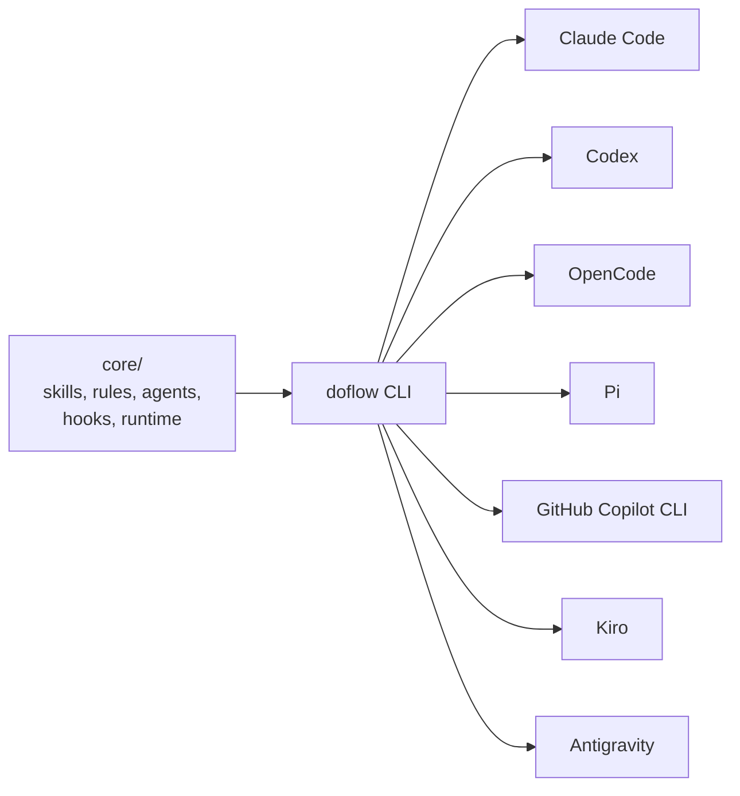

# DoFlow

AI coding agents work well on small tasks and drift on larger ones: they start editing without a spec,
report work as done without proof, forget what they deferred, and behave differently in each tool.
DoFlow is a shared engineering operating model for these tools. It ships 13 skills, 7 specialist
agents, rules, hooks and one runtime, from a single source, into your tools and your repository.

## What problem does DoFlow solve?

| Problem | What DoFlow does | Where to read |
|---|---|---|
| The coding tools you use each end up with different rules and skills | Keeps one source in `core/` and projects it into Claude Code, Codex, OpenCode, Pi, GitHub Copilot CLI, Kiro and Antigravity | [Coding agents](setup.md#coding-agents) |
| The agent invents its own procedure for each task | The agent proposes one of nine task classes; the runtime validates it against a registry and returns the stages and gates | [The shape of a run](how-doflow-work.md#the-shape-of-a-run) |
| Edits start before there is a spec | Runs features as brainstorm, design, plan, execute, test, review with up to three approval gates. A hook advises on a source edit made before `requirement.md`, `design.md` and `plan.md` exist, and the runtime grades readiness before any stage that edits source | [Deliver a feature](guide.md#deliver-a-feature) |
| The agent says "done" without proof | Records evidence with its provenance, links claims to that evidence, and scales the checks a change must pass to its risk level | [Evidence and claims](how-doflow-work.md#evidence-and-claims) |
| Always-on instructions crowd out the task | Loads principles and core rules every session. Modes and references are read on demand, and always-loaded guidance is checked against each vendor's size cap | [What gets installed](setup.md
| Follow-ups are lost between sessions and features | Stores deferred work in a lifecycle store; the next feature starts from the open items | [Keep track of what is left](guide.md#keep-track-of-what-is-left) |
| A compacted or resumed session loses its place | Reads where a run stopped from records under `.doflow/state/`, not from the transcript | [What this buys](how-doflow-work.md#what-this-buys) |
| An install overwrites files you edited | Backs up before changing files, pins choices in `doflow.lock`, leaves entries it does not own alone, and restores a backup with `doflow rollback` | [CLI lifecycle](setup.md#cli-lifecycle) |

## The component model

`core/` owns the content. The installer decides where that content belongs for each tool, so a change
to a skill or rule is made once and reaches all seven. Each tool gets the native surfaces it
documents, and anything else is guidance projection; [Harness capabilities](setup.md#harness-capabilities-and-activation)
lists the differences. The tool still runs the work: DoFlow supplies the guidance, workflows and, where
the tool supports them, hooks and MCP registrations.

## Where to go next

- [Setup](setup.md): install, verify, and run your first workflow.
- [Guide](guide.md): do a job, such as a feature, a bug fix, research or documentation.
- [How DoFlow works](how-doflow-work.md): task classes, gates, readiness, evidence and verification.
- [Reference](reference.md): skills, commands, settings, storage and hooks.
