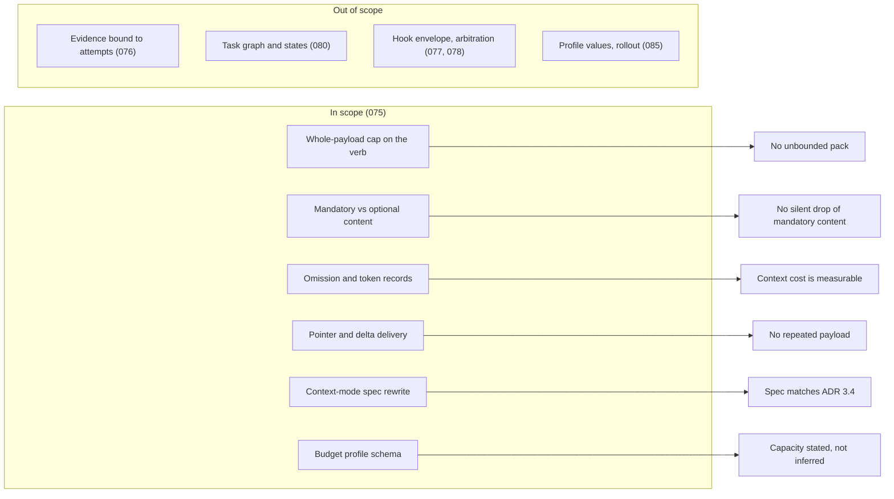

# Feature Requirement: Context delivery

**Feature:** 075-context-delivery · **Branch:** `feat/075-context-delivery` · **Maturity:** Draft
**Created:** 2026-10-13 · **Owner:** Khoa Vu Dang · **Ticket:** none
**Intent:** none

> WHAT and WHY only — no tech or implementation detail. Zero unresolved clarification markers at
> hand-off — every ambiguity is resolved via `AskUserQuestion` before this file is written;
> deferred answers become assumptions in §8.
>
> Structure follows `references/ARTIFACT_FORMAT.md`: indexed sections carry a table above full
> `**Detail**`, the document-level `Maturity` is `Draft`, `In review` or `Approved`, the item-level
> `Status` is only `Live` or `Superseded → <ref>`, and superseded prose moves to §9.

## 1. Summary

A stage that asks DoFlow for its context gets one payload whose total size is capped, in which
acceptance criteria, constraints, verification requirements and blocking gaps are never dropped, and
in which anything left out is named with a reason. Today the `doflow context-pack` verb has no
whole-payload cap and its markdown form leaves out mandatory fields, so a stage can verify against
less than its requirement and nothing says so.

**Scope boundary:**

**Baseline (re-verified at develop 815f3c9; the 837f8bf evidence names `.js`, the sources are now `.ts`):**

| Fact | Source |
|---|---|
| The bounded compiler caps bytes, splits mandatory from optional, reports `overflow` and `omissions`; it takes only acceptance criteria, constraints, a verification plan, hypotheses, unverified claims and narrative | `src/runtime/context-pack.ts:274-425` |
| Nothing in `src` or `core` calls the bounded compiler; only `test/runtime/context-pack-budget.test.js` and `test/runtime/performance-budget.test.js` do | `grep -rl compileBoundedContextPack src core test` |
| The verb compiles with the uncapped compiler and caps by item count only (files 15, claims 20, evidence 25, research 20) | `src/runtime/context-pack.ts:459`, `:68-73` |
| The verb passes no acceptance criteria or constraints, so `verificationRequirements` is always empty on that path | `src/runtime/context-pack.ts:459-472` |
| The markdown form prints objective, supported claims, hypotheses, research requests, live decisions and file locators; it omits constraints, verification requirements and conflicts | `src/runtime/context-pack.ts:207-256` |
| The verb has no `--max-bytes` flag and no budget input | `src/cli/index.ts:260`, `src/cli/runtime-commands.ts:263` (grep `max-bytes` over `src/cli`: no hit) |
| Evidence that is not `FRESH` is dropped from the pack without a record | `src/runtime/context-pack.ts:141` |
| The context-mode spec prescribes `full→delta→pointer→bare` downgrade on overflow, and all four stages read "not started" | `docs/specs/orchestrator-context-modes.md:42-45`, `:88-91` |
| `workflows.json` has no `contextMode` key | `grep -rn contextMode core src docs`: only the spec |
| Per-harness capacity is `null` with basis `profile-required`; startup tokens are `estimated:bytes/4` (2498 for every harness) | `bench/perf/budgets.json` `contextBudgets`, `startupContext` |
| Session-start stdout bytes are unmeasured: four harnesses have a hook (claude, codex, gemini, kiro), no session-start fixture exists | `bench/perf/lib/context.js:85-123`, `ls bench/perf/fixtures/*` |
| The `verb` latency intent is 150 ms with 25 percent / 10 ms headroom; no perf surface covers `context-pack` | `bench/perf/budgets.json` `intentBudgetsMs`, `headroom`, `surfaces` |
| The always-loaded guidance ceiling is 10245 bytes (projected 9992) | `test/guards/context-budget.test.js:41`, `bench/perf/budgets.json` |
| Four skills call `context-pack --json` | `core/shared/skills/{do-design,do-plan,do-execute-plan,do-implement}/SKILL.md` |

## 2. User Stories

### Story 1: A stage gets a bounded pack (P1)
- **US1 (P1):** As a stage agent in any of the eight harnesses, I want the context I am handed to
  fit a stated size, so that it cannot crowd out my reasoning, tool output or reply.

### Story 2: Verification keeps its requirements (P1)
- **US2 (P1):** As a verifier, I want acceptance criteria, constraints, verification requirements
  and blocking gaps to arrive whole or be reported as not fitting, so that I never verify against
  less than the requirement without knowing it.

### Story 3: Omissions are visible (P2)
- **US3 (P2):** As a maintainer, I want every omission, token estimate and expansion reason
  recorded, so that I can tell what a stage did not see and what its context cost.

### Story 4: No repeated payload (P2)
- **US4 (P2):** As an orchestrating session, I want material already delivered to be referenced or
  sent as a change, so that a nine-stage chain does not pay for the same text nine times.

### Story 5: One context contract (P2)
- **US5 (P2):** As a reader of the context-mode spec, I want it to agree with ADR 3.4 and with the
  code, so that I can rely on it instead of rediscovering what is true.

### Story 6: Capacity is declared (P3)
- **US6 (P3):** As the owner of rollout, I want a place to declare each harness's context capacity
  and reserve, so that "available budget" is computed from declared values and never from a model name.

## 3. Functional Requirements

**Index** — `Status` is `Live` or `Superseded → <ref>`.

| ID | Requirement | Story | Priority | Status |
|---|---|---|---|---|
| FR-001 | The verb's whole serialized payload is capped | US1 | P1 | Live |
| FR-002 | The cap comes from a declared budget, never from a model name | US1 | P1 | Live |
| FR-003 | Content is classified mandatory or optional | US2 | P1 | Live |
| FR-004 | The verb supplies the task's mandatory content | US2 | P1 | Live |
| FR-005 | Both output forms carry all mandatory content | US2 | P1 | Live |
| FR-006 | Mandatory content that does not fit is reported and handed back whole | US2 | P1 | Live |
| FR-007 | Optional content is trimmed in a declared order and each omission is recorded | US3 | P1 | Live |
| FR-008 | Estimated and actual tokens are recorded with their basis | US3 | P2 | Live |
| FR-009 | Expansion reasons are recorded | US3 | P2 | Live |
| FR-010 | Material already delivered is not re-sent unless it changed | US4 | P2 | Live |
| FR-011 | Self-loadable material is delivered as a pointer, sequential handoffs as a delta | US4 | P2 | Live |
| FR-012 | The downstream cost of a pointer is measured | US4 | P2 | Live |
| FR-013 | The context-mode spec is reconciled with ADR 3.4 | US5 | P2 | Live |
| FR-014 | Checks fail on overflow, missing telemetry, conflicting claims and stale evidence | US2 | P1 | Live |
| FR-015 | Pack metadata never becomes recurring prompt content | US1 | P1 | Live |
| FR-016 | A per-harness budget profile schema exists with unknown as a legal value | US6 | P3 | Live |
| FR-017 | Session-start output size is part of the measured startup context | US3 | P3 | Live |
| FR-018 | Evidence left out of a pack because it is not fresh is recorded, not hidden | US3 | P2 | Live |

**Detail**

- **FR-001:** The system MUST cap the entire serialized payload the `context-pack` verb emits:
  objective, constraints, verification requirements, claims, hypotheses, conflicts, research
  requests, live decisions, file locators, evidence summaries and any accounting metadata. An item
  count is not a cap. The cap applies to the emitted bytes in both the markdown and the JSON form.
  (Roadmap P1 Work 1; ADR 3.4 "Limit the entire payload".)
- **FR-002:** The system MUST take the cap from a declared budget: the task-class default, a
  per-call override, or a harness profile (FR-016). When capacity is unknown it MUST say so and use
  the declared default; it MUST NOT infer capacity from a model name. The available budget is the
  declared capacity minus consumed or estimated context minus a reserve for reasoning, tool output
  and the reply. (ADR 3.4; roadmap P1 Deliverable "Budget profiles".)
- **FR-003:** The system MUST classify every field of a pack as mandatory or optional and publish
  the classification. Mandatory includes at least the objective, acceptance criteria, constraints,
  verification requirements, blocking conflicts and blocking research gaps. Everything else is
  optional unless the classification says otherwise. (Roadmap P1 Work 3; ADR 3.4 "Do not downgrade
  away acceptance criteria, blocking conflicts, or verification requirements".)
- **FR-004:** The verb MUST populate mandatory content for the task it is asked about, without the
  caller re-entering it. A pack whose mandatory fields are empty because nothing supplied them MUST
  say they were not supplied rather than present as complete. (Baseline: `verificationRequirements`
  is always empty on the verb path.)
- **FR-005:** The markdown and the JSON form MUST each carry every mandatory field. A field present
  in one form and absent in the other is a defect. (Baseline: the markdown form omits constraints,
  verification requirements and conflicts.)
- **FR-006:** When mandatory content alone exceeds the cap, the system MUST NOT truncate or drop
  any of it. It MUST deliver the mandatory content whole, mark the pack as overflowed, state the
  size against the cap, report the gap, and tell the caller to split the work or context or to
  request a new session. The exit status MUST let a caller distinguish overflow from an empty pack.
  (Roadmap P1 Gate "explicitly split or reported; no silent truncation"; ADR 3.4; roadmap §9 hard
  gate "mandatory context is not silently dropped".)
- **FR-007:** When mandatory plus optional content exceeds the cap, the system MUST trim optional
  content in one declared priority order and record each omitted item with an id and a reason, in
  both output forms. Trimming MUST be deterministic for the same input, and size accounting MUST
  count UTF-8 bytes. (Roadmap P1 Work 6.)
- **FR-008:** The system MUST record, per delivered pack, the estimated token count and, where the
  harness reports one, the actual count. Each number MUST carry its basis, so that an estimate is
  never read as a measurement. (Roadmap P1 Work 6; ADR 3.4 "Distinguish actual usage from
  conservative estimates".)
- **FR-009:** The system MUST record the reason whenever a pack is later expanded beyond what was
  first delivered (a pointer followed, a delta widened, a cap raised). (Roadmap P1 Work 6
  "expansion reasons".)
- **FR-010:** The system MUST NOT re-deliver material already delivered to the receiving session
  unless its source changed or the receiver lacks it. Where it cannot establish that the receiver
  holds the material, it MUST deliver it. (Roadmap P1 Work 4; ADR 3.4 "Deduplicate".)
- **FR-011:** The system MUST deliver self-loadable documents as pointers and sequential handoffs
  as deltas, and MUST support a narrow mode that carries the task statement alone for classification
  calls. It MUST NOT deliver complete tool catalogs, graph dumps, routing reasoning or trace
  histories. (ADR 3.4.)
- **FR-012:** The system MUST measure what a pointer costs the receiver afterwards: the reads and
  tokens needed to load what the pointer names, compared with delivering it inline. The result MUST
  be reported so that pointer delivery is kept only where it saves total task cost. (Roadmap P1 Gate
  "Measure downstream pointer-read costs"; ADR 3.4 "Pointers incur later read costs".)
- **FR-013:** The context-mode specification MUST be rewritten so that it states no downgrade away
  from mandatory content on overflow, states the actual implementation status of each stage, and
  matches FR-006 and FR-011. It MUST NOT contradict ADR 3.4. (Roadmap P1 Work 5 and Deliverable
  "Updated context contract"; DELIVERY-STATE "Known doc drift".)
- **FR-014:** The repository MUST contain checks that fail on: a pack that overflows with
  mandatory content dropped; a delivered pack with no token record; conflicting claims presented
  without being marked as conflicting; stale evidence presented as current. (Roadmap P1 Deliverable
  "checks for overflow, missing telemetry, conflicting claims, and stale evidence".)
- **FR-015:** Pack accounting (omissions, token records, expansion reasons) MUST be available to
  the caller without being added to the prompt of every later turn. A hook that fires without a
  decision-relevant change MUST stay silent. (Roadmap P1 Gate "Metadata must not become recurring
  prompt pollution"; ADR 3.11 "Default to silence".)
- **FR-016:** The registry MUST define the shape of a per-harness budget profile: declared
  capacity, reserve, and the source of token telemetry, each allowed to be `unknown` with a stated
  basis. This feature defines the shape; the values per harness belong to the rollout feature.
  (Coverage evidence row 8.3 "schema in 075"; ADR §8 "context telemetry per harness".)
- **FR-017:** The measured startup context MUST include the bytes the session-start hook writes,
  for each harness that has one, or state per harness why it is unmeasured. (074 finding; DELIVERY-
  STATE row 075.)
- **FR-018:** Evidence excluded from a pack because it is not fresh MUST appear as an omission with
  its freshness state, and MUST NOT be presented as the absence of evidence. (Baseline: non-FRESH
  evidence is dropped silently at `src/runtime/context-pack.ts:141`; roadmap §9 hard gate "stale
  indexes never establish verified absence".)

## 4. Non-Functional Requirements

| ID | Constraint | Kind | Status |
|---|---|---|---|
| NFR-001 | The verb stays within the 074 `verb` latency budget | performance | Live |
| NFR-002 | Always-loaded guidance does not grow; no new recurring prompt text | performance | Live |
| NFR-003 | No runtime dependency is added | reliability | Live |
| NFR-004 | Behaviour is identical on all eight harnesses | compatibility | Live |
| NFR-005 | Existing consumers of the verb keep working | compatibility | Live |
| NFR-006 | No delivery path truncates silently | reliability | Live |
| NFR-007 | Estimates and measurements are never mixed | reliability | Live |
| NFR-008 | No paid model call is needed to pass the repository's checks | cost | Live |

**Detail**

- **NFR-001 (Latency):** The `context-pack` verb MUST meet the `verb` intent of 150 ms with the
  074 headroom (25 percent, 10 ms floor), and a perf surface MUST cover it, because none does today
  (`bench/perf/budgets.json` `surfaces`). Delivery bookkeeping (dedupe, token records) counts
  toward this budget.
- **NFR-002 (Context cost):** The always-loaded set stays within the 10245-byte G13 ceiling
  (`test/guards/context-budget.test.js:41`); this feature adds nothing to it. Any text a hook emits
  on a routine turn is counted in the startup and per-turn figures of FR-017.
- **NFR-003 (Zero dependencies):** `package.json` gains no dependency (ADR 3.1; guards G16, G30).
  Token counting uses the existing estimate or a harness-reported figure, not a tokenizer package.
- **NFR-004 (All harnesses):** Claude Code, Codex, Gemini CLI, Antigravity, OpenCode, Pi, GitHub
  Copilot CLI and Kiro get the same pack for the same input. Behaviour that depends on one
  harness's native feature is not acceptable; where a harness cannot report actual tokens or
  retention, the pack says so (FR-008, FR-010) and falls back to full delivery.
- **NFR-005 (Compatibility):** The four skills that call `context-pack --task-id <id> --json` keep
  working without edits unless the change is part of this feature. The exit 1 on an empty pack
  stays, per `src/runtime/context-pack.ts` header ("an empty pack is not evidence that a task needs
  no context").
- **NFR-006 (No silent loss):** Roadmap §9 hard gate "mandatory context is not silently dropped"
  holds on every delivery path, including the pointer and delta paths.
- **NFR-007 (Honest numbers):** Reports separate actual token counts from estimates (roadmap §9).
  No token-reduction percentage is claimed (roadmap §9 "No token-reduction percentage ... before
  baseline").
- **NFR-008 (Offline checks):** `npm test` and the free `npm run bench -- coverage` and `parity`
  runs pass without a model call. Any measurement that needs a paid call is a separate, approved
  step and is not a gate for `npm test`.

## 5. Out of Scope

- **Shared task state: dependency readiness, owner/attempt/version, checkpoints, aggregate budget (roadmap P1 Work 2)** — owner 080 (task-graph-lifecycle); 070 delivered the attempt and phase-order part.
- **Unknown indexed providers default to UNKNOWN (P1 Work 7)** — done by 068 (`src/runtime/retrieval-plan.ts:195-207`, `test/guards/provider-source-mode.test.js`); 075 only consumes the freshness state (FR-018).
- **Normalize provenance: source version, candidate origin (P1 Work 8)** — owner 076 (evidence-attempts).
- **Preserve EMPTY / UNREACHED / UNVERIFIED (P1 Work 9)** — already delivered (`src/runtime/retrieval-plan.ts:65`, `RESULTS`); 075 does not change retrieval results.
- **Bind evidence to query and attempt (P1 Work 10)** — owner 076.
- **Retrieval attempts and fallback as an attempt (cross-phase "every attempt has an outcome")** — owner 076.
- **Per-harness hook fixtures, hook coverage matrix, versioned envelope** — owner 077; FR-017 asks only for the session-start bytes.
- **Lineage-scoped compaction, one emission authority** — owner 078.
- **Per-harness profile values and rollout** — owner 085; FR-016 defines the shape only. Choosing the values is an open ADR §8 decision.
- **The event bus and harness mode narrowing in the context-mode spec (its stages 3 and 4)** — no roadmap feature owns them; FR-013 states their status honestly and builds neither.
- **Semantic or hybrid retrieval and its token cost (T-006)** — owner 079.
- **`doflow doctor` p95 549.81 ms against the 500 ms intent** — not a context verb; assignment in §7.
- **`doflow goal --action list` exit 1 seen once** — a lifecycle verb, not a context verb; verdict in §7.
- **Advisor-chosen context modes** — owner 084.

## 6. Acceptance Criteria

- [ ] **Scenario: Verb output is capped** (US1, FR-001, FR-002)
  - **Given** a task with evidence, claims, research requests and decisions whose uncapped pack
    exceeds its task-class budget
  - **When** a stage runs `doflow context-pack --task-id <id>` in either output form
  - **Then** the emitted bytes do not exceed the budget, and the output states the budget and where it came from

- [ ] **Scenario: Mandatory content is never trimmed to fit** (US2, FR-003, FR-006)
  - **Given** a task whose acceptance criteria, constraints and verification requirements alone exceed the budget
  - **When** the pack is compiled
  - **Then** all of that content is delivered, the pack is marked overflowed with its size and the budget, the split-or-new-session instruction is present, and the exit status differs from the empty-pack status

- [ ] **Scenario: Both forms carry the same mandatory fields** (US2, FR-005)
  - **Given** a task with constraints, verification requirements and a blocking conflict
  - **When** the pack is emitted as markdown and as JSON
  - **Then** each form contains every one of those fields

- [ ] **Scenario: The verb supplies mandatory content** (US2, FR-004)
  - **Given** a feature whose requirement defines acceptance criteria
  - **When** a stage runs the verb without passing them
  - **Then** the pack carries them, or states that none were supplied

- [ ] **Scenario: Optional content trims in order and says so** (US3, FR-007)
  - **Given** optional content that does not fit beside the mandatory content
  - **When** the pack is compiled twice with the same input
  - **Then** both packs are identical, and each omitted item appears with an id and a reason in both forms

- [ ] **Scenario: Token figures carry a basis** (US3, FR-008)
  - **Given** a harness that reports no actual token count
  - **When** a pack is delivered
  - **Then** the record holds an estimate labelled as an estimate and marks the actual count as unmeasured

- [ ] **Scenario: Expansion is explained** (US3, FR-009)
  - **Given** a pack first delivered as a pointer
  - **When** the receiver asks for the inline content
  - **Then** a record states the reason for the expansion

- [ ] **Scenario: Unchanged material is not re-sent** (US4, FR-010)
  - **Given** a session that already received material whose source has not changed
  - **When** the next stage requests context
  - **Then** the pack references the material and does not repeat it; and when the source changed, the changed part is sent

- [ ] **Scenario: Receiver retention cannot be shown** (US4, FR-010, NFR-004)
  - **Given** a harness for which retention of earlier context is not established
  - **When** a stage requests context
  - **Then** the material is delivered in full

- [ ] **Scenario: Pointer cost is reported** (US4, FR-012)
  - **Given** a stage that receives a pointer
  - **When** the pointer-read measurement runs
  - **Then** the report gives the reads and tokens needed to load the target, next to the inline size, and labels each as estimated or measured

- [ ] **Scenario: Spec and ADR agree** (US5, FR-013)
  - **Given** the rewritten context-mode spec
  - **When** it is read against ADR 3.4
  - **Then** it contains no downgrade-on-overflow rule, and each stage's status matches the code

- [ ] **Scenario: A broken delivery fails a check** (US2, FR-014)
  - **Given** a change that drops a mandatory field, omits the token record, hides a conflict or shows stale evidence as current
  - **When** `npm test` runs
  - **Then** a check fails and names the cause

- [ ] **Scenario: Routine turns stay silent** (US1, FR-015)
  - **Given** a turn with no decision-relevant change
  - **When** the lifecycle hooks run
  - **Then** they emit no context-pack accounting

- [ ] **Scenario: Unknown capacity is stated** (US6, FR-016, FR-002)
  - **Given** a harness whose profile declares capacity `unknown`
  - **When** the available budget is requested
  - **Then** the result says capacity is unknown and uses the declared default, not a value derived from a model name

- [ ] **Scenario: Session-start bytes are measured or explained** (US3, FR-017)
  - **Given** the startup-context measurement
  - **When** it runs for the eight harnesses
  - **Then** each harness with a session-start hook has a byte count, and each without one states that

- [ ] **Scenario: Stale evidence is a recorded omission** (US3, FR-018)
  - **Given** evidence whose freshness is STALE or UNKNOWN
  - **When** a pack is compiled
  - **Then** the pack lists it as omitted with its freshness state and does not report the topic as having no evidence

- [ ] The verb meets the 150 ms `verb` intent with 074 headroom under a perf surface that covers it (NFR-001).
- [ ] `test/guards/context-budget.test.js` passes unchanged and `package.json` has no dependencies (NFR-002, NFR-003).
- [ ] `npm test`, `npm run bench -- coverage` and `npm run bench -- parity` pass with no model call (NFR-008).
- [ ] Every roadmap P1 Work, Deliverable and Gate row is mapped to an FR here or to an owner in §5.

## 7. Open Questions

None. All fifteen discovery ambiguities (A1-A15) were resolved by the orchestrator under the user's delegation on 2026-10-13; each is recorded below as A-5 to A-19 and in `intention/brainstorm-01-question.md`.

## 8. Assumptions

| ID | Assumption | Affects | Basis |
|---|---|---|---|
| A-1 | 075 owns context delivery; 076 owns evidence and attempt records | FR-018, §5 | DELIVERY-STATE feature sequence rows 075, 076 |
| A-2 | The existing `TASK_CLASS_BUDGETS` (bytes per task class) are the starting caps | FR-002 | `src/runtime/context-pack.ts:14-24`; their origin is not recorded in the sources read |
| A-3 | G-P1 is judged on the integrated develop tree, offline | NFR-008 | DELIVERY-STATE completion rule |
| A-4 | Token counts are estimated as bytes/4 until a harness reports otherwise | FR-008 | `bench/perf/budgets.json` `tokensBasis` |
| A-5 | Derived from the active feature's requirement artifact, caller input overrides | A1 | orchestrator under delegation, 2026-10-13 |
| A-6 | Optional, kept first among optional items, recorded when dropped; blocking conflicts stay mandatory | A2 | orchestrator under delegation, 2026-10-13 |
| A-7 | Emit mandatory content whole, set an overflow flag, exit with a distinct non-zero status (not 1, which means empty pack), and print the split or new-session instruction; documented in docs/reference.md | A3 | orchestrator under delegation, 2026-10-13 |
| A-8 | Keep TASK_CLASS_BUDGETS as the default caps | A4 | orchestrator under delegation, 2026-10-13 |
| A-9 | UTF-8 bytes enforced; tokens reported as an estimate with its basis | A5 | orchestrator under delegation, 2026-10-13 |
| A-10 | Spec rewrite only; pointer/delta for the verb; no registry key | A6 | orchestrator under delegation, 2026-10-13 |
| A-11 | Keep them in the spec marked "not scheduled; no owning feature" | A7 | orchestrator under delegation, 2026-10-13 |
| A-12 | Task id + content digest in the per-project store; delta against the last pack for that task; full delivery whenever harness retention is unproven | A8 | orchestrator under delegation, 2026-10-13 |
| A-13 | Offline only in 075: estimated tokens, counted pointer reads and bytes; actual tokens reported as unmeasured | A9 | orchestrator under delegation, 2026-10-13 |
| A-14 | 075 measures session-start stdout bytes through one shared fixture against an installed layout (temp HOME) for claude, codex, gemini and kiro; the per-harness coverage matrix stays with 077 | A10 | orchestrator under delegation, 2026-10-13 |
| A-15 | Out of scope; recorded as a follow-up | A11 | orchestrator under delegation, 2026-10-13 |
| A-16 | 085 (P5 overhead reduction) | A12 | orchestrator under delegation, 2026-10-13 |
| A-17 | Additive keys; version stays 1; the overflow exit status is the one behaviour change | A13 | orchestrator under delegation, 2026-10-13 |
| A-18 | 075 records non-FRESH evidence as omissions with state; 076 owns every absence claim and attempt binding | A14 | orchestrator under delegation, 2026-10-13 |
| A-19 | Schema only; every value unknown with its basis; values in 085 | A15 | orchestrator under delegation, 2026-10-13 |

**Detail**

- **A-1** — If 076 ships first with a different attempt id, FR-018 reads that id instead of a provider; the requirement does not change.
- **A-2** — If measurement shows the table is wrong for a class, the number changes through the budget declaration, not through FR-002.
- **A-3** — A gate that needs a paid run would move to an approved separate step (NFR-008).
- **A-4** — A harness that reports real usage replaces the estimate for that harness only.
- **A-5** (A1) — skills call the verb with only --task-id, so caller-only would leave packs empty; the verb already resolves the active feature (context-pack.ts:36-55).
- **A-6** (A2) — ADR 3.4 names acceptance criteria, blocking conflicts and verification requirements as non-droppable and decisions only as relevant.
- **A-7** (A3) — ADR 3.4 says split or request a new session and record the gap; refusing loses content, exit 0 hides it from shell callers.
- **A-8** (A4) — capacity is profile-required for all 8 harnesses (074 budgets.json); roadmap §9: no reduction claim before a baseline.
- **A-9** (A5) — the compiler and its tests count bytes; ADR allows token estimates or byte caps.
- **A-10** (A6) — DELIVERY-STATE scope is spec rewrite plus pointer/delta; a registry key belongs with a dispatcher (080/082).
- **A-11** (A7) — honest status without silently losing the design; assigning is a roadmap decision.
- **A-12** (A8) — harness-neutral (not every harness exposes a session id); full delivery is the safe fallback.
- **A-13** (A9) — a real token figure needs a paid model call, which is on the ask-first list; not requested.
- **A-14** (A10) — DELIVERY-STATE row 075 carries it and G-P1 "recurring pollution" needs it; the hook execs installed paths, which is why the bench saw 0 bytes.
- **A-15** (A11) — lifecycle verb (src/runtime/lifecycle/cli.ts), not context delivery; 3/3 reruns exit 0.
- **A-16** (A12) — doctor is a diagnostic, not context delivery.
- **A-17** (A13) — four skills parse the JSON; bump only if a field changes meaning.
- **A-18** (A14) — the pack is 075's surface; absence verdicts need attempt records.
- **A-19** (A15) — values would be an ADR §8 decision (ask-first); coverage evidence row 8.3 says schema in 075.

## 9. History

None — initial version.
