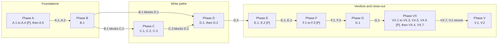

# Implementation Plan: Evidence integrity and attempt records

**Feature:** 076-evidence-attempts · **Requirement:** agent-docs/doflow/076-evidence-attempts/intention/requirement.md · **Design:** agent-docs/doflow/076-evidence-attempts/design/design.md · **Maturity:** Draft · **Created:** 2026-10-14

> HOW. Reads agent-docs/doflow/076-evidence-attempts/intention/requirement.md and
> agent-docs/doflow/076-evidence-attempts/design/design.md. Resolve every `[NEEDS CLARIFICATION]` from the
> requirement here.
>
> Structure follows `references/ARTIFACT_FORMAT.md`: indexed sections carry a table above full
> `**Detail**`, the document-level `Maturity` is `Draft`, `In review` or `Approved`, the item-level
> `Status` is only `Live` or `Superseded → <ref>`, and superseded prose moves to §9.

## 1. Approach

The plan builds the shared pieces first, then the two write paths, then the verdicts that read them:
1. Four independent foundations run in parallel (Phase A): the shared score-field module with the ledger refusal, the plan record module with locked writes, the claims rule and the CLI flags. The source-version module follows the first of them, because both edit `src/runtime/cli.ts`.
2. Declare mints the plan id and the queryRefs (B).
3. The evidence write path goes through the candidate bridge, then gains `--need` binding and the absence record (C). These tasks are sequential because they share `src/runtime/cli.ts`.
4. The attempt action, the binding rule and the report output follow (D). D.1 can run beside Phase C, because its files are disjoint from C's.
5. The freshness validator and readiness verdicts come next (E). Docs, perf rows and the end-to-end CLI check follow (F), then a negative-control audit (G).
6. The orchestrator runs the full verification and the two-lens review (V). The V.2 review findings are fixed in phase VX (DEC-024 to DEC-030), after which V.1 reruns.

Every repository locator below is in the worktree `/Users/kai/Workspace/learning/do-flow-076` (branch `feat/076-evidence-attempts`, from develop 6ae3de7).

Rules that hold for every task:
- **Workers.** Each task is sized for one worker run. agy is the first worker and Codex the second. Workers run only the targeted tests in their Verify line; the orchestrator runs the full suite in V.1.
- **Verify commands name files or quoted globs, never bare directories.** Node 22.18's `node --test` does not recurse into a directory argument.
- **Every new module is wired in its first task.** The task that creates a module also adds its first non-test consumer, so the G16 reachability guard (`test/guards/module-reachability.test.js:150`) stays green after every commit.
- **Negative controls are proved before commit.** Every test listed under a task's negative controls must fail when the named production line is reverted. The worker reverts it, runs the test, records the failing output in the hand-back, and restores it before committing. G.1 audits the whole set again.
- **No wall-clock assertion in `npm test`.** Latency is measured only by the orchestrator in the `exclusive` V.1 run with `npm run bench -- perf measure` on a quiet machine. A task marked `exclusive` runs alone: no other dispatch, no `node --test` process and no other worker.
- **`[P]` means safe to run concurrently.** A task carries `[P]` when its `files:` are disjoint from every sibling in its phase and it depends on no sibling.
- **Existing assertions do not change.** A task that cannot keep an existing assertion green stops and reports instead of editing it.
- **A task that changes a store lists every coupled file up front:** `core/registry/storage.json`, the `docs/reference.md` storage table, the G26 scenario in `test/guards/storage-declarations.test.js`, `test/runtime/storage-registry.test.js`, `test/runtime/storage-engine.test.js`, and the IC-028 guard in `test/guards/baseline-contracts.test.js`.

## 2. Constitution Check (GATE)

Tier-2 (`agent-docs/constitution.md`) does not exist, so tier-1 `CONSTITUTION_BASE.md` v1.0.0 applies alone.

- [x] Complies with P1 Safety over speed.
  - No task edits a hook or a hook policy script.
  - Absence and attempt records take the default blocking lock, never the fail-fast one, so no authoritative write is dropped under contention (DEC-012, IC-020).
  - The end-to-end check and the perf fixture run in temporary directories from `test/helper/tmp.js`, never in the repository (F.2, F.3).
- [x] Complies with P2 Evidence over assumptions.
  - Every task ends in a command the worker runs.
  - Every contract carries a negative control that the worker proves before commit, and G.1 re-proves the whole set.
  - An absence from a STALE or UNKNOWN index cannot establish a requirement (IC-018). An absence recorded outside git is UNKNOWN (DEC-018).
- [x] Complies with P3 Finish what you start.
  - Each task delivers a wired, tested change, and every new module has a production consumer in its first task.
  - The candidate bridge is the evidence-add builder, so it is not dead code waiting for 079 (DEC-014).
- [x] Complies with P4 Scope discipline.
  - Tasks map onto design C1 to C12 and the 24 contracts in specs.md.
  - Out of scope: no candidate store, no candidate CLI surface, no duration fields, no auto-run refresh (DEC-007), no 075 code change (DEC-015), and no verification reuse (089). 089 reuses only caller attempts and per-item `gitCommit`, `fileHash` and `isDirty` (DEC-029); no VX task stamps a commit or fingerprint on an attempt.
- [x] Complies with P5 Parallel by default.
  - 14 of 26 tasks carry `[P]`, and D.1 can also run beside Phase C.
  - The sequential tasks share `src/runtime/cli.ts`, `src/runtime/retrieval-plan.ts` or `src/runtime/retrieval-record.ts`, or consume a module a sibling creates.
- [x] Complies with P6 Professional honesty.
  - Perf rows stay `proposed` until measured, and no latency figure is claimed before V.1.
  - The residual false-absence risk (a model writing an absence as a located item) is stated in design R2, not hidden.

**Result:** PASS. There is no violation. The one tension is P5 against the sequential `cli.ts` tasks in Phase C and the exclusive V.1 run. Both are forced: by a shared file and by measurement noise.

## 3. Research & Decisions

Register topics (`decision --action list --slug=076-evidence-attempts`) govern the plan:

- **DEC-001**, **DEC-011:** evidence binding. The runtime stamps `queryRef` from `--need` with a per-plan id and reads `attemptRef` from the active 070 attempt. Caller-typed refs are refused. Unbound retrieval evidence does not count in plans declared under 076, and legacy plans keep provider matching.
- **DEC-002**, **DEC-012:** attempts. `attempts[]` lives in the retrieval-plan store and is written through `updateTaskState` with the default `acquireLock`. The attempt action refuses RETRIEVED. UNAVAILABLE and BYPASSED are reason codes. A need's outcome is its highest-precedence attempt.
- **DEC-003**, **DEC-008**, **DEC-014:** the candidate bridge is evidence-add's builder, and the score list is one shared module used by `cli.ts` and the ledger.
- **DEC-004**, **DEC-013:** the source version lives in `freshness`, with `isDirty` per file, from one porcelain v2 call.
- **DEC-006**, **DEC-009**, **DEC-010:** absence is a typed record whose freshness comes from the index, re-probed at record time. Located evidence is never stamped UNKNOWN.
- **DEC-017**, **DEC-018**, **DEC-020:** a FRESH absence goes STALE when HEAD or the working-tree fingerprint changes. The fingerprint includes each dirty path's size and mtime. An absence outside git is UNKNOWN.
- **DEC-016** (supersedes DEC-005): only FRESH evidence supports a claim. An UNKNOWN contradiction gives conflicted or hypothesis, never rejected.
- **DEC-007**, **DEC-015:** refresh commands are surfaced, never run. Every refusal names its fix. 076 changes no 075 code.
- **DEC-024** (supersedes DEC-023), **DEC-025:** report refreshes every derived attempt's evidence; an emptied derived attempt of any status stays as history and does not count. Report rechecks bound absences and keys derived attempts by freshness.
- **DEC-026**, **DEC-027**, **DEC-028**, **DEC-030:** an unreadable plan degrades in readiness and is set aside by declare. The fingerprint folds in submodule and nested-repo state. `git status` gets a raised `maxBuffer` and a `rev-parse` fallback. An absence is anchored in the checkout the command runs in.
- **DEC-029:** 089 reuses only caller attempts and per-item commit, hash and dirty flag. Decision only; no VX task implements it.
- **DEC-019:** "with support" means any supporting evidence. "Unbound" covers a replaced plan and another task attempt. Absence items are `extracted` with no locator. Output lists at most five unbound ids plus a total count.

## 4. Components & Changes

| ID | Change | Files | Phase | Status |
|---|---|---|---|---|
| CH1 | Shared score-field module; ledger refusal | `src/runtime/evidence-fields.ts`, `src/runtime/cli.ts`, `src/runtime/outcome.ts`, `src/runtime/evidence-ledger.ts` | A | Live |
| CH2 | Plan record module with locked writes | `src/runtime/retrieval-record.ts`, `src/runtime/retrieval-plan.ts`, `core/registry/storage.json` | A | Live |
| CH3 | Claims rule | `src/runtime/claims.ts` | A | Live |
| CH4 | CLI flags, dispatch, help | `src/cli/index.ts`, `src/cli/runtime-commands.ts` | A | Live |
| CH5 | Source version and tree fingerprint | `src/runtime/source-version.ts`, `src/runtime/cli.ts` | A | Live |
| CH6 | Plan id, queryRefs, plan attemptRef at declare | `src/runtime/retrieval-record.ts`, `src/runtime/retrieval-plan.ts`, `src/runtime/task-attempts.ts` | B | Live |
| CH7 | Candidate bridge; `--need` binding; absence record | `src/runtime/candidate.ts`, `src/runtime/cli.ts`, `src/runtime/evidence-ledger.ts`, `src/cli/runtime-commands.ts` | C | Live |
| CH8 | Attempt action; binding rule; derived attempts; report | `src/runtime/retrieval-plan.ts`, `src/runtime/retrieval-record.ts` | D | Live |
| CH9 | Freshness validator absence branch | `src/runtime/freshness.ts` | E | Live |
| CH10 | Readiness reason codes | `src/runtime/readiness.ts` | E | Live |
| CH11 | Coupled docs, G26 rows, perf rows | `docs/reference.md`, `docs/specs/candidate-evidence-boundary.md`, `core/shared/skills/do-execute-plan/references/readiness_gate.md`, `test/guards/storage-declarations.test.js`, `bench/perf/budgets.json` | F | Live |
| CH12 | End-to-end CLI property check | `test/e2e/evidence-attempts.e2e.test.js` | F | Live |
| CH13 | V.2 review fixes | `src/runtime/retrieval-plan.ts`, `src/runtime/retrieval-record.ts`, `src/runtime/readiness.ts`, `src/runtime/source-version.ts`, `src/runtime/freshness.ts`, `src/runtime/candidate.ts`, `src/runtime/cli.ts`, `src/cli/runtime-commands.ts`, `src/cli/index.ts` | VX | Live |

**Detail**

- **CH1** → Implements design C1 and C5's refusal (IC-007, IC-008). The list moves out of `src/runtime/cli.ts:229-250` unchanged, and `cli.ts` re-exports it for `src/cli/index.ts:335` and the IC-028 guard. The ledger calls the refusal first in `addEvidence` (`src/runtime/evidence-ledger.ts:128-131`).
- **CH2** → Implements design C6's storage half (IC-020). `writePlan` (`src/runtime/retrieval-plan.ts:148-153`) is deleted, and every plan write goes through `updateTaskState`. The `task-retrieval` writer moves to `src/runtime/task-state.ts` in `core/registry/storage.json:164-166`.
- **CH3** → Implements design C9 (IC-017), replacing `src/runtime/claims.ts:195-226`.
- **CH4** → Implements design C11 (IC-021): `--absence` and `--status`, the retrieval-plan dispatch keys at `src/cli/runtime-commands.ts:264`, and help at `src/cli/index.ts:396`, `:456`.
- **CH5** → Implements design C2 (IC-004). It replaces `headCommit` (`src/runtime/cli.ts:439-447`) with one `git status --porcelain=v2 --branch -z --untracked-files=all` call and adds `isDirty` and the tree fingerprint.
- **CH6** → Implements IC-010, IC-011 and the declare half of IC-005. `activeAttempt` becomes an export of `src/runtime/task-attempts.ts` (`:162`, `:410-413`).
- **CH7** → Implements design C3 and C4 (IC-001, IC-002, IC-003, IC-005, IC-006, IC-009).
- **CH8** → Implements design C7 and C6's binding half (IC-012 to IC-015). Legacy plans keep `src/runtime/retrieval-plan.ts:251-259` and `:400-405` unchanged.
- **CH9** → Implements design C8 (IC-016): the absence branch before `src/runtime/freshness.ts:125-127`, with the fingerprint computed once per pass.
- **CH10** → Implements design C10 (IC-018, IC-019).
- **CH11** → Implements design C12 (IC-022, IC-024).
- **CH12** → The end-to-end property check through `bin/doflow.js` on a temporary git repository, covering IC-001 to IC-019 as behaviour rather than units.
- **CH13** → Closes the V.2 findings listed in the synthesis (2 blockers, 8 majors, 16 minors) as amended contracts IC-004, IC-006, IC-013 to IC-016, IC-019 and IC-020. Seven tasks, VX.1 to VX.7, with disjoint write sets except where a dependency orders them.

## 5. Data / Contracts

Contracts are in `./design/specs.md` §1. Persisted shapes and flows are in `./design/data-model.md`.

| Task | Implements |
|---|---|
| A.1 | IC-007, IC-008 |
| A.2 | IC-020 |
| A.3 | IC-017 |
| A.4 | IC-021 |
| A.5 | IC-004 |
| B.1 | IC-010, IC-011, IC-005 (declare) |
| C.1 | IC-009 |
| C.2 | IC-001, IC-002, IC-003, IC-005 (evidence) |
| C.3 | IC-006 |
| D.1 | IC-012, IC-013 |
| D.2 | IC-014, IC-015 |
| E.1 | IC-016 |
| E.2 | IC-018, IC-019 |
| F.1 | IC-022 |
| F.2 | IC-024 |
| F.3 | IC-001 to IC-019, end to end |
| G.1 | IC-023 |
| VX.1 | IC-004, IC-006, IC-009, IC-016 (DEC-030) |
| VX.2 | IC-004 (DEC-027, DEC-028) |
| VX.3 | IC-013, IC-014, IC-020 (DEC-024, DEC-026) |
| VX.4 | IC-018, IC-019 (DEC-026) |
| VX.5 | IC-021 |
| VX.6 | IC-023, IC-024 |
| VX.7 | IC-014, IC-015 (DEC-025) |

## 6. Risks & Mitigations

| ID | Risk | Mitigation | Status |
|---|---|---|---|
| RK1 | Phase C serializes on `src/runtime/cli.ts` | Small tasks; D.1 runs beside it | Live |
| RK2 | Perf surfaces need a fixture-project runner that only 075 has | F.2 depends on 075's runner support | Live |
| RK3 | Legacy plans silently change result or exit | Frozen fixture from 6ae3de7 in D.2 and F.3 | Live |
| RK4 | A negative control is inert | Worker proof before commit, G.1 audit | Live |
| RK5 | Re-probe and fingerprint cost on the write path | Proposed perf rows measured in V.1 | Live |
| RK6 | A new module lands unwired and G16 fails | Wiring in the creating task | Live |

**Detail**

- **RK1** → Phase C's three tasks each touch `src/runtime/cli.ts`, so they cannot overlap. Each is kept to one contract family, and D.1 (disjoint files) runs alongside, so the critical path is C.1, C.2, C.3, D.2, E.2.
- **RK2** → On develop the perf runner runs every surface with `cwd: repoRoot` (`bench/perf/runner.js:270`). A write surface would therefore write into the repository. 075 adds `setup: { kind: 'copy-fixture-project' }` (075 `bench/perf/runner.js:271-281`). F.2 uses that setup and depends on 076 being rebased onto develop after 075 merges. If 075 does not merge first, F.2 cannot run as written. That choice is returned to the orchestrator.
- **RK3** → D.2 freezes a legacy plan and ledger from develop 6ae3de7 under `test/runtime/fixtures/retrieval-legacy/` and asserts byte-identical report output and exit code. F.3 repeats the check through the CLI.
- **RK4** → A test that passes on reverted code proves nothing. Each worker records the failing run for every listed control, and G.1 reverts each IC-023 production line on a scratch copy and confirms the failure.
- **RK5** → `freshnessEntry` can walk up to 4000 files (`src/runtime/health.ts:77`), and `git status --untracked-files=all` grows with untracked files. Neither is asserted in `npm test`. V.1 measures the IC-024 rows and keeps any row over budget `proposed`, with the figure recorded.
- **RK6** → G16 fails a module with no non-test consumer. A.1, A.2, A.5 and C.1 each wire their new module into its first consumer in the same commit.

## 7. Validation Strategy

| Requirement | Verified by |
|---|---|
| FR-001 | C.2 `runtime-evidence-write.test.js`; B.1 declare tests; F.3 |
| FR-002 | D.2 `retrieval-binding.test.js` (disjoint evidence on one provider); E.2 unbound reason; F.3 |
| FR-003 | C.1 `candidate-bridge.test.js` |
| FR-004 | A.1 `evidence-fields.test.js`, `runtime-evidence-ledger.test.js`; C.1; F.3 `--score` exit 2 |
| FR-005 | A.5 `source-version.test.js`; C.2 record fields |
| FR-006 | D.1 `retrieval-attempts.test.js`; F.3 fallback flow |
| FR-007 | D.1 declared fields deep-equal; D.2 attempt 1 unchanged |
| FR-008 | D.1 closed status and reason refusals; D.2 precedence |
| FR-009 | A.3 claims; C.3 absence freshness; E.1 staleness; E.2 `stale-absence-unverified`; F.3 |
| FR-010 | D.2 unmapped provider UNKNOWN and UNVERIFIED with exit 1; `test/guards/provider-source-mode.test.js` |
| NFR-001 | V.1 packed-install e2e; no `package.json` dependency change in any task |
| NFR-002 | F.2 rows; V.1 `npm run bench -- perf measure` |
| NFR-003 | V.1 packed-install e2e; records are plain JSON |
| NFR-004 | A.2 and D.1 child-process concurrency tests |
| NFR-005 | A.1 legacy ledger load; D.2 and F.3 frozen legacy plan; E.2 legacy plan readiness unchanged |

## 8. Tasks

> Dependency-ordered. `[P]` = parallel-safe with its phase siblings — siblings marked `[P]` must
> write disjoint `files:`, or they are not parallel-safe. `[US#]` = traces to a
> user story in requirement.md. The `- [ ]` checkboxes are the execution contract parsed by
> `/do-execute-plan` — keep the markers intact. `depends-on:` is optional — set it when a task
> depends on an external service that has no owning task in this same plan (not a service also
> touched by another task here); `/do-execute-plan --scaffold` reads it to know which services
> need a code frame generated. `external-contract:` is also optional — set it alongside `depends-on:`
> only when that dependency has no local repo (a vendor API, a SaaS integration) but *does* have a
> documented contract; points to a doc built from `templates/doflow/external-contract-template.md`, and
> tells `--scaffold` to generate a real frame from it instead of silently skipping a non-local
> dependency (the default when no `external-contract:` is set — not every dependency needs one).

### Repo Branch Plan

N/A: single-repo feature.

### Task Summary

| Phase | Tasks | Delivers | [P] |
|---|---|---|---|
| A | 5 | Score-field module, plan record with locking, claims rule, CLI flags, source version | yes |
| B | 1 | Plan id and queryRefs at declare | no |
| C | 3 | Candidate bridge, `--need` binding, absence record | no |
| D | 2 | Attempt action, binding rule, derived attempts, report | no |
| E | 2 | Absence staleness, readiness reason codes | yes |
| F | 3 | Coupled docs and G26 rows, perf rows, end-to-end CLI check | yes |
| G | 1 | Negative-control audit | no |
| VX | 7 | V.2 review fixes: worktree routing, source-version robustness, plan and attempt correctness, readiness, help, test truth, report freshness | yes (VX.1, VX.2, VX.3, VX.5, VX.6) |
| V | 2 | Orchestrator verification, two-lens review | no |

### Dependency Graph

### Phase A — Foundations

- [x] A.1 [P] [US2] Shared score-field module and ledger refusal (IC-007, IC-008).
  - Create `src/runtime/evidence-fields.ts` by moving `EVIDENCE_SCORE_FIELDS`, `scoreFieldRefusal` and `assertNoScoreFields` unchanged from `src/runtime/cli.ts:229-250`. `cli.ts` requires and re-exports all three from its `module.exports` (`src/runtime/cli.ts:664-676`), which is the module's first consumer (G16).
  - Switch `src/runtime/outcome.ts:58` to the new module. `src/runtime/retrieval-plan.ts:50` switches in B.1.
  - Add `assertNoScoreFields(item, '')` as the first statement after the object check in `EvidenceLedger.addEvidence` (`src/runtime/evidence-ledger.ts:128-131`). `load` stays unchanged.

  Tests:
  - `test/runtime/evidence-fields.test.js` (new): the list is defined only in `src/runtime/evidence-fields.ts`, and `cli.ts` re-exports the same object.
  - `test/runtime/runtime-evidence-ledger.test.js`: `addEvidence({ score })` and `addEvidence({ source: { rank } })` throw and register nothing. A legacy ledger fixture loads byte-identical. `workflow-orchestrator` tools-used items carry no score key.

  Negative controls:
  - restoring the list in `cli.ts` fails the single-definition test
  - removing the ledger call fails both throw tests

  Verify: `node --test test/runtime/evidence-fields.test.js test/runtime/runtime-evidence-ledger.test.js test/guards/baseline-contracts.test.js test/guards/module-reachability.test.js` — owner: core-implementer; files: src/runtime/evidence-fields.ts, src/runtime/cli.ts, src/runtime/outcome.ts, src/runtime/evidence-ledger.ts, test/runtime/evidence-fields.test.js, test/runtime/runtime-evidence-ledger.test.js
- [x] A.2 [P] [US4] Plan record module with locked writes (IC-020). This task changes how a store is written, so it carries the full coupled-file list.
  - Create `src/runtime/retrieval-record.ts`:
    - `planPath`, moved from `src/runtime/retrieval-plan.ts:122-125`
    - `readPlan`, through `readTaskState` (`src/runtime/task-state.ts:126-141`)
    - `updatePlan`, through `updateTaskState` with the default `acquireLock`
    - `mintPlanId`
  - Delete `writePlan` (`src/runtime/retrieval-plan.ts:148-153`). Route the declare and report writes through `updatePlan`; report recomputes its derived fields inside `build` from the disk copy. `retrieval-plan.ts` is the first consumer.
  - Coupled files:
    - `core/registry/storage.json:164-166`: `task-retrieval.writers` becomes `["src/runtime/task-state.ts"]`, because the G26 writer check runs in both directions (`test/guards/storage-declarations.test.js:155-168`).
    - `docs/reference.md:160`: the storage row is unchanged. Confirm it.
    - `test/guards/storage-declarations.test.js`: the G26 sandbox step at `:304` must stay green. The attempt and absence rows land in F.1.
    - `test/runtime/storage-registry.test.js:86` and `test/runtime/storage-engine.test.js:92`: pinned, unchanged. Run them.
    - IC-028 in `test/guards/baseline-contracts.test.js:397-411`: unchanged. Run it.

  Tests:
  - `test/runtime/retrieval-concurrency.test.js` (new): two child processes each run N reports against one plan. The file always parses, and `revision` ends at exactly 2N + 1.
  - `test/runtime/runtime-retrieval-plan.test.js` passes unchanged.

  Negative control: restoring `writeFileSync` fails the revision assertion.

  Verify: `node --test test/runtime/retrieval-concurrency.test.js test/runtime/runtime-retrieval-plan.test.js test/guards/storage-declarations.test.js test/runtime/storage-registry.test.js test/runtime/storage-engine.test.js test/guards/baseline-contracts.test.js test/guards/module-reachability.test.js` — owner: core-implementer; files: src/runtime/retrieval-record.ts, src/runtime/retrieval-plan.ts, core/registry/storage.json, test/runtime/retrieval-concurrency.test.js
- [x] A.3 [P] [US5] Claims rule (IC-017, DEC-016, DEC-019). Replace `src/runtime/claims.ts:195-226` with IC-017's five-step derivation. Terminal statuses stay untouched (`src/runtime/claims.ts:185-187`).

  Tests in `test/runtime/runtime-claim-status.test.js`:
  - UNKNOWN-only support gives `hypothesis`
  - FRESH plus UNKNOWN support gives `supported`
  - STALE gives `invalidated`
  - an UNKNOWN contradiction gives `conflicted` with support and `hypothesis` without, never `rejected`

  Negative control: restoring `!== 'STALE'` at `src/runtime/claims.ts:201` and `:210` fails the UNKNOWN cases.

  Verify: `node --test test/runtime/runtime-claim-status.test.js test/runtime/runtime-claims.test.js test/runtime/runtime-readiness.test.js` — owner: core-implementer; files: src/runtime/claims.ts, test/runtime/runtime-claim-status.test.js
- [x] A.4 [P] [US4] [US6] CLI flags, dispatch and help (IC-021).
  - Add the boolean `--absence` switch case and the `--status` entry to `RUNTIME_STRING_FLAGS` (option key `attemptStatus`) in `src/cli/index.ts`.
  - Pass `provider`, `attemptStatus`, `reason` and `note` in the retrieval-plan dispatch (`src/cli/runtime-commands.ts:264`).
  - Add `attempt` to the help lines at `src/cli/index.ts:396` and `:456`, and add both flags to the flag list.
  - `evidenceItemFromFlags` is not changed here; C.2 and C.3 change it.

  Test: `test/runtime/cli-attempt-flags.test.js` (new). `doflow --help` lists `--absence`, `--status` and the `attempt` action, and a parsed argv carries `attemptStatus` and `absence`.

  Negative control: dropping the `--status` map entry fails the parse assertion.

  Verify: `node --test test/runtime/cli-attempt-flags.test.js test/guards/cli-boundary.test.js test/guards/verb-reachability.test.js` — owner: core-implementer; files: src/cli/index.ts, src/cli/runtime-commands.ts, test/runtime/cli-attempt-flags.test.js
- [x] A.5 [US3] Source version and tree fingerprint (IC-004, DEC-013, DEC-017, DEC-020). Depends A.1, since both edit `src/runtime/cli.ts`.
  - Create `src/runtime/source-version.ts` with `measureTreeState` and `sourceVersionFor`:
    - one `git status --porcelain=v2 --branch -z --untracked-files=all` call per root per process, with a 2000 ms timeout
    - `prefix` found by filesystem walk
    - per-file `isDirty`
    - the fingerprint over `branch.oid` plus sorted entries, each with the dirty path's size and `mtimeMs` from `fs.statSync`
  - Replace `headCommit` (`src/runtime/cli.ts:439-447`) and its call at `:519` with it, and add `isDirty` to the freshness written at `:527`. `cli.ts` is the first consumer.

  Tests in `test/runtime/source-version.test.js` (new):
  - `isDirty` is false for a clean file, true for a modified one, true for an untracked one, and null for a uri locator
  - a non-git temp dir gives null `gitCommit`, `isDirty` and `fingerprint`, with `fileHash` set
  - the fingerprint changes after an uncommitted edit, after a second edit to an already-modified file, and after a new file inside an untracked directory
  - the fingerprint does not change after `git fetch`
  - an injected runner counts one spawn per write

  Negative controls:
  - re-adding `rev-parse` makes the spawn count 2
  - hashing only `branch.oid` fails the edit case
  - dropping the size and `mtimeMs` term fails the second-edit case

  Verify: `node --test test/runtime/source-version.test.js test/runtime/runtime-evidence-write.test.js test/guards/module-reachability.test.js` — owner: core-implementer; files: src/runtime/source-version.ts, src/runtime/cli.ts, test/runtime/source-version.test.js

### Phase B — Plan binding

- [x] B.1 [US1] Plan id, queryRefs and plan attemptRef at declare (IC-010, IC-011, IC-005 declare half). Depends A.1, A.2.
  - In `src/runtime/retrieval-record.ts`, add `resolveNeed` and `activeAttemptRef`. The latter reads `storeFile` (`src/runtime/task-attempts.ts:51-53`) and `activeAttempt`, which this task adds to the `module.exports` of `src/runtime/task-attempts.ts:410-413`; no other change is made to that file.
  - Declare writes `planId`, `binding: "query"`, `attemptRef` and `needs[].queryRef`. It prints a `QueryRef` column and includes the fields in the JSON output.
  - Switch `src/runtime/retrieval-plan.ts:50` to import from `src/runtime/evidence-fields.ts`.

  Tests in `test/runtime/runtime-retrieval-plan.test.js`:
  - declare writes the fields, and `version` stays 1
  - re-declare mints a new `planId`
  - with a claimed 070 attempt the plan's `attemptRef` is `A.1#1`

  Negative controls:
  - omitting `planId` fails the field test
  - reusing the previous `planId` fails the re-declare test

  Verify: `node --test test/runtime/runtime-retrieval-plan.test.js test/runtime/task-attempts.test.js test/runtime/evidence-fields.test.js` — owner: core-implementer; files: src/runtime/retrieval-record.ts, src/runtime/retrieval-plan.ts, src/runtime/task-attempts.ts, test/runtime/runtime-retrieval-plan.test.js

### Phase C — Evidence write path

- [x] C.1 [US2] Candidate bridge `toEvidence` (IC-009, DEC-003, DEC-014). Depends A.5.
  - Create `src/runtime/candidate.ts` with `CANDIDATE_FIELDS` and `toEvidence`:
    - given `{ candidate }`, it strips rank and score and refuses a hash mismatch with the IC-009 message
    - given `{ item }`, it runs `validateEvidenceItem`, which refuses score keys rather than stripping them
  - Route every item built by `addEvidence` (`src/runtime/cli.ts:486-541`) through `toEvidence`. That route is the module's first consumer.

  Tests in `test/runtime/candidate-bridge.test.js` (new):
  - a candidate with `rank: 1, score: 0.85` persists without either
  - a raw item with `score` exits 2
  - a changed file refuses
  - an unknown candidate field refuses

  Negative controls:
  - removing the strip fails the persistence test
  - stripping raw items too fails the exit-2 test

  Verify: `node --test test/runtime/candidate-bridge.test.js test/runtime/runtime-evidence-write.test.js test/guards/module-reachability.test.js` — owner: core-implementer; files: src/runtime/candidate.ts, src/runtime/cli.ts, test/runtime/candidate-bridge.test.js
- [x] C.2 [US1] `--need` binding, refusals, attemptRef and ledger filters (IC-001, IC-002, IC-003, IC-005, DEC-011, DEC-015). Depends C.1, B.1.
  - `evidenceItemFromFlags` (`src/cli/runtime-commands.ts:107-125`) adds `need`, and a batch item accepts `"need"`.
  - The bridge resolves the need through `resolveNeed` and stamps `source.queryRef`, and `source.attemptRef` from `activeAttemptRef`.
  - Add the IC-002 entries to `EVIDENCE_REFUSED_FIELDS` (`src/runtime/cli.ts:214-221`) and the new `EVIDENCE_REFUSED_SOURCE_FIELDS`, checked before `src/runtime/cli.ts:339-343`, with every IC-002 message exactly.
  - `queryEvidence` gains `queryRef` and `attemptRef` filters (`src/runtime/evidence-ledger.ts:202-214`).

  Tests in `test/runtime/runtime-evidence-write.test.js`:
  - each IC-002 row exits 2 with its exact message, and a refused batch writes nothing
  - an item without `--need` exits 0
  - the stamped refs are right
  - the filters match exactly

  Negative controls:
  - removing the `queryRef`, `attemptRef` and `result` refused entries fails their rows
  - dropping the stamp fails the binding test
  - skipping the 070 store read fails the attemptRef test

  Verify: `node --test test/runtime/runtime-evidence-write.test.js test/runtime/runtime-evidence-ledger.test.js test/runtime/candidate-bridge.test.js` — owner: core-implementer; files: src/runtime/cli.ts, src/runtime/candidate.ts, src/runtime/evidence-ledger.ts, src/cli/runtime-commands.ts, test/runtime/runtime-evidence-write.test.js
- [x] C.3 [US5] Absence record (IC-006, DEC-009, DEC-010, DEC-018, DEC-019). Depends C.2.
  - `--absence` (`evidenceItemFromFlags`, batch `"absence": true`) writes `result: "EMPTY"`.
  - Apply the four IC-002 absence refusals.
  - Exempt the absence item from `src/runtime/cli.ts:353-356` and `:362-368`.
  - Re-probe with `freshnessEntry` once per distinct provider in the write, and map the result through the IC-006 table, including the outside-git row that gives UNKNOWN.
  - Store `freshness.treeFingerprint` from A.5.

  Tests in `test/runtime/runtime-evidence-absence.test.js` (new):
  - an absence against a STALE fixture index is written STALE
  - an unmapped index provider gives UNKNOWN
  - `native.rg` gives FRESH with a fingerprint
  - after refreshing the fixture index, a second absence is FRESH without a re-declare
  - outside git, a `native.rg` absence is UNKNOWN with no fingerprint
  - each absence refusal exits 2 with its message

  Negative controls:
  - copying `providers{}` instead of re-probing fails the refresh case
  - dropping the outside-git row fails that case

  Verify: `node --test test/runtime/runtime-evidence-absence.test.js test/runtime/runtime-evidence-write.test.js` — owner: core-implementer; files: src/runtime/cli.ts, src/runtime/candidate.ts, src/cli/runtime-commands.ts, test/runtime/runtime-evidence-absence.test.js

### Phase D — Attempts and report

- [x] D.1 [US4] [US6] `retrieval-plan --action attempt` (IC-012, IC-013, DEC-002, DEC-012). Depends B.1, A.4. Its files are disjoint from Phase C, so it may run beside C.1 to C.3.
  - Append one attempt under `updatePlan`: `n` is the disk length plus one, and `role` is computed.
  - Re-probe `indexState`, and map EMPTY through `resultForEmptyAnswer` (`src/runtime/retrieval-plan.ts:99-108`).
  - Every IC-012 refusal exits 2 with its exact message. The declared fields are never written.

  Tests in `test/runtime/retrieval-attempts.test.js` (new):
  - `--status RETRIEVED`, `UNAVAILABLE`, a missing reason and an unregistered provider each exit 2
  - EMPTY on an UNKNOWN index stores UNVERIFIED with `index-unverifiable`
  - attempt 1 `semble.search` UNREACHED `provider-unavailable` is recorded with role `primary`
  - the declared fields deep-equal their declare-time values
  - flags reach the handler through `bin/doflow.js`
  - two child processes appending attempts lose none

  Negative controls:
  - removing each check fails its row
  - letting the action write `need.provider` fails the deep-equal
  - dropping the dispatch keys at `src/cli/runtime-commands.ts:264` fails the bin test

  Verify: `node --test test/runtime/retrieval-attempts.test.js test/runtime/retrieval-concurrency.test.js test/runtime/runtime-retrieval-plan.test.js` — owner: core-implementer; files: src/runtime/retrieval-plan.ts, src/runtime/retrieval-record.ts, test/runtime/retrieval-attempts.test.js
- [x] D.2 [US1] [US6] Binding rule, derived attempts, precedence and report output (IC-014, IC-015, DEC-011, DEC-019). Depends D.1, C.3.
  - Add `bindEvidence` and `deriveOutcome` to `src/runtime/retrieval-record.ts`. Unbound items carry the causes `no-query-ref`, `replaced-plan` and `other-attempt`.
  - Derived attempts are appended once per (provider, status), and the precedence order and `resolvedBy`/`viaFallback` follow IC-014.
  - Report output gains the IC-015 JSON fields and the conditional text attempt lines, and `unbound` lists at most five ids plus the total.
  - The legacy branch keeps `src/runtime/retrieval-plan.ts:251-259` and `:400-405`.
  - Freeze a legacy plan and ledger from develop 6ae3de7 under `test/runtime/fixtures/retrieval-legacy/`.

  Tests in `test/runtime/retrieval-binding.test.js` (new):
  - two needs on one provider get disjoint `evidenceIds`
  - a fallback gives `result: RETRIEVED, resolvedBy: 2, viaFallback: true` with attempt 1 unchanged
  - an absence item derives EMPTY, STALE gives `index-stale`, UNKNOWN gives UNVERIFIED
  - the legacy fixture report is byte-identical, with the same exit
  - an unmapped index provider gives UNKNOWN and UNVERIFIED, exit 1
  - `Refresh:` prints and nothing runs
  - the unbound counts and causes are right

  Negative controls:
  - restoring provider matching for query-bound plans fails the disjoint test
  - deleting the legacy branch fails the fixture test
  - mapping an unknown provider to NOT_APPLICABLE fails the FR-010 test

  Verify: `node --test test/runtime/retrieval-binding.test.js test/runtime/retrieval-attempts.test.js test/runtime/runtime-retrieval-plan.test.js test/guards/provider-source-mode.test.js` — owner: core-implementer; files: src/runtime/retrieval-record.ts, src/runtime/retrieval-plan.ts, test/runtime/retrieval-binding.test.js, test/runtime/fixtures/retrieval-legacy/

### Phase E — Verdicts

- [x] E.1 [P] [US5] Absence staleness in the freshness validator (IC-016, DEC-017, DEC-018, DEC-020). Depends A.5, C.3.
  - Add the absence branch before `src/runtime/freshness.ts:125-127`. `validateLedgerFreshness` (`:155-170`) computes `measureTreeState(root).fingerprint` once per pass.
  - A different fingerprint gives STALE `tree-changed-since-recorded`. A missing or unmeasurable fingerprint gives STALE `tree-unverifiable`.

  Tests in `test/runtime/freshness-observations.test.js`:
  - a FRESH absence goes STALE after a new commit
  - it goes STALE after an uncommitted edit to a clean tracked file
  - it goes STALE after a second edit to a file that was dirty at record time
  - it stays FRESH with no change
  - one pass over three absence items spawns git once

  Negative controls:
  - removing the branch fails the commit case
  - comparing only `gitCommit` fails the uncommitted-edit case
  - dropping the size and `mtimeMs` term fails the second-edit case
  - computing per item fails the spawn count

  Verify: `node --test test/runtime/freshness-observations.test.js test/runtime/source-version.test.js` — owner: core-implementer; files: src/runtime/freshness.ts, test/runtime/freshness-observations.test.js
- [x] E.2 [P] [US5] [US1] Readiness reason codes (IC-018, IC-019, DEC-006, DEC-011, DEC-015). Depends D.2, C.3.
  - FRESH absence items qualify.
  - A STALE or UNKNOWN absence for an unsatisfied requirement sets `reasonCode: "stale-absence-unverified"` with the IC-018 message, and the report gains `staleAbsence`. Absence items are kept out of `staleEvidence` (`src/runtime/readiness.ts:227-229`).
  - In a query-bound plan (read through `readPlan`), unbound items do not qualify. The result gets `unbound-retrieval-evidence` with the IC-019 message, and the report gains `unboundEvidence`.
  - Precedence follows IC-018. A requirement result without a code carries `reasonCode: null`.

  Tests in `test/runtime/runtime-readiness.test.js`:
  - a STALE absence for `architecture_mapped` gives NEEDS_EVIDENCE with `stale-absence-unverified` and does not appear in `staleEvidence`
  - a FRESH `native.rg` absence clears it
  - an unbound structural item does not satisfy `architecture_mapped` in a query-bound plan, and still satisfies it under a legacy plan

  Negative controls:
  - dropping the reason code fails the first case
  - letting absence items into `staleEvidence` fails it
  - skipping the unbound filter fails the third

  Verify: `node --test test/runtime/runtime-readiness.test.js test/runtime/readiness-bindings.test.js test/runtime/readiness-stage-entry.test.js` — owner: core-implementer; files: src/runtime/readiness.ts, test/runtime/runtime-readiness.test.js

### Phase F — Coupling, perf rows and end-to-end check

- [x] F.1 [P] Coupled docs and G26 rows (IC-022). Depends D.2, E.1, E.2.
  - The G26 sandbox scenario (`test/guards/storage-declarations.test.js:304`) gains rows for `retrieval-plan --action attempt` and `evidence --action add --absence --need`.
  - `docs/reference.md:45` and `:66` document `--need`, `--absence`, `attempt`, `planId`, queryRefs, attempts and the precedence. The storage row at `:160` stays unchanged.
  - `docs/specs/candidate-evidence-boundary.md` states that binding is implemented (`:46-50`). Example `invalid-stale-absence` takes the IC-006 shape with the same id, and the headings stay unchanged.
  - `core/shared/skills/do-execute-plan/references/readiness_gate.md` gains one line: an absence is recorded with `--absence --need`, and a positive item never states one.

  Verify: `node --test test/guards/storage-declarations.test.js test/guards/baseline-contracts.test.js test/guards/docs.test.js test/guards/skill-caps.test.js test/runtime/storage-registry.test.js test/runtime/storage-engine.test.js` — owner: core-implementer; files: test/guards/storage-declarations.test.js, docs/reference.md, docs/specs/candidate-evidence-boundary.md, core/shared/skills/do-execute-plan/references/readiness_gate.md
- [x] F.2 [P] [US3] Perf surfaces, status `proposed` (IC-024). Depends D.2, E.2, and the 075 merge into develop with 076 rebased onto it (DEC-021).
  - Add the six IC-024 surfaces to `bench/perf/budgets.json`, each with `enforced: false`. Each uses the `setup: { kind: "copy-fixture-project", git: true }` form and the `{project}` placeholder that 075 adds to the runner.
  - Add the fixture project `bench/perf/fixtures/evidence-attempts-project/`, with a declared plan and one index-backed provider layout.
  - The 4000-file variant generates its files at setup instead of committing them.
  - No measurement runs here, and no test asserts wall-clock time.

  Verify: `node --test test/bench/perf-runner.test.js` passes, and `node bench/runner.js perf check` exits 0 on the edited budgets file (`cmdCheck`, `bench/perf/runner.js:615`, validates recorded rows and measures nothing) — owner: core-implementer; files: bench/perf/budgets.json, bench/perf/fixtures/evidence-attempts-project/; depends-on: 075 `copy-fixture-project` perf setup on develop (075 `bench/perf/runner.js:271-281`)
- [x] F.3 [P] [US1] [US4] [US5] [US6] End-to-end property check through the real CLI. Depends D.2, E.1, E.2.

  Create `test/e2e/evidence-attempts.e2e.test.js`. It spawns `bin/doflow.js` in a temporary git repository from `test/helper/tmp.js` and checks these flows:
  1. two needs on one provider bind disjoint evidence
  2. primary `UNREACHED provider-unavailable`, then fallback `native.rg` evidence, gives `resolvedBy: 2`, exit 0
  3. a STALE graph absence gives readiness NEEDS_EVIDENCE `stale-absence-unverified`, and a `native.rg` absence clears it
  4. an uncommitted edit after a FRESH absence returns readiness to `stale-absence-unverified`
  5. a second edit to an already-dirty file does the same
  6. an absence outside git is UNKNOWN and never clears the requirement
  7. an unbound item in a query-bound plan gives `unbound-retrieval-evidence`
  8. the frozen legacy plan reports with the same exit
  9. `--score 0.85` exits 2
  10. `--status RETRIEVED` exits 2

  Negative control: reverting the E.1 fingerprint comparison fails flow 4.

  Verify: `node --test test/e2e/evidence-attempts.e2e.test.js` — owner: quality-guardian; files: test/e2e/evidence-attempts.e2e.test.js

### Phase G — Control audit

- [x] G.1 [US1] [US2] [US3] [US4] [US5] [US6] Negative-control audit (IC-023). Depends F.1, F.3.
  - For every IC-023 row and every control named in A.1 to F.3, revert the named production line in a scratch export, run that row's test, confirm that it fails, and restore.
  - Report one table row per control: contract, mutation, test, failing assertion.
  - A control that does not fail is fixed in its test file only, and the fix is re-proved.

  Verify: every listed control fails under its mutation, and `node --test "test/runtime/*evidence*.test.js" "test/runtime/retrieval-*.test.js" test/runtime/runtime-retrieval-plan.test.js test/runtime/source-version.test.js test/runtime/candidate-bridge.test.js test/runtime/freshness-observations.test.js test/runtime/runtime-claim-status.test.js test/runtime/runtime-readiness.test.js test/runtime/cli-attempt-flags.test.js test/e2e/evidence-attempts.e2e.test.js` passes on the restored tree — owner: quality-guardian; files: test/runtime/evidence-fields.test.js, test/runtime/runtime-evidence-ledger.test.js, test/runtime/retrieval-concurrency.test.js, test/runtime/runtime-claim-status.test.js, test/runtime/cli-attempt-flags.test.js, test/runtime/source-version.test.js, test/runtime/runtime-retrieval-plan.test.js, test/runtime/candidate-bridge.test.js, test/runtime/runtime-evidence-write.test.js, test/runtime/runtime-evidence-absence.test.js, test/runtime/retrieval-attempts.test.js, test/runtime/retrieval-binding.test.js, test/runtime/freshness-observations.test.js, test/runtime/runtime-readiness.test.js, test/e2e/evidence-attempts.e2e.test.js

### Phase VX — V.2 review fixes

> Closes the V.2 review (synthesis in the session scratchpad, 2 blockers, 8 majors, 16 minors) under DEC-024 to DEC-030. Finding ids are the synthesis ids. Every control named below must fail with its production change reverted and pass with it; the worker proves that before commit and records the failing output. Workers run only the listed `node --test` files. Groups: VX.1, VX.2, VX.3, VX.5, VX.6 in parallel; then VX.4 (after VX.1); then VX.7 (after VX.1 and VX.3).

- [x] VX.1 [P] [US1] Linked-worktree routing and the tree root (closes L1-1, L1-1d, L1-13, L2-14 lazy part; IC-004, IC-006, IC-009, IC-016, DEC-030). No dependencies.
  - `src/cli/runtime-commands.ts:136`: add `'retrieval-plan'` to `FEATURE_STORE_VERBS`. At `:267` pass `slug: storeSlug, stateRoot: storeRoot, sourceRoot: evidenceRoot(o)`. At `:217` and `:218` add `sourceRoot: evidenceRoot(o)`. VX.7 consumes the retrieval-plan `sourceRoot`.
  - `src/runtime/cli.ts`: `handleEvidenceCommand` (`:376`) and `addEvidence` (`:249-320`) take `sourceRoot`, defaulting to `root`. When the batch holds an absence and `path.resolve(sourceRoot) !== path.resolve(root)`, compute `absenceTreeState = measureTreeState(sourceRoot)` and pass `ctx.absenceTreeState` and `ctx.probeRoot = sourceRoot` into `toEvidence`. At `:318` print "not measured" when `treeState.prefix !== null` and `gitCommit` is null, and "not a git worktree" only when prefix is null. `handleReadinessCommand` (`:92`) takes `sourceRoot` and passes `treeRoot: sourceRoot` to `evaluateTaskReadiness`.
  - `src/runtime/candidate.ts` absence branch (`:452-476`): use `ctx.absenceTreeState || treeState` and `getProviderFreshness(provider, ctx.probeRoot || root, ctx)`. In the candidate path (`:413-423`) set `rawItem.absence = candidate.absence ?? ctx.absence` when either is defined (L1-13).
  - `src/runtime/freshness.ts`: the `FreshnessValidator` constructor accepts `treeRoot` (default `repoRoot`), and `:130` and `:179` measure on `treeRoot`. `:179` becomes lazy: measure on the first FRESH `result: 'EMPTY'` item, at most once per pass (L2-14). At `:183-185`, when a check returns STALE, also set `item.freshness.staleReason = check.reason`, in memory only.
  - `src/runtime/readiness.ts`, `evaluateTaskReadiness` only (`:458-474`): `new FreshnessValidator({ repoRoot: projectRoot, treeRoot })`, with `treeRoot` from the function args. No other line of that file changes here.

  Tests (copy the layout of `test/hooks/pre-implementation-gate-readiness.test.js:370-392`: main repo, folder only in main, `git worktree add -b feat/9xx`):
  - `test/e2e/evidence-attempts-worktree.e2e.test.js` (new), (a): from the worktree, `declare`, then `evidence --need --absence`, then `report`, then `readiness` all exit as on a single checkout, the report binds the item, and `wt/.doflow` does not exist.
  - same file, (b): after the absence, edit a tracked file in the worktree; readiness lists it in `staleAbsence`.
  - `test/runtime/candidate-absence.test.js` (new), (c): `toEvidence({candidate:{...,absence:true,need}})` writes `result: 'EMPTY'`.
  - (d): with a counting runner, a ledger with no absence makes 0 spawns.

  Negative controls:
  - reverting the `FEATURE_STORE_VERBS` change fails (a)
  - reverting the `sourceRoot`, `absenceTreeState`, `probeRoot` and `treeRoot` changes fails (b)
  - reverting the `candidate.absence ?? ctx.absence` line fails (c)
  - reverting the lazy measure fails (d)

  Verify: `node --test test/e2e/evidence-attempts-worktree.e2e.test.js test/runtime/candidate-absence.test.js test/runtime/freshness-observations.test.js test/runtime/runtime-evidence-absence.test.js test/runtime/runtime-readiness.test.js` — owner: core-implementer; files: src/cli/runtime-commands.ts, src/runtime/cli.ts, src/runtime/candidate.ts, src/runtime/freshness.ts, src/runtime/readiness.ts, test/e2e/evidence-attempts-worktree.e2e.test.js, test/runtime/candidate-absence.test.js
- [x] VX.2 [P] [US3] Source-version robustness and fingerprint coverage (closes L2-2, L2-12, L1-15, L1-5, L2-1; IC-004, DEC-027, DEC-028). No dependencies.
  - `defaultGitRunner` (`src/runtime/source-version.ts:53-64`): add `maxBuffer` of 256 MiB; the timeout stays 2000 ms (DEC-028).
  - `measureTreeState` (`:87-99`): when `status` returns null and `workTreeTop` exists, run `rev-parse HEAD` through the same runner and keep its `gitCommit`, with `dirty` and `fingerprint` null.
  - `:147-157`: leave entries whose path starts with `prefix + '.doflow/state/'` out of `entryRecords` (they still go into `dirty`).
  - `sourceVersionFor` (`:211-213`): `path.posix.normalize(prefix + file-in-posix)` with a leading `./` stripped. An absolute locator gets `isDirty: null`.
  - DEC-027: fold each `S` entry (including `S.M.`) and each `? <dir>/` entry holding a `.git` into the fingerprint through filesystem reads only (inner `HEAD` and index `mtimeMs`, no extra spawn). A project root below the work-tree top that its parent repo ignores gives `fingerprint: null`.
  - New `test/runtime/source-version-spawns.test.js`: patch `child_process.execFileSync` with a counter before requiring `src/runtime/candidate.ts`, call `clearTreeStateCache()`, then call `toEvidence` for 3 file items.

  Tests:
  - a runner returning null for `status` and real output for `rev-parse`: `gitCommit` equals HEAD, fingerprint null
  - delete `.doflow/state/.gitignore`, measure, write a file under `.doflow/state/evidence/`, clear the cache, measure again: same fingerprint
  - a dirty `sub/a.js` with root `sub` and locator `./a.js`: `isDirty` true
  - 3 file items: exactly 1 `status` spawn and 0 `rev-parse`
  - one probe per case from the V.2 `sub.sh`, `sub2.sh` and `ign.sh` scenarios (a change inside an `S.M.` submodule, an untracked nested repo, an ignored project root): the first two change the fingerprint, the third gives null

  Negative controls:
  - reverting the `rev-parse` fallback gives `gitCommit` null
  - reverting the `.doflow/state/` exclusion makes the fingerprints differ
  - reverting the key normalization gives `isDirty` false
  - adding a `rev-parse` call in `toEvidence` fails the spawn count
  - reverting the submodule, nested-repo or ignored-root handling fails its probe

  Verify: `node --test test/runtime/source-version.test.js test/runtime/source-version-spawns.test.js test/runtime/runtime-evidence-write.test.js` — owner: core-implementer; files: src/runtime/source-version.ts, test/runtime/source-version.test.js, test/runtime/source-version-spawns.test.js
- [x] VX.3 [P] [US1] [US4] Plan record and attempt correctness (closes L1-3, L1-12, L1-10, L2-10, L2-11, L1-2, L2-6; IC-013, IC-014, IC-020, DEC-024, DEC-026). No dependencies.
  - L1-3: `declaredIntentList(plan, sep = ', ')`. In the command text of `resolveNeed` (`src/runtime/retrieval-record.ts:94`, `:105`) use `sep = ','`. Update the expected string at `test/runtime/runtime-retrieval-plan.test.js:544`.
  - L1-12: in `attemptPlan` (`src/runtime/retrieval-plan.ts`), a missing `--status` gives "--status is required: EMPTY, UNREACHED or UNVERIFIED". After `:632`, refuse when the reason is not allowed for the status, naming the allowed codes (IC-013). At `:671-676` map indexState STALE to `index-stale`, as UNKNOWN is mapped.
  - L1-10: in the report grouping (`:404`, `:412`, `:415`), encode "no provider" as a sentinel rather than `''`. The derived attempt gets `provider: null, role: 'primary'`.
  - L2-10: before `updatePlan` (`:387`), collect the providers of bound positive items missing from `record.providers` and probe them outside the lock, through `module.exports._probe`. Inside `build`, only merge the results.
  - L2-11: in the `build` closures (`:388`, `:683`), when `disk` is null throw "the retrieval plan for task X was removed during the update; re-declare it". Extract the closures as exported pure `applyReport(disk, ...)` and `applyAttempt(disk, ...)`.
  - L1-2 (DEC-024): in `deriveOutcome` (`src/runtime/retrieval-record.ts:180-182`) drop every derived attempt whose `evidenceIds` is empty unless it has `basis === 'report-need'`. The legacy `report --need` attempt (`retrieval-plan.ts:409-413`, `:437-444`) is written with `basis: 'report-need'`, and the `:409` condition `need.attempts.length === 0` becomes "no counted attempt".
  - L2-6 (DEC-026): give `updatePlan` an optional `prepare`, passed through to `updateTaskState`. `declarePlan` passes a `prepare` that, under the lock, tries `JSON.parse` on the existing file and on a parse error renames it to `<file>.corrupt-<ISO>` and prints a note. A `version` other than 1 is still refused.

  Tests:
  - a CLI test runs the printed fix command and gets both needs declared (L1-3)
  - EMPTY plus `provider-unavailable` exits 2; a missing `--status` exits 2 with the new text (L1-12)
  - a need with a null provider plus `report --need` gives `viaFallback false` (L1-10)
  - the plan's `.lock` is absent when `_probe` runs (L2-10)
  - `applyReport(null, ...)` and `applyAttempt(null, ...)` throw (L2-11)
  - the absence-superseded case added to `test/runtime/retrieval-binding.test.js:172`: `UNREACHED`, exit 1 (L1-2)
  - a `{bad` plan, then declare: exit 0 with the `.corrupt-` file present (L2-6)

  Negative controls:
  - reverting the separator change, the reason check, the sentinel, the probe move, the null-disk throw, the `basis` filter or the `prepare` fails its test above

  Verify: `node --test test/runtime/runtime-retrieval-plan.test.js test/runtime/retrieval-attempts.test.js test/runtime/retrieval-binding.test.js test/runtime/retrieval-concurrency.test.js` — owner: core-implementer; files: src/runtime/retrieval-plan.ts, src/runtime/retrieval-record.ts, test/runtime/runtime-retrieval-plan.test.js, test/runtime/retrieval-attempts.test.js, test/runtime/retrieval-binding.test.js
- [x] VX.4 [US5] Readiness on an unreadable plan and message accuracy (closes L1-4, L1-8, L1-9, L2-9; IC-018, IC-019, DEC-026). Depends VX.1, which sets `staleReason` and edits another range of `src/runtime/readiness.ts`.
  - `src/runtime/readiness.ts:216`: wrap `readPlan` and catch `code === 'store-unreadable'`. Treat the plan as absent and add a top-level `retrievalPlan: { unreadable: true, reason }`.
  - `:255-257`: skip `unboundIds` when `queryBound`.
  - `:353-356`: branch on `item.freshness.staleReason`. `tree-changed-since-recorded` or `tree-unverifiable` gives "the working tree changed since it was recorded; re-run the lookup and record the absence again". `freshness.gitCommit === null` gives "absence cannot be established outside a git work tree; record a positive item". Otherwise the current text.
  - `:362-364`: use `unboundQualifying.length` and its ids.

  Tests in `test/runtime/runtime-readiness.test.js`:
  - a torn plan and a `{"version":2}` plan return a verdict (CLI exit 0) with `retrievalPlan.unreadable`
  - an absence bound to a replaced plan does not appear in `staleAbsence`
  - one test per message branch
  - one qualifying item plus one non-kind unbound item gives "1 item(s)"

  Negative controls:
  - reverting the `readPlan` guard exits 2 on the torn plan
  - reverting each other change fails its test

  Verify: `node --test test/runtime/runtime-readiness.test.js test/runtime/readiness-bindings.test.js` — owner: core-implementer; files: src/runtime/readiness.ts, test/runtime/runtime-readiness.test.js
- [x] VX.5 [P] [US6] Help text (closes L1-17, L2-16; IC-021). No dependencies.
  - `src/cli/index.ts:476-491`: list `--need` on the evidence-add help line.
  - `core/shared/scripts/doflow/bin/doflow-run:363`: the usage line names `attempt` among the retrieval-plan actions.

  Test: `test/runtime/retrieval-help.test.js` (new) asserts `--need` on the evidence-add help line and `attempt` in the `doflow-run` usage line.

  Negative control: reverting either text fails its assertion.

  Verify: `node --test test/runtime/retrieval-help.test.js test/guards/verb-reachability.test.js test/guards/frozen-behaviour.test.js` — owner: core-implementer; files: src/cli/index.ts, core/shared/scripts/doflow/bin/doflow-run, test/runtime/retrieval-help.test.js
- [x] VX.6 [P] [US3] [US4] Test and fixture truth, plus a perf row (closes L1-6, L1-7, L2-14 row; IC-023, IC-024). No dependencies.
  - Remove `revision` from `test/runtime/fixtures/retrieval-legacy/plan.json` and stop stripping it at `test/e2e/evidence-attempts.e2e.test.js:152`. The e2e must still pass.
  - `test/runtime/retrieval-concurrency.test.js`: add a mixed `attempt` and `report` two-child test (K each). Assert all K caller attempts are present and `revision` is 1 + 2K.
  - `bench/perf/runner.js`: add a `generate.untracked: true` option (generate after `git add`). `bench/perf/budgets.json`: add a `proposed` row `verb.evidence-add-untracked`. Run `npm run bench -- parity` only, never measure.

  Negative control: restoring `writeFileSync` in `retrieval-plan.ts` fails the mixed test (as in A.2).

  Verify: `node --test test/e2e/evidence-attempts.e2e.test.js test/runtime/retrieval-concurrency.test.js test/bench/perf-runner.test.js`, then `npm run bench -- parity` — owner: core-implementer; files: test/runtime/fixtures/retrieval-legacy/plan.json, test/e2e/evidence-attempts.e2e.test.js, test/runtime/retrieval-concurrency.test.js, bench/perf/budgets.json, bench/perf/runner.js
- [x] VX.7 [US1] [US6] Report rechecks absences (closes L2-3, L1-11; IC-014, IC-015, DEC-025). Depends VX.1, VX.3.
  - `src/runtime/retrieval-plan.ts`: `handleRetrievalPlanCommand` (`:780-870`) takes `sourceRoot` (default `projectRoot`) and uses it for every `freshnessEntry` call (`:272`, `:428`, `:665`).
  - After `ledger.load` (`:375`) in `reportPlan`, run `new FreshnessValidator({ repoRoot: projectRoot, treeRoot: sourceRoot }).validateLedgerFreshness(ledger)`, in memory and never saved.
  - Key absent groups (`:404`) and match derived attempts (`:416-417`) by provider, status and `item.freshness.status`. A STALE group appends a derived `EMPTY` / `index-stale` / `STALE` attempt, and the emptied FRESH one stops counting through VX.3.

  Test: `test/runtime/retrieval-report-freshness.test.js` (new). The `syn/stl` scenario (a tree-stale absence, FRESH at record time) gives `result EMPTY`, a winning attempt with `indexState STALE`, and reason `index-stale`.

  Negative control: reverting the validator call gives a FRESH `empty-answer` attempt.

  Verify: `node --test test/runtime/retrieval-report-freshness.test.js test/runtime/retrieval-binding.test.js test/runtime/runtime-retrieval-plan.test.js` — owner: core-implementer; files: src/runtime/retrieval-plan.ts, test/runtime/retrieval-report-freshness.test.js

### Phase V — Verification and review

- [x] V.1 Full verification by the orchestrator (`exclusive`; never dispatched). Depends G.1. After phase VX it reruns in full on the new branch head, and VX.7 is a further dependency.

  Run each of these on a clean export of the branch head:
  - `npm test` on Node 22.18 and on Node 24, each with `PATH` set to that node's directory plus `/usr/bin:/bin` (CI-like)
  - `npm run typecheck`
  - the packed-install e2e: `node --test test/e2e/packed-install.e2e.test.js`
  - `npm run bench -- coverage` and `npm run bench -- parity`
  - `npm run bench -- perf measure` on a quiet machine, with the six IC-024 rows written. A row over budget stays `proposed` with its figure.

  A pre-existing failure is proven only by the same run on the base commit. `git diff` against the base must show that `test/guards/` assertions and `package.json` dependencies are unchanged.

  Verify: every command exits 0, and the results are recorded in `state.md` — owner: orchestrator; files: agent-docs/doflow/076-evidence-attempts/state.md
- [x] V.2 One two-lens Opus review (read-only; never the author). Depends V.1.
  - Lens 1: contracts and tests against specs IC-001 to IC-024 and the FR/NFR map in §7.
  - Lens 2: failure modes, concurrency, legacy compatibility, cross-harness parity and the false-absence residual (design R2).
  - Findings went to a fresh fix dispatch, recorded as phase VX in this plan (DEC-024 to DEC-030), and V.1 reruns after VX.

  Verify: both reviews are filed and every blocker is closed or recorded — owner: orchestrator; files: agent-docs/doflow/076-evidence-attempts/state.md

### Checkpoints

- After Phase A: fields, concurrency, claims, flag and source-version tests are green, and G16 and G26 pass; commit `feat(evidence): 076 A — score-field module, locked plan writes, claims rule, flags, source version`.
- After Phase B: declare tests are green; commit `feat(retrieval): 076 B — plan id and queryRefs`.
- After Phase C: bridge, binding and absence tests are green; commit `feat(evidence): 076 C — candidate bridge, need binding, absence record`.
- After Phase D: attempt and binding tests and the legacy fixture are green; commit `feat(retrieval): 076 D — attempts, binding rule, report`.
- After Phase E: freshness and readiness tests are green; commit `feat(readiness): 076 E — absence staleness and reason codes`.
- After Phase F: G26, IC-028, docs and the e2e check are green, and the perf rows are present as `proposed`; commit `docs(evidence): 076 F — coupled docs, perf rows, e2e check`.
- After Phase G: the control audit table is attached to the hand-back; commit only if a test was fixed.
- After Phase VX: each task's targeted tests are green, its controls are proved, and one commit per task is made; V.1 then reruns in full.

### Completion criteria

- [ ] All tasks checked
- [ ] Validation gates pass
- [ ] state.md updated

## 9. History

Earlier entries: [decisions/history/plan.md](decisions/history/plan.md).
