# Implementation Plan: Scoped context arbitration

**Feature:** 078-scoped-context-arbitration · **Requirement:** agent-docs/doflow/078-scoped-context-arbitration/intention/requirement.md · **Design:** agent-docs/doflow/078-scoped-context-arbitration/design/design.md · **Maturity:** Draft · **Created:** 2026-10-14

> HOW. Reads agent-docs/doflow/078-scoped-context-arbitration/intention/requirement.md and
> agent-docs/doflow/078-scoped-context-arbitration/design/design.md. Resolve every `[NEEDS CLARIFICATION]` from the
> requirement here.
>
> Structure follows `references/ARTIFACT_FORMAT.md`: indexed sections carry a table above full
> `**Detail**`, the document-level `Maturity` is `Draft`, `In review` or `Approved`, the item-level
> `Status` is only `Live` or `Superseded → <ref>`, and superseded prose moves to §9.

## 1. Approach

The plan builds from the bottom of the design's dependency stack upwards: identity first, then the rule authority and its two renderers, then the store, then the hook consumers, then the launcher side, then coverage, guards and verification. The latency baseline on develop 468e77b runs before any hook-changing task merges, because IC-023 measures every changed surface against it.

| Plan phase | Delivers | Contracts |
|---|---|---|
| H | Latency baseline on develop 468e77b (H.1, first), after-change measurement (H.2, last before V) | IC-023 |
| A | One bash identity source, the TypeScript identity reader, envelope identity fields | IC-007, IC-008, IC-009 |
| B | `arbitrate()` rules and TypeScript renderer, the rule compiler and generated table, `emission.jq` with the parity corpus | IC-001 (decision half), IC-002, IC-003, IC-022 (parity) |
| C | Summary store in bash and TypeScript, grants, legacy adoption, compaction hooks | IC-010 to IC-014 |
| D | Hook emission adapter, prompt-policy rewire, ledger, check-freshness and scope tests | IC-004, IC-015, IC-016, IC-022 |
| E | `emitContext()`, the two launcher verbs, the stand-in and the authority tests | IC-001 (emit half), IC-005, IC-006, IC-013 (verb) |
| F | Coverage `endOfTurn` and `behaviours` blocks, validator, rendered behaviour block | IC-017, IC-018, IC-019 |
| G | Guards G38 and G39, guard inventory in `docs/architecture.md` | IC-020, IC-021 |
| V | One integration run, one two-lens review with a separate synthesizer | IC-024, all |

Requirement.md carries no `[NEEDS CLARIFICATION]` marker; DEC-001 to DEC-023 settled every open point before planning.

Every repository locator below is in the worktree `/Users/kai/Workspace/learning/do-flow-078` (branch `feat/078-scoped-context-arbitration`, from develop 468e77b).

Rules that hold for every task:
- **Workers run only the tests their change touches, once.** Each task's Verify line names the test files it runs. The full suite runs only in V.1.
- **Verify lines name files, never bare directories.** Node 22.18's `node --test` does not recurse into a directory argument.
- **Typecheck is `npm run typecheck`** (`npx -y -p typescript@5.7.2 tsc -p tsconfig.json`, `noEmit`). A task that changes `src/` runs it once.
- **bash 3.2.** Every new or changed shell file runs under macOS `/bin/bash` 3.2: no associative arrays, no `{fd}` allocation, no `${var,,}`, no `mapfile` (design A5).
- **Golden bytes come from develop 468e77b.** A task that pins today's output takes it from `git archive 468e77b core/harnesses` into a temp dir, never from the tree it is changing.
- **Negative controls are proved before commit.** The worker reverts the production line a control names, runs the test, records the failing output in the hand-back, and restores the line.
- **No wall-clock assertion in `npm test`.** Latency is measured only in H.1 and H.2, which run `exclusive`: no other dispatch and no other `node --test` process (the perf runner refuses otherwise).
- **`[P]` means safe to run concurrently with the other `[P]` tasks of its phase**: their `files:` are disjoint and none depends on another. A `[P]` task may still depend on an earlier, unmarked sibling (B.2 and B.3 both wait for B.1). At most two writers run at once, even when three siblings carry `[P]`.
- **Existing assertions do not change** (NFR-002), except the two helper paths DEC-020 names and the legacy-path lines of `test/verify-hooks.sh` (DEC-025). A task that cannot keep another assertion green stops and reports.
- **One owner per shared file inside a phase.** `core/registry/storage.json` is written by A.1, C.1, C.2 (after C.1), D.1 and E.1; `docs/reference.md` by C.1 and E.2; `src/runtime/context/arbitrate.ts` by B.1 and E.1; `core/registry/lifecycle.json` by F.1 only.
- **New tests use `test/helper/tmp.js`** for every temp dir (G27).
- **Node built-ins only** in new TypeScript (`node:fs`, `node:path`, `node:crypto`), and no jq from Node (IC-024).

## 2. Constitution Check (GATE)

Tier-2 (`agent-docs/constitution.md`) does not exist, so tier-1 `CONSTITUTION_BASE.md` v1.0.0 applies alone.

- [x] P1 Safety over speed: PASS.
  - The gate, bash and MCP policies and the bridge decision path are not edited, and G38.5 fails if they start reading emission state (IC-016, DEC-017).
  - A claim or render fault on the hook path resolves to the silent response, and a missing `identity.sh` resolves the role to `worker` (IC-004, IC-009): every fault isolates rather than leaks.
  - The legacy summary moves once into the default main scope and is removed only after the move (IC-014); no installer step touches `session-env`.
- [x] P2 Evidence over assumptions: PASS.
  - Every task ends in a named test command, every new check carries a negative control, and latency is compared against a measured 468e77b baseline (H.1), never an estimate.
  - Renderer parity is byte equality over a shared corpus (IC-022), not inspection.
- [x] P3 Finish what you start: PASS.
  - Each new module ships with its first consumer in the same phase: `identity.ts` with `arbitrate.ts`, `summary-store.ts` with `emitContext()`, `emission.sh` with the prompt policy, `renderBehaviourMatrix()` with the rendered block.
  - The inline role copies and the inline bootstrap logic are deleted in the task that replaces them (A.1, D.2).
- [x] P4 Scope discipline: PASS.
  - Tasks map onto design C1 to C13 and IC-001 to IC-024 only. The launcher (081), task DAG and checkpoints (080), dispatch eligibility and budget-row approval stay out.
- [x] P5 Parallel by default: PASS.
  - 13 of 25 tasks carry `[P]`. The sequential chains are real data dependencies: the table is compiled from the rules (B.1 then B.2), the adapter consumes the table and store (D.1 after B, C), the verbs wrap `emitContext()` (E.2 after E.1).
- [x] P6 Professional honesty: PASS.
  - Identity stays `limitation` on every harness until 081 observes forwarding (DEC-004); no latency claim is made before H.2.
  - Three spec gaps found while planning are recorded as risks RK1 to RK3 and resolved by DEC-024 to DEC-026.

**Result:** PASS. No violation.

## 3. Research & Decisions

The plan rests on these registered decisions (`decision --action list --slug=078-scoped-context-arbitration`); it authors none of its own.

- **DEC-001**, **DEC-021:** the launcher is a test stand-in calling `emitContext()` and `grantSummary()` in process, with `doflow-run context-emit` and `context-grant` as the shell entry; 081 re-runs the scenarios.
- **DEC-002**, **DEC-012:** a grant names one summary and one recipient `(run, lineage)`, as a self-contained copy; one pending `summary.md` per scope, claimed by rename.
- **DEC-003**, **DEC-014:** a pre-078 project summary is adopted lazily into the default main scope by `doflow_summary_adopt_legacy`; nothing writes the old path.
- **DEC-004:** launcher-environment forwarding is a recorded limitation per harness until 081.
- **DEC-005**, **DEC-006:** `arbitrate()` in `src/runtime/context/arbitrate.ts` owns the rules; hooks read a generated bash table and render in one `emission.jq` pass; TypeScript renders the same templates for the launcher.
- **DEC-007**, **DEC-008:** the bootstrap unit is `(run, lineage, attempt)` when launched, else the harness `session_id`; a launched unit binds to its first harness session and later ones are inherited `solo`.
- **DEC-009**, **DEC-010**, **DEC-011:** `DOFLOW_LINEAGE_ID` and `DOFLOW_WORKTREE` join the reserved variables; the worktree key is the existing `cwd_hash` of the canonical directory; `policies/identity.sh` is the single bash definition.
- **DEC-013:** a worker in a launched lineage records its summary; a `solo` worker records nothing; `meta.json` stays main-only.
- **DEC-015**, **DEC-016:** a grant is mandatory content (whole or a pointer, never cut), the owner summary keeps its 4000-character cut; silence is `{}` on prompt events and nothing elsewhere.
- **DEC-017:** deduplication is one-shot tokens plus a per-unit ledger; checks read none of it.
- **DEC-018**, **DEC-019:** coverage gains `endOfTurn` and `behaviours` blocks and a rendered block, revision 3; guards G38 and G39 are new files and no existing guard's check changes.
- **DEC-020:** the two path helpers in `test/hooks/compact-summary.test.js` follow the store rename.
- **DEC-022:** the commit list joins with the literal ` · `.
- **DEC-023:** pre-compact hooks consult rule `compact-instructions` and keep their output bytes.
- **DEC-024**, **DEC-025**, **DEC-026:** run and lineage ids are at most 56 characters; `test/verify-hooks.sh` follows the store rename; the two new stores take the `project-dirs` age rule.

## 4. Components & Changes

| ID | Change | Files | Phase | Status |
|---|---|---|---|---|
| CH1 | Latency baseline and after-change measurement | `agent-docs/doflow/078-scoped-context-arbitration/perf/` | H | Live |
| CH2 | Single bash identity source and the harness `lib.sh` copies | `core/harnesses/shared/hooks/policies/{identity.sh,lib.sh}`, `core/harnesses/{claude,codex,gemini}/hooks/lib.sh` | A | Live |
| CH3 | TypeScript identity reader and shared identity cases | `src/runtime/context/identity.ts`, `test/fixtures/identity/cases.json` | A | Live |
| CH4 | Envelope identity additions | `core/harnesses/shared/hooks/bridge/{bridge.sh,envelope.jq}` | A | Live |
| CH5 | Rules, `arbitrate()` and TypeScript renderer | `src/runtime/context/arbitrate.ts`, `src/runtime/context-pack.ts` | B | Live |
| CH6 | Rule compiler and generated hook table | `src/runtime/context/emission-rules.ts`, `core/harnesses/shared/hooks/policies/emission-rules.sh` | B | Live |
| CH7 | One-pass hook renderer | `core/harnesses/shared/hooks/policies/emission.jq` | B | Live |
| CH8 | Summary store in bash and TypeScript, grants, legacy adoption | `core/harnesses/shared/hooks/policies/summary-store.sh`, `src/runtime/context/summary-store.ts`, `core/registry/storage.json` | C | Live |
| CH9 | Compaction hooks on the rules and the store | `core/harnesses/claude/hooks/{post-compact.sh,pre-compact.sh}`, `core/harnesses/codex/hooks/pre-compact.impl.sh`, `core/harnesses/gemini/hooks/pre-compact.sh` | C | Live |
| CH10 | Hook emission adapter and prompt-policy rewire | `core/harnesses/shared/hooks/policies/{emission.sh,user-prompt-submit.sh}` | D | Live |
| CH11 | `emitContext()`, launcher verbs, stand-in | `src/runtime/context/arbitrate.ts`, `src/runtime/cli.ts`, `src/cli/{runtime-commands.ts,index.ts}`, `core/shared/scripts/doflow/bin/doflow-run`, `test/helper/launcher-stand-in.js` | E | Live |
| CH12 | Coverage blocks, validator, rendered behaviour block | `core/registry/lifecycle.json`, `src/registry/index.ts`, `src/lifecycle/coverage.ts`, `docs/capability-map.md` | F | Live |
| CH13 | Guards G38, G39 and the guard inventory | `test/guards/{context-authority,coverage-semantics}.test.js`, `docs/architecture.md` | G | Live |
| CH14 | Integration run and review | none (reports only) | V | Live |

**Detail**

- **CH1** → Implements IC-023. H.1 measures every surface IC-023 names on a detached 468e77b worktree before any hook-changing task merges; H.2 measures the same surfaces with the same runner on the feature head. Results are agent-docs files, not code.
- **CH2** → Implements design C4 (bash half) and C13 (IC-007, IC-009). `identity.sh` defines `doflow_session_role` and `doflow_identity` and nothing else; the four inline copies are deleted (`policies/lib.sh:302`, `claude/hooks/lib.sh:292`, `codex/hooks/lib.sh:323`, `gemini/hooks/lib.sh:290`).
- **CH3** → Implements design C4 (TypeScript half, IC-007). `test/fixtures/identity/cases.json` covers every IC-007 row, inheritance and invalid values, and is the input G38.6 reads.
- **CH4** → Implements IC-008. `bridge.sh:84` passes two more variables; `envelope.jq`'s `session_identity` gains the two optional fields.
- **CH5** → Implements design C1's decision half (IC-001 `arbitrate()`, IC-002). Rules are data; `arbitrate()` is pure; the renderer counts code points with `Array.from()` (design R1).
- **CH6** → Implements design C2 (IC-003). The generator enumerates each rule's finite domain through `arbitrate()`; `--check` exits 1 on difference.
- **CH7** → Implements the renderer half of design C3 (IC-002 templates, IC-004 step 7), byte-equal with CH5 over the IC-022 corpus.
- **CH8** → Implements design C5 (IC-010 to IC-014) and the storage declarations RK2 names.
- **CH9** → Implements design C7 (IC-011, DEC-023).
- **CH10** → Implements design C3's adapter half and C6 (IC-004, IC-015). The inline bootstrap, summary and warning logic in `user-prompt-submit.sh` (around `:49`, `:177`, `:198`) is removed.
- **CH11** → Implements design C1's emit half, C8 and C9 (IC-001 `emitContext()`, IC-005, IC-006, IC-013 verb). The verb handler lives in `src/runtime/cli.ts` beside `handleContextPackCommand`, dispatched from `src/cli/runtime-commands.ts:277`.
- **CH12** → Implements design C10 (IC-017 to IC-019). `coverage.revision` goes from 2 to 3; `rows` and `rowsDigest` (`lifecycle.json:2848`) are untouched.
- **CH13** → Implements design C11 and C12 (IC-020, IC-021).
- **CH14** → Runs the integration gate and the review; it changes no file except on a fix dispatch the review triggers.

## 5. Data / Contracts

Contracts are in `./design/specs.md` §1. Persisted shapes and flows are in `./design/data-model.md`.

| Task | Implements | Data-model entities touched |
|---|---|---|
| H.1, H.2 | IC-023 | none |
| A.1 | IC-007 (bash), IC-009 | SESSION_IDENTITY, BOOTSTRAP_UNIT, LAUNCH_BINDING |
| A.2 | IC-007 (TypeScript), IC-020 (G38.6 corpus) | SESSION_IDENTITY, BOOTSTRAP_UNIT, LAUNCH_BINDING |
| A.3 | IC-008 | SESSION_IDENTITY |
| B.1 | IC-001 (`arbitrate()`), IC-002, IC-022 (corpus) | EMISSION_RULE |
| B.2 | IC-003 | EMISSION_RULE, RULE_ARM |
| B.3 | IC-002 (templates), IC-004 (step 7), IC-022 (parity) | none |
| C.1 | IC-010, IC-011 (store write), IC-012, IC-014 | SUMMARY_SCOPE, SUMMARY_RECORD, GRANT, LEGACY_SUMMARY |
| C.2 | IC-010, IC-012, IC-013 (`grantSummary()`) | SUMMARY_SCOPE, SUMMARY_RECORD, GRANT |
| C.3 | IC-011, IC-022 (DEC-020 rename) | SUMMARY_SCOPE, SUMMARY_RECORD |
| D.1 | IC-004, IC-015 | BOOTSTRAP_UNIT, LEDGER_LINE, RULE_ARM |
| D.2 | IC-004, IC-014 (adopt on prompt), IC-016 | BOOTSTRAP_UNIT, SUMMARY_RECORD, GRANT, LEGACY_SUMMARY |
| D.3 | IC-016, IC-022 (check freshness) | none |
| D.4 | IC-012, IC-014, IC-022 (scope, grant, carry-over, cross-harness emission) | SUMMARY_SCOPE, SUMMARY_RECORD, GRANT, LEGACY_SUMMARY |
| E.1 | IC-001 (`emitContext()`), IC-012 (TypeScript claim), IC-015 | BOOTSTRAP_UNIT, LEDGER_LINE, GRANT |
| E.2 | IC-005, IC-013 (verb) | GRANT |
| E.3 | IC-006, IC-022 (authority scenarios) | BOOTSTRAP_UNIT, LAUNCH_BINDING, LEDGER_LINE |
| F.1 | IC-017, IC-018 | END_OF_TURN, BEHAVIOUR_ENTRY |
| F.2 | IC-019 | BEHAVIOUR_ENTRY |
| G.1 | IC-020 | EMISSION_RULE, RULE_ARM, LEGACY_SUMMARY |
| G.2 | IC-021 | END_OF_TURN, BEHAVIOUR_ENTRY |
| G.3 | IC-020, IC-021 (inventory) | none |
| V.1 | IC-022, IC-024 | none |
| V.2 | all | none |

## 6. Risks & Mitigations

| ID | Risk | Mitigation | Status |
|---|---|---|---|
| RK1 | A launched unit id can be longer than the `session-dirs` store match allows | Resolved by DEC-024: ids at most 56 characters, unit id at most 120 | Live |
| RK2 | G26 rejects the new `summaries/`, `grants/` and ledger writers unless declared | Each writer's task adds its declaration; one owner per phase | Live |
| RK3 | `test/verify-hooks.sh` asserts the retired legacy path and runs in CI | C.3 moves those lines to the new scope path | Live |
| RK4 | A baseline taken after a hook change compares the change with itself | H.1 runs on a detached 468e77b worktree before A.1 merges | Live |
| RK5 | The generator script has no non-test importer, so G16 may flag it | B.2 checks G16 and stops if the module is unreachable | Live |
| RK6 | G38.3 reads token mentions in comments as output | G.1 scans executed lines only, with a comment control | Live |
| RK7 | TypeScript and jq renderers drift on character counting | B.1 writes the corpus with expected bytes; B.3 must match them | Live |
| RK8 | A new identity corpus case breaks a per-harness parity test | A.3 runs every bridge-parity file and G35 once | Live |
| RK9 | The prompt-policy rewire changes a pinned 468e77b output byte | D.2 compares against `git archive 468e77b` goldens; only DEC-022's separator may differ | Live |

**Detail**

- **RK1** → IC-007 allowed 64-character run and lineage ids, so `L.<run>.<lineage>.<attempt>` reached 136 characters against the 128-character `session-dirs` match. DEC-024 lowers the bound to 56, so the longest unit id is 120; `storage.json` is unchanged for this.
- **RK2** → G26 (`test/guards/storage-declarations.test.js:25-28`) scans `src`, `core/shared/scripts` and `core/harnesses` for write calls. specs.md never names `core/registry/storage.json`. A.1 adds `identity.sh` to `session-dirs` writers (`bound`); C.1 adds stores `session-env/summaries` and `session-env/grants` with `summary-store.sh`, plus their rows in the `docs/reference.md` storage table (`:173`); C.2 adds `summary-store.ts`; D.1 adds `emission.sh` (`injected`, `emitted`); E.1 adds `arbitrate.ts`. Retention for the two new stores follows design R5: declared with an age rule like `project-dirs`; the age rule is the one `project-dirs` uses (DEC-026).
- **RK3** → `test/verify-hooks.sh:655-675` checks that `post-compact.sh` creates `projects/<hash>/last-compact-summary.md` and leaves no temp file; `.github/workflows/cross-os-tests.yml:114-116` runs it. IC-022 lists only `compact-summary.test.js`. After 078 that assertion fails by design, so C.3 moves it to `summaries/<hash>/local/main/summary.md` and the `.summary.*` temp pattern. This is the same rename allowance DEC-020 grants (DEC-025). G38.4 does not cover `test/`, so the old name may stay in that script's carry-over check if one is added.
- **RK4** → The perf runner refuses while another `node --test` runs (`bench/perf/runner.js:491`). H.1 therefore runs alone, first, in `git worktree add --detach <tmp> 468e77b`, and is removed after.
- **RK5** → `test/guards/module-reachability.test.js` (G16) requires every `src/` module to be reachable. `emission-rules.ts` is run as a script. If importing it from `arbitrate.ts` is circular, B.2 exports `compileEmissionTable()` and keeps the CLI behind a main guard; if G16 still fails, B.2 stops and reports rather than adding an allowlist entry.
- **RK6** → `core/harnesses/codex/hooks/pre-compact.sh:4-5` names `systemMessage` and `additionalContext` in comments, and is not one of the three pre-compact hooks IC-020 names. G.1 strips shell comments before matching and seeds a comment-only control that must not fail.
- **RK7** → jq `length` counts code points and JavaScript `length` counts UTF-16 units. The corpus holds multibyte, CRLF, oversized and empty bodies; B.1 computes its expected bytes and B.3 must reproduce them exactly.
- **RK8** → `test/guards/lifecycle-bridges.test.js:55` walks every fixture under `test/fixtures/hooks/`, and G37.1 joins fixtures to wired events. A.3 adds identity cases only under events that are already wired.
- **RK9** → G35.3 pins policy output against 0fcd973 goldens and DEC-016 keeps `{}`. The commit separator changes visible first-prompt text (design R7); no test asserts the old bytes, and D.2 records that diff in its hand-back.

## 7. Validation Strategy

Verification policy (user's standing rule): "Workers run only the tests their change touches, once. One integration run after the LAST merge of the feature. No re-runs after doc-only or test-only edits. No emulated full-matrix local runs. CI is the final gate."

| Requirement | Verified by |
|---|---|
| FR-001 | E.3 hook-vs-launcher scenario in `test/hooks/context-authority.test.js`; G.1 G38.2, G38.3 |
| FR-002 | D.1 silent cases; E.3 unchanged-event scenario on Claude and Codex |
| FR-004 | B.1 budget fill; D.1 pointer and refusal; E.3 low-budget scenario; E.2 exit 3 |
| FR-005 | C.1 scope write; C.3 compaction records; D.4 worktree and lineage isolation |
| FR-006 | C.1, C.2 claims; D.4 ungranted and granted scenarios |
| FR-007 | C.1 adopter; D.4 carry-over scenario; G.1 G38.4 |
| FR-008 | A.1, A.2 identity cases; A.3 envelope corpus; G.1 G38.6 |
| FR-009 | D.3 `test/hooks/check-freshness.test.js`; G.1 G38.5 |
| FR-010 | F.1 `endOfTurn`; G.2 G39.1 |
| FR-011 | G.1 G38.1; D.1 no Node or `doflow-run` process on the hook path |
| FR-012 | F.1 `behaviours`; F.2 rendered block; G.2 G39.2, G39.3 |
| FR-013 | B.1 rule rows; E.3 no-duplicate-bootstrap and worker scenarios |
| NFR-001 | H.1 baseline, H.2 after-change measurement per IC-023 |
| NFR-002 | Every task's Keeps green list; C.3 DEC-020 rename; V.1 full suite |
| NFR-003 | B.3 renderer parity; D.4 cross-harness emission cases; G.1 G38.2, G38.6 |
| NFR-004 | V.1 `git diff 468e77b -- package.json` shows no dependency change; G30 |

Traceability: every live FR (FR-001, FR-002, FR-004 to FR-013) and every NFR (NFR-001, NFR-002, NFR-003, NFR-004) maps to at least one task above; FR-003 is superseded by FR-013.

## 8. Tasks

> Dependency-ordered. `[P]` = parallel-safe with its phase siblings — siblings marked `[P]` must
> write disjoint `files:`, or they are not parallel-safe. `[US#]` = traces to a
> user story in requirement.md. The `- [ ]` checkboxes are the execution contract parsed by
> `/do-execute-plan` — keep the markers intact. `depends-on:` is optional — set it when a task
> depends on an external service that has no owning task in this same plan (not a service also
> touched by another task here); `/do-execute-plan --scaffold` reads it to know which services
> need a code frame generated. `external-contract:` is also optional — set it alongside `depends-on:`
> only when that dependency has no local repo (a vendor API, a SaaS integration) but *does* have a
> documented contract; points to a doc built from `templates/doflow/external-contract-template.md`, and
> tells `--scaffold` to generate a real frame from it instead of silently skipping a non-local
> dependency (the default when no `external-contract:` is set — not every dependency needs one).

### Repo Branch Plan

N/A: single-repo feature; branch feat/078-scoped-context-arbitration (worktree ../do-flow-078).

### Task Summary

| Phase | Tasks | Delivers | [P] |
|---|---|---|---|
| H | 2 | Latency baseline on 468e77b (first), after-change measurement (last before V) | no |
| A | 3 | Bash identity source, TypeScript identity reader, envelope identity fields | yes |
| B | 3 | Rules and `arbitrate()`, compiled table, `emission.jq` with renderer parity | yes (B.2, B.3) |
| C | 3 | Bash store and legacy adopter, TypeScript store and grants, compaction hooks | yes (C.2, C.3) |
| D | 4 | Emission adapter, prompt-policy rewire, check-freshness, scope and parity tests | yes (D.1, D.3) |
| E | 3 | `emitContext()`, launcher verbs, stand-in and authority tests | yes (E.2, E.3) |
| F | 2 | Coverage blocks and validator, rendered behaviour block | no |
| G | 3 | Guards G38, G39, guard inventory | yes (G.1, G.2) |
| V | 2 | Integration run, two-lens review with synthesizer | no |

### Dependency Graph

```mermaid
flowchart LR
    H1["H.1 baseline<br/>468e77b"]
    PA["Phase A<br/>A.1 to A.3 [P]"]
    PB["Phase B<br/>B.1, then B.2, B.3 [P]"]
    PC["Phase C<br/>C.1, then C.2, C.3 [P]"]
    PD["Phase D<br/>D.1, D.3 [P], then D.2, D.4"]
    PE["Phase E<br/>E.1, then E.2, E.3 [P]"]
    PF["Phase F<br/>F.1, F.2"]
    PG["Phase G<br/>G.1, G.2 [P], then G.3"]
    H2["H.2 after<br/>measurement"]
    PV["Phase V<br/>V.1, V.2"]

    H1 -->|"precedes"| PA
    PA -->|"identity"| PB
    PA -->|"identity"| PC
    PB -->|"table, renderer"| PC
    PB -->|"table, renderer"| PD
    PC -->|"store"| PD
    PD -->|"ledger, rewire"| PE
    PE -->|"enforced tests"| PF
    PE -->|"emitContext"| PG
    PF -->|"blocks"| PG
    PG -->|"last merge"| H2
    H2 -->|"exclusive run done"| PV
```

### Phase H — Latency (H.1 runs first, H.2 after the last hook change)

- [x] H.1 [US1] Latency baseline on develop 468e77b per IC-023 (NFR-001, DEC-005). — owner: quality-guardian; files: agent-docs/doflow/078-scoped-context-arbitration/perf/baseline-468e77b.json; depends none
  - Exclusive: no other dispatch and no `node --test` process while it runs. Create a detached worktree of 468e77b in a temp dir, run the perf measure there, remove the worktree.
  - Surfaces: `hook.shared.user-prompt-submit`, `hook.claude.user-prompt-submit`, `hook.codex.user-prompt-submit`, `hook.claude.post-compact`, `hook.{claude,codex,gemini}.pre-compact`, `hook.{claude,codex,gemini}.session-end`, and every bridged gate surface (`hook.shared.pre-bash-guard` plus each harness's `pre-implement-gate`, `pre-bash-guard`, `mcp-tool-guard`). Record any surface the runner reports unmeasured, with its reason.
  - No `--write`: `bench/perf/budgets.json` is not changed. The JSON output is saved as the baseline file with the machine id, date and commit.
  - Verify: `npm run bench -- perf measure --runs 30 --surface <id>` per surface (or one run with every id), in the 468e77b worktree.
- [x] H.2 [US1] After-change latency per IC-023 (NFR-001). — owner: quality-guardian; files: agent-docs/doflow/078-scoped-context-arbitration/perf/after-078.json; depends G.3
  - Exclusive, same machine and runner as H.1, on the feature head. Compare each surface: an approved row within its ceiling, a proposed or unmeasured row within its tolerance of the H.1 value. A row out of tolerance is reported with the first-prompt jq process count (IC-023's lever); the orchestrator dispatches a fix before V.1.
  - Verify: the same `npm run bench -- perf measure --runs 30` invocation as H.1, then a comparison table in the hand-back.

### Phase A — Session identity

- [x] A.1 [P] [US3] One bash identity source `policies/identity.sh` and the harness `lib.sh` copies (IC-007, IC-009, DEC-008, DEC-009, DEC-010, DEC-011). — owner: core-implementer; files: core/harnesses/shared/hooks/policies/identity.sh, core/harnesses/shared/hooks/policies/lib.sh, core/harnesses/claude/hooks/lib.sh, core/harnesses/codex/hooks/lib.sh, core/harnesses/gemini/hooks/lib.sh, core/registry/storage.json, test/hooks/identity-bash.test.js; depends H.1
  - Id bound per DEC-024: run and lineage match `^[A-Za-z0-9][A-Za-z0-9_-]{0,55}$`.
  - `identity.sh` defines `doflow_session_role` (output and diagnostic text unchanged from `policies/lib.sh:302`) and `doflow_identity "$session_id" "$cwd"` setting `DF_ID_RUN`, `DF_ID_ATTEMPT`, `DF_ID_LINEAGE`, `DF_ID_ROLE`, `DF_ID_WORKTREE`, `DF_ID_KIND`, `DF_ID_UNIT` per the IC-007 table. Built-ins only, plus `pwd -P` in a `cd` subshell only when `DOFLOW_WORKTREE` is set. Binding creates `sessions/<unitId>/bound` exclusively under `set -C`; a different `session_id` is inherited `solo` with `identity-inherited` captured once. Invalid run or lineage goes to `doflow_capture_failure <policy> identity-invalid`, never stdout.
  - `policies/lib.sh` sources `$_DOFLOW_LIB_DIR/identity.sh` and drops its copy. The three harness `lib.sh` files source `${BASH_SOURCE[0]%/*}/../../.doflow/shared/hooks/policies/identity.sh`, with the IC-009 fallback (prints `worker`, captures `identity-missing`) when the file is absent. Kiro's `lib.sh` is unchanged. Caller sites in `session-end.sh`, `session-end.impl.sh` and `post-compact.sh` are unchanged.
  - Coupled file: `storage.json` `session-dirs` writers gain `identity.sh` (RK2).
  - Tests in `test/hooks/identity-bash.test.js` (new), run with `/bin/bash`: every IC-007 row; unknown role prints the diagnostic once per process; binding and inheritance; invalid ids never reach a path; sourcing defines functions only and sets no option; the harness fallback with `identity.sh` absent from an install mirror.
  - Negative controls: inferring role from the payload fails the unset-role row; skipping the `bound` check fails inheritance.
  - Keeps green: 066 role tests (`test/hooks/compact-summary.test.js`, `test/hooks/prompt-nudge-session.test.js`), G26, G27, G23.
  - Verify: `node --test test/hooks/identity-bash.test.js test/hooks/compact-summary.test.js test/hooks/prompt-nudge-session.test.js test/guards/storage-declarations.test.js test/guards/test-tempdirs.test.js test/guards/hidden-unicode.test.js`
- [x] A.2 [P] [US3] TypeScript identity reader and the shared identity cases (IC-007, IC-020 G38.6 corpus, DEC-008, DEC-009, DEC-010). — owner: core-implementer; files: src/runtime/context/identity.ts, test/fixtures/identity/cases.json, test/runtime/context-identity.test.js; depends H.1
  - `resolveIdentity(env, { cwd, sessionId, bind })` returns the IC-007 fields, `lineageKind` and unit id; `bind` creates `bound` with `fs.openSync(..., 'wx')`. The same root as `policies/lib.sh:29-30`. `cwd_hash` is reproduced exactly (read the bash implementation; cases include its output).
  - `cases.json`: every IC-007 row, inheritance, each invalid value, a case-insensitive role, and a `DOFLOW_WORKTREE` that is relative or missing.
  - Tests in `test/runtime/context-identity.test.js` (new) run every case. Negative control: treating `local` as a valid launched run fails.
  - Keeps green: G16 is satisfied once B.1 imports the module; until then the module is test-only, so A.2 does not run G16.
  - Verify: `node --test test/runtime/context-identity.test.js test/guards/test-tempdirs.test.js` and `npm run typecheck`
- [x] A.3 [P] [US3] Envelope v1 identity additions (IC-008). — owner: core-implementer; files: core/harnesses/shared/hooks/bridge/bridge.sh, core/harnesses/shared/hooks/bridge/envelope.jq, test/fixtures/hooks/claude/pre-bash-guard/identity.json, test/fixtures/hooks/codex/pre-bash-guard/identity.json, test/fixtures/hooks/gemini/pre-bash-guard/identity.json, test/fixtures/hooks/kiro/pre-bash-guard/identity.json, test/fixtures/hooks/antigravity/pre-implement-gate/identity.json, test/fixtures/hooks/pi/tool_call/identity.json, test/hooks/policy-envelope.test.js; depends H.1
  - `bridge.sh:84` passes `DOFLOW_LINEAGE_ID` and `DOFLOW_WORKTREE` beside the four it passes; `envelope.jq` adds `identity.lineage` and `identity.worktree` only when non-empty. Bridges copy and never compute.
  - One corpus case per bridged harness sets all six variables and expects them in `identity`; every existing case is unchanged (RK8).
  - `test/hooks/policy-envelope.test.js` gains the six-field case and an unset case with both fields absent.
  - Negative control: defaulting `identity.worktree` to `cwd` fails the unset case.
  - Keeps green: G34, G35, G37 and each bridge-parity file.
  - Verify: `node --test test/hooks/policy-envelope.test.js test/hooks/bridge-library.test.js test/hooks/bridge-parity.test.js test/hooks/bridge-parity-codex.test.js test/hooks/bridge-parity-gemini.test.js test/hooks/bridge-parity-kiro.test.js test/hooks/bridge-parity-antigravity.test.js test/hooks/pi-bridge.test.js test/guards/lifecycle-bridges.test.js`

### Phase B — Emission authority

- [x] B.1 [US1] Rules, `arbitrate()` and the TypeScript renderer, with the render corpus (IC-001 decision half, IC-002, IC-022 corpus, DEC-005, DEC-007, DEC-015, DEC-016, DEC-022). — owner: core-implementer; files: src/runtime/context/arbitrate.ts, src/runtime/context-pack.ts, test/fixtures/emission/render-corpus.json, test/runtime/context-arbitrate.test.js; depends A.2
  - The IC-002 rule table as data; `arbitrate(request)` pure and total over the domain; actions, claims in IC-004 order, reason strings and ledger hint per IC-001. Budget fill per IC-002: mandatory first, then `git`, `summary`, `warning`, `nudge`; `DOFLOW_CONTEXT_MAX_BYTES` resolution belongs to the caller.
  - The renderer implements every IC-002 template and join rule, counting with `Array.from()`, and the commit join ` · ` (DEC-022). `context-pack.ts` re-exports `arbitrate`.
  - `render-corpus.json`: every template, including multibyte, CRLF, oversized (cut and marker), empty body, missing git file, not-a-repository, and each join combination, with expected bytes.
  - Tests in `test/runtime/context-arbitrate.test.js` (new): every IC-002 row, every unlisted combination is `skip`, equal requests give equal decisions, mandatory over budget gives `refused:mandatory-over-budget` with every mandatory segment `pointer`, an optional segment that does not fit is dropped whole and named, worker launch never renders git or nudge, and the TypeScript render of every corpus case equals its expected bytes.
  - Negative controls: cutting a grant body fails the mandatory case; JavaScript `.length` counting fails the multibyte case.
  - Keeps green: G16 (`module-reachability.test.js`), the context-pack suite files that import `context-pack.ts`.
  - Verify: `node --test test/runtime/context-arbitrate.test.js test/runtime/context-pack-parity.test.js test/runtime/context-pack-mandatory.test.js test/guards/module-reachability.test.js test/guards/context-silence.test.js` and `npm run typecheck`
- [x] B.2 [P] [US1] Rule compiler and generated `emission-rules.sh` (IC-003, DEC-005). — owner: core-implementer; files: src/runtime/context/emission-rules.ts, core/harnesses/shared/hooks/policies/emission-rules.sh, test/runtime/emission-rules.test.js; depends B.1
  - `node src/runtime/context/emission-rules.ts --write|--check` (exit 0, 1, 2); output exactly the IC-003 format: header with `rules-digest`, four variables, one `doflow_emission_rule` function with one explicit arm per non-`skip` combination sorted by event, segment, vector, and `*) DF_ACTION=skip`. No glob in a pattern; no token from IC-024's `context-silence` list.
  - The CLI sits behind a main guard; `compileEmissionTable()` is exported (RK5).
  - Tests in `test/runtime/emission-rules.test.js` (new): `--check` is 0 on the committed file and 1 after a one-byte edit; every arm's action equals `arbitrate()` for that vector; sourcing under `/bin/bash` 3.2 with `set -euo pipefail` defines one function and four variables, prints nothing; a lookup sets `DF_ACTION` without a subshell.
  - Negative control: adding a rule without regenerating fails `--check`.
  - Verify: `node --test test/runtime/emission-rules.test.js test/guards/module-reachability.test.js test/guards/context-silence.test.js test/guards/hidden-unicode.test.js` and `npm run typecheck`
- [x] B.3 [P] [US1] One-pass hook renderer `emission.jq` and the jq half of renderer parity (IC-002 templates, IC-004 step 7, IC-022, DEC-006, DEC-022). — owner: core-implementer; files: core/harnesses/shared/hooks/policies/emission.jq, test/runtime/context-arbitrate.test.js; depends B.1
  - `jq -n -f emission.jq --argjson plan ... --rawfile ... --arg nudge ...` prints the full response: Claude and Codex `hookSpecificOutput` bytes as today, `sessionTitle` only on Claude under IC-004's rule, `{}` plus newline when nothing renders.
  - `test/runtime/context-arbitrate.test.js` gains a block that renders every corpus case through `emission.jq` and requires the expected bytes (RK7).
  - Negative control: `length` on a UTF-8 byte string fails the multibyte case.
  - Verify: `node --test test/runtime/context-arbitrate.test.js test/guards/context-silence.test.js test/guards/hidden-unicode.test.js`

### Phase C — Summary store and grants

- [x] C.1 [US2] Bash summary store, grant claim and legacy adopter `policies/summary-store.sh` (IC-010, IC-011 store write, IC-012, IC-014, DEC-003, DEC-012, DEC-014). — owner: core-implementer; files: core/harnesses/shared/hooks/policies/summary-store.sh, core/registry/storage.json, docs/reference.md, test/hooks/summary-store-lib.test.js; depends A.1
  - Functions only on source: `doflow_summary_write` (scope `mkdir -p`, `mktemp .summary.XXXXXX`, IC-010 record with `summary_id`, `mv` to `summary.md`), `doflow_summary_claim` (IC-012 owner steps, 65536-byte bounded reads, `own-write` detection), `doflow_grant_claim` (oldest by name, pattern and symlink checks, `fits` or `over`), `doflow_summary_adopt_legacy` (IC-014). The literal `last-compact-summary.md` appears only in the adopter.
  - Coupled files: `storage.json` gains stores `session-env/summaries` and `session-env/grants` with `summary-store.sh` as writer; `docs/reference.md` storage table gains their rows (RK2).
  - Tests in `test/hooks/summary-store-lib.test.js` (new), under `/bin/bash`: write then claim once; a summary written after the rename survives; `own-write` keeps the file; a symlink or a bad grant name is ignored; oldest grant first; adopt with and without a pending summary; adopt never runs for a symlinked legacy file.
  - Negative controls: claiming by copy-then-delete fails the concurrent-write case; adopting over a pending summary fails.
  - Verify: `node --test test/hooks/summary-store-lib.test.js test/guards/storage-declarations.test.js test/runtime/storage-registry.test.js test/guards/test-tempdirs.test.js`
- [x] C.2 [P] [US2] TypeScript store and `grantSummary()` (IC-010, IC-012, IC-013 in-process, DEC-002, DEC-012). — owner: core-implementer; files: src/runtime/context/summary-store.ts, core/registry/storage.json, test/runtime/context-summary-store.test.js; depends C.1, A.2
  - Same paths and rules as C.1 with `fs.renameSync`; `grantSummary(options)` resolves `pending` or an id, refuses legacy records without `summary_id`, refuses an existing grant, refuses a body over `maxBytes` before any write, writes the IC-013 record atomically; coded errors map to exits 1, 2, 3.
  - Coupled file: `storage.json` writers for `summaries` and `grants` gain `summary-store.ts` (RK2; C.1 has merged).
  - Tests in `test/runtime/context-summary-store.test.js` (new): each grant error code; the owner summary is untouched by a grant; a TypeScript claim of a bash-written summary and the reverse.
  - Negative control: a grant that moves rather than copies the body fails the owner-untouched case.
  - Verify: `node --test test/runtime/context-summary-store.test.js test/hooks/summary-store-lib.test.js test/guards/storage-declarations.test.js` and `npm run typecheck`
- [x] C.3 [P] [US2] Compaction hooks on the rules and the store (IC-011, DEC-013, DEC-020, DEC-023). — owner: core-implementer; files: core/harnesses/claude/hooks/post-compact.sh, core/harnesses/claude/hooks/pre-compact.sh, core/harnesses/codex/hooks/pre-compact.impl.sh, core/harnesses/gemini/hooks/pre-compact.sh, test/hooks/compact-summary.test.js, test/verify-hooks.sh; depends C.1, B.2
  - `post-compact.sh`: existing guards, `doflow_identity`, rule `compact-store.summary` (skip exits 0 with nothing written), `doflow_summary_write`, rule `compact-meta.meta` for `meta.json`. The old path is never written.
  - The three pre-compact hooks source `emission-rules.sh` and print only after `compact-instructions.instructions` is `include`; output bytes equal 468e77b (`git archive` goldens).
  - `test/hooks/compact-summary.test.js`: only `summaryFileFor` and `projectDirFor`'s summary path move to `summaries/<cwd_hash>/local/main/summary.md` (DEC-020); no assertion changes. Cases that need the prompt-side claim or the carry-over (the test that writes `last-compact-summary.md` directly) go green only with D.2; C.3 names them in its hand-back and D.2 runs the whole file.
  - `test/verify-hooks.sh:655-675` moves to the new scope path and `.summary.*` temp pattern (RK3).
  - Tests: pre-compact goldens for Claude, Codex and Gemini; a `solo` worker writes nothing; a launched worker writes its scope; `meta.json` only for default main.
  - Negative control: writing the old path fails the "old path never written" case.
  - Verify: `node --test test/hooks/compact-summary.test.js test/hooks/identity-bash.test.js test/guards/lifecycle-bridges.test.js` and `bash test/verify-hooks.sh`

### Phase D — Hook emission and deduplication

- [x] D.1 [P] [US1] Hook emission adapter `policies/emission.sh` and the ledger (IC-004, IC-015, DEC-015, DEC-016, DEC-017). — owner: core-implementer; files: core/harnesses/shared/hooks/policies/emission.sh, core/registry/storage.json, test/hooks/emission-adapter.test.js; depends B.2, B.3, C.1
  - Functions only: build each segment's vector with built-ins (IC-004 step 3), `legacy-adopt` lookup, per-segment lookups, claims in the order `slot`, `summary`, `grant`, `warning` stopping at the first failure with the silent response, one `jq -n` of `emission.jq`, the ledger line appended only when `(kind, key, outcome)` is absent. Budget from `DOFLOW_CONTEXT_MAX_BYTES` or 16384. Any fault: silent response and `doflow_capture_failure user-prompt-submit emission-<point>`.
  - Coupled file: `storage.json` `session-dirs` writers gain `emission.sh`.
  - Tests in `test/hooks/emission-adapter.test.js` (new): `EEXIST` on the slot skips every bootstrap segment; claim order; a render fault prints `{}` and captures; a grant over budget renders the pointer once and is silent the second time; no `node` or `doflow-run` process, counted through a `PATH` shim; one jq process for the render.
  - Negative controls: claiming the summary before the slot fails the `EEXIST` case; appending duplicate ledger lines fails the second-refusal case.
  - Verify: `node --test test/hooks/emission-adapter.test.js test/guards/storage-declarations.test.js test/guards/context-silence.test.js test/guards/test-tempdirs.test.js`
- [x] D.2 [US1] Prompt-policy rewire `user-prompt-submit.sh` (IC-004, IC-014 on prompt, IC-016, DEC-007, DEC-022). — owner: core-implementer; files: core/harnesses/shared/hooks/policies/user-prompt-submit.sh; depends D.1, C.3
  - Keeps envelope-class handling, the empty-session exit, decision records, the nudge classifier and its gates; sources `identity.sh`, `summary-store.sh`, `emission-rules.sh`, `emission.sh`; hands every emission to the adapter. The inline `injected` flag (`:49`), commit join (`:177`) and summary claim (`:198`) are removed.
  - Goldens: Claude and Codex first prompt, later prompt, worker and subagent outputs equal the 468e77b bytes except the commit separator (RK9).
  - Keeps green: the prompt-nudge suite, `compact-summary.test.js` including the cases C.3 deferred, `policy-records.test.js`, `verdict-0fcd973.test.js`, G35.
  - Verify: `node --test test/hooks/compact-summary.test.js test/hooks/prompt-nudge.test.js test/hooks/prompt-nudge-session.test.js test/hooks/prompt-nudge-gates.test.js test/hooks/prompt-nudge-decision.test.js test/hooks/prompt-nudge-process.test.js test/hooks/prompt-nudge-failures.test.js test/hooks/policy-records.test.js test/hooks/verdict-0fcd973.test.js test/hooks/emission-adapter.test.js test/guards/lifecycle-bridges.test.js`
- [x] D.3 [P] [US4] Checks are never deduplicated (IC-016, IC-022, DEC-017). — owner: quality-guardian; files: test/hooks/check-freshness.test.js; depends A.3
  - For every bridged gate harness (Claude, Codex, Gemini, Kiro, Antigravity, Pi): a denied edit, then the same event id after the state changes, returns the verdict for the new state; the same for `pre-bash-guard` and `mcp-tool-guard`; Kiro's two `PreToolUse` paths both evaluate.
  - Negative control: a stub cache keyed by tool-call id in a temp copy of the gate makes the second verdict stale and fails.
  - Verify: `node --test test/hooks/check-freshness.test.js`
- [x] D.4 [US2] Scope, grant, carry-over and cross-harness emission tests (IC-012, IC-014, IC-022). — owner: quality-guardian; files: test/hooks/summary-scope.test.js, test/hooks/cross-harness-parity.test.js; depends D.2, C.2
  - `test/hooks/summary-scope.test.js` (new), through the installed front doors: two main sessions in two worktrees each get only their own summary; an ungranted worker gets `{}` and the summary stays; a granted worker gets it once over two prompts; a pre-078 file is adopted once, removed, and never written again.
  - `test/hooks/cross-harness-parity.test.js` gains equal canonical prompt event and state on Claude and Codex giving equal `additionalContext`.
  - Negative control: keying the scope by `session_id` instead of worktree fails isolation.
  - Verify: `node --test test/hooks/summary-scope.test.js test/hooks/cross-harness-parity.test.js`

### Phase E — Launcher side

- [x] E.1 [US1] `emitContext()` with the launcher-side claims and ledger (IC-001 emit half, IC-012 TypeScript claim, IC-015, DEC-001, DEC-007). — owner: core-implementer; files: src/runtime/context/arbitrate.ts, src/runtime/context-pack.ts, core/registry/storage.json, test/runtime/context-emit.test.js; depends D.1, C.2
  - Gathers state from the store with `identity.ts` and `summary-store.ts`, calls `arbitrate()`, takes the slot with `wx` and the claims unless `peek`, renders, writes the ledger line in the IC-015 format. For `launch` and `delta`, calls `compileContextPack()` with the budget and `since` from the unit's last `pack` ledger key; unchanged is `silent:unchanged`, overflow is `refused:mandatory-over-budget`. `launch` without a launched identity throws a usage error.
  - Coupled file: `storage.json` `session-dirs` writers gain `arbitrate.ts`.
  - Tests in `test/runtime/context-emit.test.js` (new): `peek` takes no claim and writes no line; a second `launch` for the unit is silent; a worker launch has pack and at most one grant; the ledger line a hook writes is read back by `delta`.
  - Negative control: ignoring `peek` fails the no-claim case.
  - Verify: `node --test test/runtime/context-emit.test.js test/runtime/context-arbitrate.test.js test/runtime/context-delta.test.js test/runtime/context-pack-overflow.test.js test/guards/storage-declarations.test.js test/guards/module-reachability.test.js` and `npm run typecheck`
- [x] E.2 [P] [US1] `doflow-run context-emit` and `context-grant` verbs (IC-005, IC-013 verb, DEC-021). — owner: core-implementer; files: src/runtime/cli.ts, src/cli/runtime-commands.ts, src/cli/index.ts, core/shared/scripts/doflow/bin/doflow-run, docs/reference.md, test/guards/verb-reachability.test.js, test/runtime/context-emit-cli.test.js; depends E.1
  - Handlers beside `handleContextPackCommand`; cases beside `context-pack` in `src/cli/runtime-commands.ts:277`; flags and help in `src/cli/index.ts`; `doflow-run` usage lines, `is_node_verb` (`:482-485`) and the status-3 pass-through (`:124`) gain `context-emit` (and `is_node_verb` gains `context-grant`); two `docs/reference.md` verb rows.
  - Coupled file: `test/guards/verb-reachability.test.js` `ALLOWLIST` gains two caller-free entries with the reason "launcher entry for 081; no skill invokes it" (the data the guard reads, not its check, DEC-019).
  - Tests in `test/runtime/context-emit-cli.test.js` (new), through `bin/doflow.js` and `doflow-run`: exit 0 emit and silent, 2 usage including launch without identity, 3 refused; `--json` shape; `--peek`; `context-grant` exits 0, 1, 2, 3.
  - Verify: `node --test test/runtime/context-emit-cli.test.js test/guards/verb-reachability.test.js test/guards/dispatch.test.js test/guards/docs.test.js` and `npm run typecheck`
- [x] E.3 [P] [US1] Launcher stand-in and the authority scenarios (IC-006, IC-022, DEC-001). — owner: quality-guardian; files: test/helper/launcher-stand-in.js, test/hooks/context-authority.test.js; depends E.1, D.2
  - `launch()` and `firstPrompt()` per IC-006 against an install mirror (`test/hooks/build-install-mirror.sh`).
  - `test/hooks/context-authority.test.js` (new): hook output equals `emitContext({peek: true})` text and decision for two copies of one state; an unchanged second prompt is silent on Claude and Codex; launch then first prompt delivers bootstrap once; a worker gets no nudge or git summary; a grant above `DOFLOW_CONTEXT_MAX_BYTES` gives the pointer, never a cut.
  - Negative control: a hook that ignores the slot fails no-duplicate-bootstrap.
  - Verify: `node --test test/hooks/context-authority.test.js test/guards/test-tempdirs.test.js`

### Phase F — Coverage

- [x] F.1 [US1] `coverage.endOfTurn` and `coverage.behaviours` with validation (IC-017, IC-018, DEC-004, DEC-018). — owner: core-implementer; files: core/registry/lifecycle.json, src/registry/index.ts, test/registry/coverage-validate.test.js; depends E.3, D.3, D.4
  - Both blocks per IC-017 and IC-018 with the IC-018 initial values; `enforced` entries name the tests from D.3, D.4 and E.3; `revision` 2 to 3; `rows` and `rowsDigest` unchanged. `validateCoverage()` checks shape: one entry per harness and per behaviour × harness, `none` when `events` is empty, provenance on non-empty `events`, `tests` or `limitation` present.
  - Tests in `test/registry/coverage-validate.test.js`: a missing harness, a duplicate pair, an empty `limitation` and a non-empty `events` without provenance are each rejected; the shipped registry loads.
  - Verify: `node --test test/registry/coverage-validate.test.js test/runtime/enforcement.test.js test/guards/lifecycle-bridges.test.js test/guards/registry.test.js` and `npm run typecheck`
- [x] F.2 [US1] Rendered behaviour block (IC-019). — owner: core-implementer; files: src/lifecycle/coverage.ts, docs/capability-map.md, test/runtime/behaviour-matrix.test.js; depends F.1
  - `renderBehaviourMatrix(coverage)` per IC-019; the block between `<!-- BEGIN GENERATED:context-behaviour-matrix -->` and its end marker, outside the enforcement-matrix markers (`docs/capability-map.md:149-235`), whose header line takes the new revision only.
  - Tests in `test/runtime/behaviour-matrix.test.js` (new): sort order, header line, every row of the shipped block equals the renderer.
  - Verify: `node --test test/runtime/behaviour-matrix.test.js test/guards/lifecycle-bridges.test.js test/guards/docs.test.js` and `npm run typecheck`

### Phase G — Guards

- [x] G.1 [P] [US4] Guard G38 context authority (IC-020, DEC-019). — owner: quality-guardian; files: test/guards/context-authority.test.js; depends E.1, D.2, C.3, A.3
  - G38.1 to G38.6 as IC-020 states, each a function over injected files with a negative control seeding one violation and expecting one named finding. G38.3 matches executed lines only, with a comment-only control that must pass (RK6). G38.6 runs `identity.sh` and `identity.ts` over `test/fixtures/identity/cases.json`.
  - Verify: `node --test test/guards/context-authority.test.js`
- [x] G.2 [P] [US4] Guard G39 coverage semantics (IC-021, DEC-019). — owner: quality-guardian; files: test/guards/coverage-semantics.test.js; depends F.2
  - G39.1 to G39.3 as IC-021 states, reading `lifecycle.json`, the stop-check fixtures and `bench/inventory/coverage.json`, with negative controls (a `SessionEnd` in `endOfTurn`, a missing pair, `identity` enforced without `live` provenance, a hand-edited rendered row).
  - Verify: `node --test test/guards/coverage-semantics.test.js`
- [x] G.3 [US4] Guard inventory entries in `docs/architecture.md` (IC-020, IC-021). — owner: quality-guardian; files: docs/architecture.md; depends G.1, G.2
  - G38 and G39 entries in the guard inventory; the counts in the inventory's opening sentences (`:468-476`) updated to match the directory.
  - Doc-only: no re-run of G.1 or G.2.
  - Verify: `node --test test/guards/docs.test.js`

### Phase V — Verification

- [x] V.1 [US1] One integration run after the last merge (IC-022, IC-024, NFR-002, NFR-004). — owner: quality-guardian; files: none; depends H.2
  - `npm test` once on Node 22.18 and once on Node 24, `npm run typecheck`, and `git diff 468e77b -- package.json` showing no dependency change. No re-run after a doc-only or test-only fix; CI is the final gate.
  - Verify: the four commands above, with their exit codes in the hand-back.
- [x] V.2 [US1] Two-lens review and a separate synthesizer. — owner: quality-guardian; files: none; depends V.1
  - Two independent read-only reviewers at frontier tier, different from every author: one on behaviour and contracts (IC-001 to IC-016), one on guards, coverage and hot-path cost (IC-017 to IC-024, H.2). A third agent synthesizes one verdict and a fix list; fixes go back to the owning archetype.
  - Verify: the synthesizer's verdict file under `agent-docs/doflow/078-scoped-context-arbitration/`.

### Checkpoints

- After H.1: baseline file present; nothing merged before it.
- After Phase A: identity in bash, TypeScript and the envelope; commit `feat(078): session identity contract`.
- After Phase B: `--check` clean and renderer parity green; commit `feat(078): emission authority and compiled table`.
- After Phase C: store, grants and compaction hooks; commit `feat(078): lineage-scoped summary store`.
- After Phase D: prompt policy on the adapter; commit `feat(078): hook emission adapter and dedup`.
- After Phase E: launcher verbs and stand-in; commit `feat(078): launcher entry and stand-in`.
- After Phases F and G: coverage, guards, inventory; commit `feat(078): coverage blocks and guards G38, G39`.
- After H.2 and V.1: latency within budget or tolerance, full suite green on both Node versions.

### Completion criteria

- [ ] All tasks checked
- [ ] Validation gates pass
- [ ] state.md updated

## 9. History

None — initial version.
